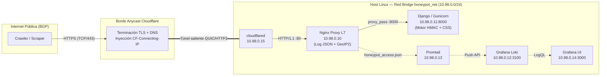
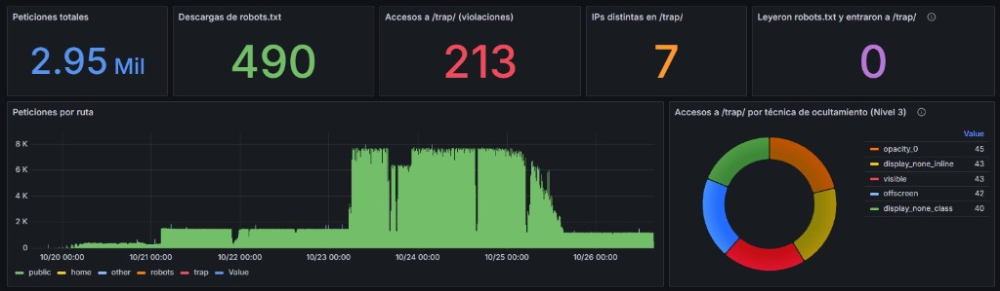
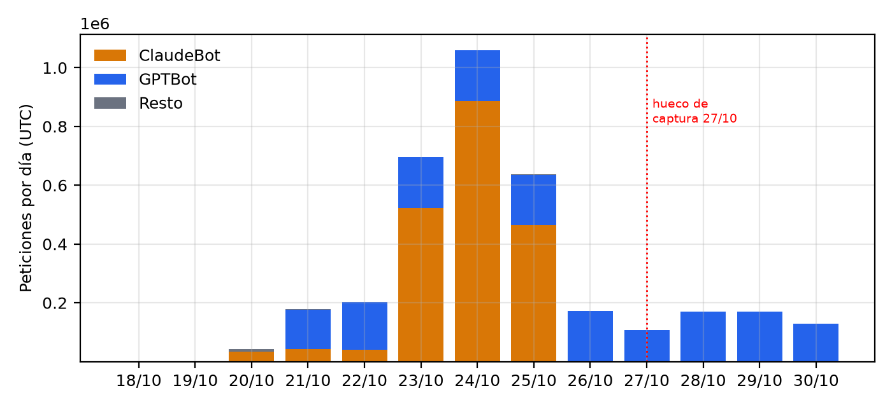
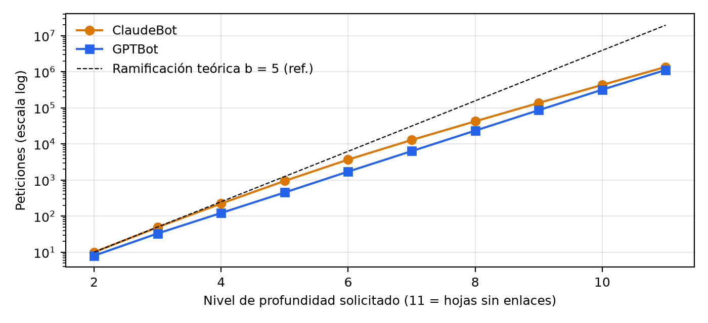
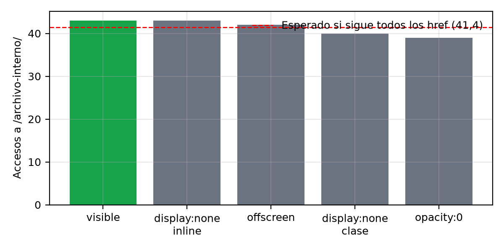

# Diseño, Implementación y Evaluación Empírica de un Honeypot Web con Trampas de Visibilidad CSS para la Detección y Caracterización de Crawlers

**Asignatura:** Internetworking — Ingeniería en Sistemas de Información (FaCENA, UNNE)  
**Dominio de estudio:** `definitivamente-no-hay-trabas.com.ar`  
**Período de observación:** 19 al 30 de octubre de 2025 (12 días calendario; 245,8 horas efectivas de captura)  
**Volumen de datos analizado:** 3.568.349 peticiones HTTP en producción (3,45 GB de registros JSON estructurados)  
**Repositorio público del proyecto:** https://github.com/Gio-glitch04/crawler-honeypot

---

## Resumen

El crecimiento acelerado de los modelos de lenguaje de gran escala (LLM) ha intensificado la recolección automatizada de datos en la web (*web scraping*), planteando interrogantes sobre el respeto práctico al Protocolo de Exclusión de Robots (`robots.txt`, estandarizado en el RFC 9309). Este informe presenta el marco conceptual de la tecnología *honeypot*, su evolución hacia sistemas de engaño en capa de aplicación y el diseño, despliegue en producción y evaluación empírica de un *honeypot* web de baja interacción con un laberinto dinámico de profundidad acotada ($D_{\text{máx}} = 32$). El sistema actúa como un observatorio de tráfico de rastreadores mediante dos mecanismos complementarios: (1) una directiva explícita `Disallow: /trap/` en `robots.txt` y (2) un conjunto de enlaces hacia rutas prohibidas inyectados en el árbol HTML pero ocultos visualmente al usuario humano mediante cuatro técnicas de hojas de estilo en cascada (CSS), complementadas con un grupo de control visible y protegidas contra falsificación mediante tokens criptográficos HMAC-SHA256 sin estado (*stateless*).

Durante una ventana de captura de 12 días sobre un dominio propio expuesto en Internet a través de un túnel reverso en la red de borde de Cloudflare, el sistema registró **3.568.349 peticiones HTTP**. Los resultados empíricos en este entorno experimental muestran una bifurcación marcada: por un lado, los rastreadores de los **5 operadores comerciales principales de IA y búsqueda observados** (`ClaudeBot` de Anthropic, `GPTBot` y `OAI-SearchBot` de OpenAI, `Googlebot` y `GoogleOther` de Google, `bingbot` de Microsoft y `Amazonbot` de Amazon), que concentraron el **99,83 %** del volumen total y cuyas subredes fueron verificadas contra los bloques BGP (`AS16509`, `AS8075`, `AS15169`) y las listas JSON oficiales, registraron **cero violaciones** a las rutas de trampa. Por otro lado, se identificaron **6 orígenes IP externos** que accedieron a `/trap/` (207 peticiones tras depurar 6 accesos de validación manual propios), camuflando su cadena `User-Agent` como navegadores de escritorio convencionales y concentrando el **95,65 %** de los impactos en dos nodos alojados en Tencent Cloud. El análisis de uniformidad sobre las técnicas de ocultamiento CSS arroja un estadístico $\chi^2 = 0,3188$ ($gl = 4; p = 0,9886$), indicando que los recolectores que activaron las trampas extraen hipervínculos sin filtrar por su visibilidad visual efectiva, comportamiento compatible tanto con analizadores léxicos de HTML crudo como con consultas directas al árbol DOM que ignoran el renderizado CSS.

---

## 1. Introducción y marco conceptual

### 1.1. Planteamiento del problema y contexto de surgimiento

La arquitectura de la World Wide Web descansa sobre un pacto de cooperación implícita formulado en 1994 por Martijn Koster y formalizado en septiembre de 2022 por el Internet Engineering Task Force (IETF) bajo el **RFC 9309** (*Robots Exclusion Protocol*) [1]. En aquel contexto fundacional, el rastreo automatizado (*web crawling*) era ejecutado mayoritariamente por motores de indexación que generaban un beneficio recíproco: el sitio web cedía ancho de banda y ciclos de cómputo a cambio de visibilidad pública y tráfico de referencia humano. En consecuencia, el estándar `robots.txt` se diseñó como un mecanismo meramente consultivo y voluntario (*advisory*), desprovisto de controles de acceso criptográficos o barreras en capa de red.

A partir de 2022, la irrupción masiva de los modelos fundacionales de inteligencia artificial generativa alteró estructuralmente esta simetría económica y técnica. Los recolectores de datos de entrenamiento (*AI data scrapers*) y los agentes de recuperación en tiempo real (*Retrieval-Augmented Generation*, RAG) descargan repositorios completos de contenido con frecuencias de miles de peticiones por minuto sin retornar tráfico humano al servidor de origen [2]. En paralelo, proliferan redes de recolección no declaradas que rotan direcciones IP en nubes públicas y falsifican sus cabeceras HTTP para eludir bloqueos basados en listas de reputación.

Este escenario plantea un problema de **observabilidad y atribución en redes**: ¿cómo distinguir empíricamente, desde el servidor de origen, entre un rastreador declarado que respeta las políticas de exclusión, un cliente humano legítimo y un recolector automatizado evasivo que suplanta su identidad en capa de aplicación? La técnica que aborda este problema desde la seguridad defensiva es el despliegue de **honeypots**.

**Pregunta de investigación, objetivos y alcance:**
* **Pregunta de investigación:** *¿En qué medida un honeypot web de baja interacción basado en enlaces ocultos mediante CSS y tokens criptográficos sin estado permite detectar recolectores automatizados que ignoran `robots.txt` y caracterizar su comportamiento de navegación y de red?*
* **Objetivo general:** Diseñar, implementar y evaluar empíricamente un *honeypot* web de baja interacción que permita observar el comportamiento de *crawlers* frente a directivas de exclusión (RFC 9309) y mecanismos de ocultamiento CSS, caracterizando sus patrones de recorrido y su atribución en capa de red (BGP/ASN) mediante telemetría estructurada.
* **Objetivos específicos:** (1) Construir una arquitectura contenerizada detrás de un túnel reverso capaz de validar rutas señuelo sin estado mediante firmas HMAC-SHA256; (2) Contrastar la identidad declarada en `User-Agent` con los prefijos BGP, registros RDAP y manifiestos JSON oficiales de los operadores; y (3) Evaluar estadísticamente si los orígenes que acceden a rutas prohibidas discriminan entre enlaces visibles y enlaces ocultos por distintas propiedades CSS.
* **Alcance metodológico:** Los hallazgos empíricos de este estudio se circunscriben al tráfico recibido por un dominio dedicado de reciente creación durante una ventana observacional de 12 días, por lo que describen el comportamiento de las infraestructuras que interactuaron con el sensor en dicho período sin pretender extrapolarse como un censo universal de toda la actividad de cada operador en Internet.

### 1.2. Fundamentos de la técnica Honeypot: historia, taxonomía y *tarpits*

En la literatura de seguridad en redes, Lance Spitzner definió formalmente un **honeypot** como *"un recurso de sistema de información cuyo valor reside en el uso no autorizado o ilícito de dicho recurso"* [3]. A diferencia de los mecanismos de perímetro tradicionales —como cortafuegos (*firewalls*), sistemas de detección de intrusiones (IDS) o *Web Application Firewalls* (WAF)—, un *honeypot* no aloja servicios productivos ni usuarios reales. Por definición, carece de tráfico legítimo habitual: cualquier paquete o petición que interactúe con un recurso señuelo constituye, en sí mismo, un evento de interés analítico, reduciendo drásticamente la tasa de falsos positivos que afecta a los detectores basados en firmas.

La evolución histórica de la técnica comenzó en la década de 1990 con los trabajos seminales de Clifford Stoll (*The Cuckoo's Egg*, 1989) y Bill Cheswick (*An Evening with Berferd*, 1992), consolidándose a principios de los años 2000 con el **Honeynet Project** [3] y el análisis sistemático de Niels Provos sobre marcos de engaño distribuido (`Honeyd`, 2004) [4]. La taxonomía clásica divide estos sistemas según su **nivel de interacción**:

1. **Honeypots de baja interacción (*Low-interaction*):** Emulan únicamente un subconjunto acotado de protocolos, puertos o rutas de aplicación (por ejemplo, `Honeyd` [4], `Dionaea` para captura de *exploits* SMB/HTTP, o **Canarytokens** [5] para detección de acceso a recursos señuelo). Su superficie de ataque es mínima, son fáciles de instrumentar a gran escala y no exponen un sistema operativo subyacente al adversario.
2. **Honeypots de media y alta interacción (*Medium/High-interaction*):** Exponen entornos complejos o sistemas operativos completos instrumentados para registrar el comportamiento post-explotación del atacante (por ejemplo, **Cowrie** [6] para sesiones interactivas SSH/Telnet, o arquitecturas multi-sensor como **T-Pot** [7]). Ofrecen telemetría profunda, pero conllevan un riesgo elevado de que el intruso utilice el nodo comprometido como pivote hacia otras redes.

Una variante especializada dentro de las tecnologías de engaño (*deception technology*) es el **tarpit** (pozo de brea), introducido originalmente por Tom Liston con `LaBrea` en capa TCP y extendido en aplicaciones como `Endlessh` [8] o el sistema clásico de recolección de *malware* `Nepenthes` (2006) [9]. Mientras un *honeypot* pasivo busca observar sin interferir, un *tarpit* retiene deliberadamente al cliente automatizado en un ciclo de consumo de tiempo o estado. En el contexto actual de rastreo masivo para IA, esta técnica resurgió en capa de aplicación HTTP como **laberintos dinámicos de enlaces** (*crawler tarpits*), ejemplificados por proyectos recientes como el *tarpit* homónimo `Nepenthes` (2025) [10] y el servicio comercial **Cloudflare AI Labyrinth** (2025) [12], que alimentan a los *scrapers* infractores con grafos sintéticos de páginas interconectadas para degradar su eficiencia de recolección y etiquetar su huella de red.

### 1.3. Conceptos fundamentales de Internetworking y capa de aplicación

Para comprender el diseño y los hallazgos del sistema implementado, es necesario establecer cuatro conceptos técnicos transversales de redes y arquitectura web:

* **Semántica de evaluación de `robots.txt` (RFC 9309):** El estándar especifica que un rastreador debe recuperar `/robots.txt`, identificar el grupo de reglas aplicable a su `User-Agent` (o el comodín `*`) y evaluar las directivas `Allow` y `Disallow` mediante coincidencia de prefijos de ruta (*path prefix matching*), donde prevalece la regla de mayor longitud de caracteres en caso de conflicto [1]. Asimismo, el protocolo permite a los rastreadores almacenar el archivo en caché hasta por 24 horas para evitar sobrecargar al servidor en cada petición.
* **Diferencia entre extracción HTML/DOM y renderizado visual CSS (*Render Tree*):** Conforme a los estándares del **WHATWG HTML** [11] y del **W3C CSS Display Module** [20], un navegador web moderno construye primero el *Document Object Model* (DOM) a partir del HTML, luego el *CSS Object Model* (CSSOM), y combina ambos en el **Render Tree** antes de calcular la geometría (*layout*) y pintar los píxeles en pantalla. Los nodos con `display: none` son excluidos del *Render Tree*, y los elementos con `opacity: 0` o desplazados fuera del *viewport* (`left: -9999px`) resultan invisibles al usuario humano, aunque **todos ellos permanecen presentes en el árbol DOM y en el texto fuente HTML**. Por consiguiente, tanto un recolector ligero que analice el texto HTML crudo (`curl`, `Scrapy`) como un navegador automatizado (*headless browser* con Playwright/Puppeteer) que consulte el DOM mediante selectores (`querySelectorAll('a')`) sin verificar explícitamente la geometría o visibilidad computada del elemento extraerán indistintamente los enlaces ocultos y los visibles.
* **Túneles reversos en el borde y preservación de identidad L3/L7:** Cuando un servicio web se publica detrás de una red de entrega de contenidos (CDN) o un túnel reverso (como *Cloudflare Tunnel*), la conexión TCP/TLS del cliente final termina en el nodo de borde (*edge*) más cercano por enrutamiento BGP *anycast*. El borde reenvía la petición HTTP al servidor de origen a través de un túnel persistente. Como consecuencia, la dirección IP de origen en la capa de red (L3) que observa el socket del servidor local ya no es la del cliente, sino la del contenedor del túnel, y la huella criptográfica del saludo TLS del cliente (**JA3/JA4**) queda oculta salvo que el proveedor del borde la inyecte explícitamente en cabeceras HTTP. Para restituir la IP real del cliente sin permitir suplantación (*IP spoofing*), el servidor web de origen debe validar que la conexión provenga de un rango de red de confianza antes de sobrescribir la dirección remota con la cabecera inyectada por el borde (`CF-Connecting-IP`).
* **Atribución mediante Sistemas Autónomos (ASN) y registros BGP/RDAP:** Dado que la cabecera `User-Agent` en capa 7 es texto arbitrario trivialmente falsificable por el cliente, la verificación de identidad en Internetworking requiere contrastar la dirección IP de origen contra la tabla de enrutamiento global **BGP** (*Border Gateway Protocol*), los registros de asignación regional **RDAP/WHOIS** (ARIN, RIPE, APNIC, LACNIC) y los manifiestos JSON de prefijos IP publicados oficialmente por los operadores de rastreadores (`gptbot.json`, `searchbot.json`, `googlebot.json`).

---

## 2. Arquitectura y funcionamiento

El sistema desarrollado implementa un **honeypot web de baja interacción con laberinto dinámico sin estado de profundidad acotada ($D_{\text{máx}} = 32$)**. Su objetivo es doble: medir el cumplimiento práctico del RFC 9309 y evaluar empíricamente si los clientes que acceden a rutas restringidas filtran los hipervínculos según su visibilidad visual CSS.

### 2.1. Componentes principales y topología de red en Docker

La arquitectura sigue un diseño de microservicios contenerizados orquestados mediante Docker Compose sobre una red virtual tipo *bridge* dedicada (`honeypot_net`, subred `10.98.0.0/24`), asignando direcciones IPv4 estáticas a cada componente para garantizar políticas de aislamiento deterministas:



1. **Agente de túnel reverso (`cloudflared`, `10.98.0.15`):** Establece conexiones salientes persistentes (sobre QUIC/UDP o HTTP/2/TCP) hacia el borde de Cloudflare sin abrir puertos entrantes en el *firewall* del servidor anfitrión. Recibe las peticiones HTTP desencriptadas en el borde y las entrega internamente a Nginx.
2. **Proxy inverso y sensor de telemetría (`nginx`, `10.98.0.10`):** Compilado a medida a partir de `nginx:1.29.1-alpine` incorporando el módulo dinámico `ngx_http_geoip2_module` (véase [`nginx/Dockerfile`](https://github.com/Gio-glitch04/crawler-honeypot/blob/main/nginx/Dockerfile)). Cumple tres funciones críticas:
   * **Restitución segura de IP real:** Mediante `real_ip_header CF-Connecting-IP` y una lista blanca de prefijos de Cloudflare (`include /etc/nginx/cloudflare_ips.conf`, más la subred de contenedores `10.98.0.0/24`), reemplaza `$remote_addr` únicamente cuando el paquete proviene del túnel legítimo, impidiendo que un cliente externo falsifique su IP enviando cabeceras `X-Forwarded-For` apócrifas.
   * **Enriquecimiento en línea con MaxMind GeoLite2:** Resuelve en memoria el código de país, ciudad y número de Sistema Autónomo (ASN) a partir de las bases binarias `GeoLite2-Country.mmdb` y `GeoLite2-ASN.mmdb`.
   * **Serialización atómica de eventos:** Escribe cada transacción HTTP en `/var/log/nginx/honeypot_access.json` con escape JSON nativo (`escape=json`), capturando marca temporal ISO 8601, IP real, método, URI, código de estado, bytes enviados, `User-Agent`, `Referer`, latencia de respuesta (`request_time`), protocolo y cabeceras de borde (`cf_ray`, `cf_ipcountry`).
3. **Motor de generación de señuelos y validación criptográfica (`web`, `10.98.0.11:8000`):** Aplicación Django 5.2 servida por **Gunicorn** (4 procesos *worker*, recarga periódica a las 1.000 peticiones para prevenir fugas de memoria). Genera dinámicamente las páginas públicas y las trampas en memoria en menos de $2\text{ ms}$, sin utilizar una base de datos relacional en el camino crítico de lectura/escritura.
4. **Pipeline de observabilidad (`promtail` `.13`, `loki` `.12`, `grafana` `.14`):** `Promtail` monitorea el descriptor de archivo de Nginx (con rotación automática `logrotate` a los $100\text{ MB}$) y envía los flujos hacia **Grafana Loki** (`loki:2.9.4`), donde se consultan mediante **LogQL** en paneles de **Grafana** en tiempo real. Un sexto contenedor auxiliar (`analytics`) ejecuta tareas programadas de agregación sobre Loki.

### 2.2. Flujo de trabajo típico y diseño del token criptográfico sin estado (HMAC-SHA256)

El desafío arquitectónico central de un laberinto de enlaces (*tarpit*) bajo fuego de rastreo masivo es mantener la trazabilidad de la sesión (saber en qué nivel de profundidad va el bot y cuándo caduca el enlace) sin realizar escrituras en disco o consultas SQL por cada petición, lo cual agotaría las operaciones de entrada/salida (IOPS) del servidor ante millones de accesos.

Para resolverlo, se diseñó un **token de ruta autoverificable de 52 caracteres hexadecimales** implementado en [`honeypot/trap/tokens.py`](https://github.com/Gio-glitch04/crawler-honeypot/blob/main/honeypot/trap/tokens.py). Cada token $\tau$ concatena cuatro campos de longitud fija:

$$\tau = \underbrace{\text{UUID}_{v4}}_{\text{32 hex (128 bits)}} \;\Vert\; \underbrace{T_{\text{hex}}}_{\text{8 hex (32 bits)}} \;\Vert\; \underbrace{D_{\text{hex}}}_{\text{2 hex (8 bits)}} \;\Vert\; \underbrace{\text{Trunc}_{40}\!\left(\text{HMAC-SHA256}\left(K,\; \text{UUID}_{v4} \Vert T_{\text{hex}} \Vert D_{\text{hex}}\right)\right)}_{\text{10 hex (40 bits)}}$$

donde:
* $\text{UUID}_{v4}$ es un identificador pseudoaleatorio único por enlace generado;
* $T_{\text{hex}}$ codifica la marca de tiempo Unix de emisión en segundos (`int(time.time())`);
* $D_{\text{hex}}$ codifica la profundidad actual del nodo en el árbol de navegación ($d \in [0, 255]$);
* $K$ es la clave secreta del servidor (`HONEYPOT_TOKEN_SECRET`), y los últimos 10 caracteres hexadecimales corresponden a los primeros 40 bits del código de autenticación de mensaje **HMAC-SHA256**.

**Justificación de ingeniería sobre el truncamiento a 40 bits:** Aunque el RFC 2104 recomienda mantener al menos 80 bits de salida HMAC para aplicaciones criptográficas de propósito general [19], en este diseño se optó por truncar la etiqueta a **40 bits (`10 hex`)** para preservar URLs compactas de 52 caracteres que imiten identificadores de recursos web convencionales. Dado que cada intento de adivinación requiere una petición HTTP en línea hacia el servidor y que el token caduca a los 7 días, un adversario sin la clave $K$ enfrenta un espacio de $2^{40} \approx 1,10 \times 10^{12}$ firmas posibles por cada tupla $(\text{UUID}_{v4}, T_{\text{hex}}, D_{\text{hex}})$, requiriendo un valor esperado de $2^{39} \approx 5,50 \times 10^{11}$ peticiones HTTP para forjar un único enlace válido por fuerza bruta, lo cual resulta inviable a través de la red durante la ventana experimental. No obstante, esta reducción de margen criptográfico se documenta explícitamente como un compromiso de diseño en la Sección 4.1.

**Flujo de trabajo ante una petición entrante:**
1. **Ingreso inicial (`/` o `/robots.txt`):** El cliente solicita la portada o el archivo `/robots.txt` (que declara explícitamente `Disallow: /trap/`). La portada renderiza enlaces hacia `/public/<token_d0>` (permitidos) y enlaces hacia `/trap/<token_d0>?t=<tecnica>` (prohibidos).
2. **Verificación en tiempo constante:** Cuando un cliente solicita `/public/<token>` o `/trap/<token>`, la función `verify_token` en [`honeypot/trap/views.py`](https://github.com/Gio-glitch04/crawler-honeypot/blob/main/honeypot/trap/views.py) extrae los primeros 42 caracteres, recalcula el HMAC-SHA256 con la clave $K$ y compara la firma mediante `hmac.compare_digest` (previniendo ataques de canal lateral por tiempos de respuesta). Si la firma coincide, verifica que la edad del token no supere la ventana de validez (`TOKEN_MAX_AGE = 604800` s, 7 días).
3. **Ramificación controlada o degradación elegante:** Si el token es válido y $d < D_{\text{máx}}$, el servidor incrementa la profundidad a $d+1$ y genera un nuevo lote de enlaces firmados hijos (entre 2 y 4 enlaces `/public/` y 5 enlaces `/trap/`). Si el token fue adulterado, expiró o alcanzó la cota máxima de profundidad (`HONEYPOT_MAX_DEPTH = 32`), el servidor responde con código `200 OK` sirviendo una página señuelo estática sin nuevos enlaces firmados y estampa las cabeceras internas `X-Honeypot-Token-Valid: false` y `X-Honeypot-Trap-Reason` para su registro en el log.

### 2.3. Terminología específica y taxonomía de trampas de visibilidad CSS

En cada página generada dentro de `/public/`, la función `_build_trap_links` inyecta exactamente **cinco hipervínculos** que apuntan a `/trap/<token>?t=<tecnica>`, permutando su orden aleatoriamente en cada respuesta para eliminar sesgos posicionales (como la tendencia de algunos *scrapers* a seguir únicamente el primer enlace del documento):

1. **`display_none_inline`:** Aplica el atributo en línea `style="display:none"`. El estándar CSS suprime por completo la caja del elemento y la excluye del árbol de renderizado visual.
2. **`display_none_class`:** Asigna la clase `class="trap-hidden"`, definida en la hoja de estilos `/static/honeypot.css` como `.trap-hidden { display: none !important; }`. Evalúa si el rastreador descarga hojas de estilo externas y resuelve selectores de clase.
3. **`opacity_0`:** Asigna `class="trap-opacity"` (`opacity: 0; pointer-events: none; position: absolute; width: 0; height: 0;`). El nodo existe en el DOM con transparencia total e inhabilitación de eventos de puntero.
4. **`offscreen`:** Asigna `class="trap-offscreen"` (`position: absolute; left: -9999px; top: -9999px;`). Desplaza la geometría del enlace fuera del área visible de la pantalla (*viewport*).
5. **`visible` (Grupo de control):** Enlace renderizado de forma visible en el cuerpo de la página, acompañado de una advertencia textual explícita indicando que se trata de una ruta restringida para pruebas de auditoría.

Adicionalmente, el sistema define una **taxonomía de clasificación conductual en tres niveles** para todo origen observado:
* **Nivel 1 (Cumplimiento verificado en ventana):** El agente descarga `/robots.txt` y registra $0$ accesos a `/trap/`.
* **Nivel 2 (No intrusivo sin descarga directa de `robots.txt` por IP):** El agente navega exclusivamente rutas públicas ($0$ accesos a `/trap/`), pero no registra una descarga de `/robots.txt` desde esa misma dirección IP durante la ventana de captura. Conforme al RFC 9309, esta categoría **no implica incumplimiento**, ya que un rastreador distribuido puede compartir en caché una lectura previa de `robots.txt` entre múltiples nodos de salida o haber consultado el archivo desde otra IP de su mismo Sistema Autónomo.
* **Nivel 3 (Acceso a ruta restringida `/trap/`):** El origen solicita recursos dentro del directorio vedado `/trap/`. Para evitar mezclar comportamientos distintos bajo una misma etiqueta, dentro del Nivel 3 se distingue analíticamente entre: **(a) activación de enlaces ocultos mediante CSS** (evidencia de extracción de hipervínculos sin filtrado de visibilidad visual) frente a **acceso exclusivo al enlace `visible` de control**; y **(b) incumplimiento directo verificado** (cuando el mismo origen descargó previamente `/robots.txt` con `200 OK` y aun así ingresó a `/trap/`) frente a **acceso directo sin lectura previa observada de `/robots.txt`**.

---

## 3. Caso práctico

### 3.1. Despliegue paso a paso y decisiones de implementación

El caso práctico se ejecutó en un entorno real expuesto a Internet durante 12 días continuos (del **19 de octubre de 2025 a las 18:11 UTC** al **30 de octubre de 2025 a las 23:59 UTC**). A continuación se documenta la secuencia de implementación, las decisiones técnicas adoptadas y los comandos utilizados:

1. **Registro de dominio y configuración del borde en Cloudflare:** Se adquirió el dominio `definitivamente-no-hay-trabas.com.ar` en NIC Argentina y se delegaron sus servidores de nombres a Cloudflare. Se tomó la **decisión metodológica deliberada** de desactivar los mecanismos activos de bloqueo de bots en el panel de Cloudflare (*Bot Fight Mode*, *Block AI Bots* y *AI Labyrinth* en estado *Off*) para evitar que la CDN filtrara en el borde precisamente el tráfico que el experimento buscaba medir. Únicamente permanecieron activas las reglas base predeterminadas de integridad HTTP (*Browser Integrity Check* y reglas administradas por defecto del plan gratuito).
2. **Inicialización criptográfica y aprovisionamiento de red:** En el servidor anfitrión Linux se ejecutaron los scripts de configuración del repositorio ([`scripts/configure.sh`](https://github.com/Gio-glitch04/crawler-honeypot/blob/main/scripts/configure.sh) y [`scripts/update_cloudflare_ips.sh`](https://github.com/Gio-glitch04/crawler-honeypot/blob/main/scripts/update_cloudflare_ips.sh)) para generar la clave secreta aleatoria de 256 bits (`HONEYPOT_TOKEN_SECRET`), descargar las bases `GeoLite2-ASN.mmdb` y `GeoLite2-Country.mmdb`, y poblar la lista de rangos IPv4/IPv6 de Cloudflare para el módulo `real_ip` de Nginx:
   ```bash
   # Generación de variables de entorno, clave HMAC y descarga de rangos de Cloudflare
   ./scripts/configure.sh --domain definitivamente-no-hay-trabas.com.ar
   ./scripts/update_cloudflare_ips.sh

   # Construcción de la imagen personalizada de Nginx con GeoIP2 y despliegue del stack
   docker compose build --no-cache nginx web
   docker compose up -d
   ```
3. **Descubrimiento pasivo (CT Logs) y siembra activa (*Active Seeding*):** La emisión del certificado TLS público en el borde de Cloudflare registró automáticamente el dominio en los **Certificate Transparency (CT) Logs** globales, un canal monitoreado en tiempo real por escáneres de seguridad y bots de descubrimiento. De forma complementaria, cerca del inicio del experimento se ejecutó el comando de administración [`manage.py seed_urls`](https://github.com/Gio-glitch04/crawler-honeypot/blob/main/honeypot/trap/management/commands/seed_urls.py) para generar enlaces semilla firmados de profundidad $d=0$:
   ```bash
   # Generación de semillas firmadas y actualización de seeds/config.json y README.md
   docker compose exec web python manage.py seed_urls --count 5 --output /app/seeds/config.json
   ```
   Una semilla quedó publicada de forma persistente en el archivo [`seeds/config.json`](https://github.com/Gio-glitch04/crawler-honeypot/blob/main/seeds/config.json) y en el `README.md` del repositorio público de GitHub (`/public/1f5d2bbd5c3e4f3996083ff27059b2016ad53ff5009fb7180e5c`), y se compartieron enlaces adicionales en **Hacker News** y foros técnicos. En los registros de Nginx se verificó la llegada de tráfico con cabecera `Referer` explícita de Hacker News (1 petición inicial) y de Google (51 peticiones), mientras que el grueso de los rastreadores ingresó sin cabecera `Referer` (práctica habitual en bots que leen repositorios en GitHub, listas de semillas o flujos de *Certificate Transparency*).

### 3.2. Evidencia concreta: configuración, registros crudos, pruebas y monitoreo

Como evidencia directa del funcionamiento del sistema, el siguiente bloque muestra la estructura JSON generada por `/var/log/nginx/honeypot_access.json` reconstruida sobre el evento real capturado el `2025-10-27T07:53:09+00:00` (documentado en [`informe-tecnico-honeypot.md §7.5`](https://github.com/Gio-glitch04/crawler-honeypot/blob/main/docs/entrega/informe-tecnico-honeypot.md#L334-L355), donde el token de 52 caracteres se abrevia como `<token_52_hex>`), correspondiente a una violación de trampa CSS (`display_none_inline`) por parte del recolector automatizado alojado en Tencent Cloud (`43.173.179.82`, Singapur):

```json
{
  "time": "2025-10-27T07:53:09+00:00",
  "remote_addr": "43.173.179.82",
  "host": "definitivamente-no-hay-trabas.com.ar",
  "method": "GET",
  "uri": "/trap/<token_52_hex>?t=display_none_inline",
  "status": 200,
  "bytes": 1850,
  "referer": "-",
  "user_agent": "Mozilla/5.0 (Windows NT 10.0; Win64; x64) AppleWebKit/537.36 (KHTML, like Gecko) Chrome/124.0.0.0 Safari/537.36",
  "req_time": 0.002,
  "proto": "HTTP/1.1",
  "cf_ray": "<cf_ray_id>-SIN",
  "cf_ipcountry": "SG",
  "geoip_country_code": "SG"
}
```

La **Figura 1** presenta la captura de pantalla del panel de producción en Grafana durante la ventana del 20 al 26 de octubre de 2025.



> **Nota de lectura sobre la Figura 1:** La captura de pantalla fue tomada con el selector temporal de Grafana acotado a 7 días (20/10 al 26/10) y sobre el flujo crudo antes de la depuración metodológica post-hoc. Por ello, el indicador superior muestra **2,95 millones** de peticiones acumuladas en esa sub-ventana (frente a los **3.568.349** del período completo de 12 días), **7 IPs distintas en `/trap/`** y **45 accesos a `opacity_0`** (que incluyen las **6 peticiones de prueba manual** realizadas desde la IP residencial `181.4.69.199` por el equipo/cátedra para verificar el contador del panel; al excluir dicha IP de prueba, quedan los **6 actores externos** y los **39 accesos a `opacity_0`** reportados en el análisis final).

### 3.3. Problemas surgidos durante la implementación y cómo se resolvieron

Durante la operación en producción surgieron tres problemas técnicos e incidentes operativos que resultaron clave para el aprendizaje práctico de la materia:

1. **Colapso por memoria del contenedor `analytics` y saturación de consulta en Loki (21 de octubre):** Durante los primeros dos días, el tráfico se mantuvo por debajo de las 13.000 peticiones diarias. Sin embargo, el 21 de octubre el ingreso simultáneo de `ClaudeBot` y `GPTBot` multiplicó el volumen por 27 (alcanzando 344.205 peticiones/día). El contenedor `analytics`, cuyo script [`daily.py`](https://github.com/Gio-glitch04/crawler-honeypot/blob/main/analytics/honeypot_analytics/daily.py) consultaba la API HTTP de Loki (`query_range`) para hidratar todas las líneas en un `DataFrame` de Pandas en memoria RAM, agotó la memoria disponible y dejó de generar los resúmenes JSON diarios (`daily_20251020.json` fue el último archivo consolidado por esa vía). Además, el límite `max_entries_limit_per_query: 5000` en [`loki/loki-config.yml`](https://github.com/Gio-glitch04/crawler-honeypot/blob/main/loki/loki-config.yml) impedía extraer series masivas de una sola vez por API. **Resolución:** Gracias al diseño desacoplado en el que Nginx escribe directamente en disco (`honeypot_access.json`) antes de Promtail/Loki, no se perdió un solo evento por la caída de `analytics`. Al finalizar la ventana experimental, se exportó el volumen completo comprimido (`nginx-logs.tar.gz`, 3,45 GB descomprimidos, procesado mediante un script Python en *streaming* y consolidado en [`docs/entrega/informe-tecnico-honeypot.md`](https://github.com/Gio-glitch04/crawler-honeypot/blob/main/docs/entrega/informe-tecnico-honeypot.md) y [`scripts/estadisticas_y_graficos.py`](https://github.com/Gio-glitch04/crawler-honeypot/blob/main/scripts/estadisticas_y_graficos.py)) leyendo línea por línea con complejidad espacial $O(1)$.
2. **Interrupción del enlace físico/túnel del host (22 de octubre, 00:00 a 08:59 UTC):** Durante exactamente 9 horas en la madrugada del 22 de octubre se produjo una caída temporal de conectividad en el entorno anfitrión que interrumpió el túnel `cloudflared`, provocando 0 registros en ese intervalo. **Resolución:** Al restablecerse el enlace a las 09:00 UTC, el demonio `cloudflared` reconectó automáticamente contra el borde de Cloudflare y los rastreadores de IA retomaron la descarga exactamente desde los nodos de profundidad donde habían quedado, validando en la práctica la resiliencia del diseño de tokens HMAC sin estado frente a reinicios o cortes de red.
3. **Falsos positivos por validación manual e intentos de explotación externa:** Al auditar las rutas `/trap/` y las peticiones anómalas, se detectaron tres subconjuntos que habrían sesgado las pruebas estadísticas de no depurarse:
   * **6 accesos manuales a `/trap/?t=opacity_0`** desde la dirección `181.4.69.199` (proveedor argentino Telecentro / AS7303, con `User-Agent` Chrome/141 en Windows 10), correspondientes a pruebas funcionales realizadas por los autores/cátedra para verificar la ingesta en Grafana.
   * **53 peticiones bloqueadas por reglas base de Cloudflare (`HTTP 403`)** dirigidas a rutas de explotación de WordPress y archivos sensibles (`/wp-admin/setup-config.php`, `/wordpress/wp-admin/`, `/.env`).
   * **4 peticiones con código `HTTP 499`** (*Client Closed Request*), donde el cliente cerró el socket TCP antes de que el *worker* de Gunicorn completara el envío (latencias observadas de $0,104\text{ s}$ a $0,757\text{ s}$).
   **Resolución:** Se estableció un protocolo de limpieza explícito que excluyó estos **63 eventos** ($53 + 4 + 6$) de las pruebas de inferencia sobre el laberinto, documentándolos por separado.

### 3.4. Resultados empíricos obtenidos

#### 3.4.1. Evolución temporal y distribución por familia de agente

Sobre el total de **3.568.349 peticiones** y **1.000 direcciones IP únicas** consolidadas en el análisis global del archivo de registros (véanse los agregados completos en [`docs/entrega/informe-tecnico-honeypot.md`](https://github.com/Gio-glitch04/crawler-honeypot/blob/main/docs/entrega/informe-tecnico-honeypot.md) y [`docs/entrega/resumen-datos-honeypot.md`](https://github.com/Gio-glitch04/crawler-honeypot/blob/main/docs/entrega/resumen-datos-honeypot.md)), el tráfico exhibió tres fases bien diferenciadas (Figura 2): una fase de descubrimiento inicial (19 y 20 de octubre, con 329 y 12.660 peticiones), una fase de explosión y saturación entre el 23 y el 25 de octubre (alcanzando el pico máximo el **24 de octubre con 906.872 peticiones/día**, a razón de $\sim 10,5\text{ req/s}$ sostenidas), y una meseta de estabilización del 26 al 30 de octubre en torno a las **193.800 peticiones/día** dominada casi exclusivamente por `ClaudeBot`.



La **Tabla 1** desglosa el volumen, la cantidad de direcciones IP únicas y subredes `/24`, y el comportamiento frente a `/robots.txt` y `/trap/` para cada categoría de tráfico identificada:

**Tabla 1.** Distribución del tráfico por tipo de agente y categoría (19 al 30 de octubre de 2025).

| Agente / Categoría | Categoría funcional | Peticiones totales | % del total | IPs únicas | Subredes `/24` | Descargas `/robots.txt` | Accesos a `/trap/` | Nivel asignado |
| :--- | :--- | ---: | ---: | ---: | ---: | ---: | ---: | :---: |
| `ClaudeBot` (Anthropic) | Crawler IA | 1.989.866 | 55,76 % | 27 | 3 | 10 | 0 | Nivel 1 |
| `GPTBot` (OpenAI) | Crawler IA | 1.558.875 | 43,69 % | 451 | 4 | 90 | 0 | Nivel 1 |
| `GoogleOther` (Google) | Crawler IA / I+D | 10.671 | 0,30 % | 309 | 5 | 0* | 0 | Nivel 1* |
| `Googlebot` (Google) | Motor de búsqueda | 1.563 | 0,04 % | 140 | 4 | 54 | 0 | Nivel 1 |
| `bingbot` (Microsoft) | Motor de búsqueda | 699 | 0,02 % | 22 | 5 | 25 | 0 | Nivel 1 |
| `Amazonbot` (Amazon) | Crawler IA / Índice | 661 | 0,02 % | 13 | 13 | 7 | 0 | Nivel 1 |
| `OAI-SearchBot` (OpenAI) | Búsqueda IA | 49 | <0,01 % | 11 | 3 | 0* | 0 | Nivel 1* |
| Otros bots declarados (22 familias) | SEO / Monitoreo / Redes | 384 | 0,01 % | ~40 | ~35 | 384 | 0 | Nivel 1 |
| Clientes HTTP (`curl`, `python-requests`, `Go-http`) | Scripts / Automatización | 150 | <0,01 % | 29 | 27 | 12 | 0 | Nivel 1 / 2 |
| Escáneres de vulnerabilidades (`LeakIX`, WP) | Escaneo oportunista | 79 | <0,01 % | 24 | 24 | 15 | 0 | Nivel 2 |
| Navegadores sin acceso a trampa | Humanos / Bots cautos | 5.137 | 0,14 % | ~380 | ~310 | 32 | 0 | Nivel 2 |
| **Orígenes IP externos en `/trap/` (6 IPs)** | **Acceso a ruta vedada / Camuflaje UA** | **207** | **<0,01 %** | **6** | **6** | **1** | **207** | **Nivel 3** |
| Pruebas manuales de validación (`181.4.69.199`) | Validación interna (6 en `/trap/`, 2 públicas) | 8 | <0,01 % | 1 | 1 | 0 | 6 | Excluido |
| **Total general** | — | **3.568.349** | **100,00 %** | **1.000** | — | **628** | **213** | — |

*\*Nota sobre `GoogleOther` y `OAI-SearchBot`: Ambos comparten exactamente la misma infraestructura de red y caché de políticas `robots.txt` que sus agentes hermanos (`Googlebot` en `66.249.73.0/24` con 54 descargas de `/robots.txt`, y `GPTBot` en `74.7.0.0/16` con 90 descargas), conforme a la reutilización de caché prevista en el RFC 9309.*

#### 3.4.2. Dinámica de exploración del árbol de profundidad ($d=0$ a $d=32$)

El análisis de los tokens HMAC en las **3.562.238 peticiones a `/public/<token>`** (que representan el **99,83 %** de todo el tráfico del servidor) permitió reconstruir la estrategia algorítmica de recorrido de grafos de los dos grandes recolectores de IA (Figura 3):

* **Factor de ramificación exponencial hasta la cota $d=12$:** Desde la raíz ($d=0$, con 1.240 peticiones) hasta la profundidad $d=11$ (992.233 peticiones), el volumen de peticiones crece con una razón geométrica media de **$r \approx 1,85\times$ por nivel**, alcanzando el máximo global en **$d=12$ con 1.805.095 peticiones** (el 50,67 % de todo el tráfico de la plataforma).
* **Transición en $d=13$ y recorrido hasta el fondo del laberinto ($d=32$):** A partir de $d=13$ (212.235 peticiones), ambos operadores principales aplican una poda severa de presupuesto de rastreo (*crawl budget*). De manera notable, **`ClaudeBot` se detuvo estrictamente en $d=13$** ($0$ peticiones en $d \ge 14$), mientras que **`GPTBot` continuó descendiendo en anchura acotada hasta alcanzar el límite configurado del sistema en $d=32$** (con alrededor de $325$ peticiones por nivel entre $d=15$ y $d=31$, y $168$ peticiones en $d=32$). El **100,00 %** de los tokens presentados por estos rastreadores resultaron criptográficamente válidos y dentro de su ventana de vida útil, confirmando que no intentaron sintetizar ni truncar URLs.



#### 3.4.3. Verificación de atribución en capa de red (BGP, RDAP y listas JSON oficiales)

Para descartar que el tráfico de `ClaudeBot`, `GPTBot`, `OAI-SearchBot`, `Googlebot` y `GoogleOther` fuera producto de terceros falsificando la cabecera `User-Agent`, se ejecutó el script reproducible [`scripts/verificar_rangos_ip.py`](https://github.com/Gio-glitch04/crawler-honeypot/blob/main/scripts/verificar_rangos_ip.py), que cruza las subredes observadas en el log (documentadas en [`docs/entrega/informe-tecnico-honeypot.md §5`](https://github.com/Gio-glitch04/crawler-honeypot/blob/main/docs/entrega/informe-tecnico-honeypot.md#L166-L246)) contra los anuncios BGP en **RIPE Stat**, los registros **ARIN RDAP** y los archivos JSON oficiales publicados por OpenAI y Google. La **Tabla 2** resume los resultados exactos:

**Tabla 2.** Verificación de subredes observadas contra tablas BGP/RDAP y manifiestos JSON oficiales.

| Agente declarado | Subredes `/24` o `/16` observadas (peticiones reales en el log) | Prefijo BGP anunciado y Sistema Autónomo (ASN) | Fuente oficial verificada y coincidencia de prefijos | Peticiones verificadas sobre el total del agente |
| :--- | :--- | :--- | :--- | :--- |
| **`ClaudeBot`**<br>(1.989.866 reqs;<br>27 IPs) | • `216.73.217.0/24` (1.590.538)<br>• `216.73.216.0/24` (399.324)<br>• `34.162.0.0/16` (4) | • `216.73.216.0/22` — **AS16509** (Amazon AWS; registro ARIN `NET-216-73-216-0-1` / `AWS-ANTHROPIC`, Anthropic PBC)<br>• `34.162.0.0/18` — **AS396982** (Google Cloud Platform, `GOOGL-2`) | Documentación oficial de Anthropic [13] y registro ARIN RDAP (`216.73.216.0/22`). Las 4 peticiones desde `34.162.0.0/16` provienen de GCP (`AS396982`). | **1.989.862 / 1.989.866** (**99,9998 %**) en el `/22` dedicado de Anthropic (+ 4 reqs en GCP `AS396982`) |
| **`GPTBot`**<br>(1.558.875 reqs;<br>451 IPs) | • `74.7.242.0/24` (1.557.329)<br>• `132.196.86.0/24` (751)<br>• `172.182.207.0/24` (410)<br>• `172.182.202.0/24` (385) | • `74.7.0.0/16` — **AS8075**<br>• `132.196.0.0/16` — **AS8075**<br>• `172.160.0.0/11` — **AS8075**<br>(Microsoft Corporation / Azure) | `https://openai.com/gptbot.json` [14] (`creationTime: 2026-09-22`): contiene `132.196.86.0/24`, `74.7.242.0/25`, `172.182.207.0/25` y `172.182.202.0/25` (y `74.7.242.128/25` en `searchbot.json`). | **1.558.875 / 1.558.875** (**100,00 %**) en subredes oficiales de OpenAI sobre Microsoft Azure (`AS8075`) |
| **`OAI-SearchBot`**<br>(49 reqs;<br>11 IPs) | • `74.7.175.0/24` (38)<br>• `74.7.230.0/24` (9)<br>• `51.8.102.0/24` (2) | • `74.7.0.0/16` — **AS8075**<br>• `51.8.0.0/16` — **AS8075**<br>(Microsoft Corporation / Azure) | `https://openai.com/searchbot.json` [14] (`creationTime: 2026-01-02`): contiene `74.7.175.128/25`, `74.7.230.0/25` y `51.8.102.0/24`. | **49 / 49** (**100,00 %**) en subredes oficiales de `searchbot.json` (`AS8075`) |
| **`Googlebot` + `GoogleOther`**<br>(12.234 reqs;<br>449 IPs) | • `66.249.73.0/24` (12.071)<br>• `192.178.6.0/24` (94)<br>• `66.249.69.0/24` + `66.249.70.0/24` y 1 `/24` adicional (69) | • `66.249.64.0/20` — **AS15169**<br>• `192.178.0.0/15` — **AS15169**<br>(Google LLC) | `https://developers.google.com/static/search/apis/ipranges/googlebot.json` [15] (`creationTime: 2026-10-30`): publica los 8 bloques `/27` contiguos que cubren el 100 % de cada `/24`. | **12.234 / 12.234** (**100,00 %**) en bloques oficiales de Google LLC (`AS15169`) |

#### 3.4.4. Análisis de los orígenes IP en `/trap/` y prueba de hipótesis sobre ocultamiento CSS

Al analizar los **207 accesos externos a `/trap/`**, se identificaron **6 orígenes IP distintos**, ninguno de los cuales declaró un `User-Agent` de bot: todos emplearon cadenas correspondientes a navegadores de escritorio (Chrome sobre Windows 10, macOS y Linux). Es importante precisar desde la perspectiva de Internetworking que **6 direcciones IP de origen no equivalen necesariamente a 6 operadores u organizaciones independientes**: de hecho, los orígenes **A (`43.130.12.164`, EE. UU.)** y **B (`43.173.179.82`, Singapur)** operan ambos sobre **Tencent Cloud**, registraron volúmenes casi idénticos (175 y 173 peticiones totales; 100 y 98 en `/trap/`) y comparten la cadena `Chrome/124.0.0.0`, lo que sugiere fuertemente que constituyen **dos nodos de salida de una misma infraestructura distribuida de recolección**. La **Tabla 3** detalla la huella de red y la sub-clasificación conductual de cada origen:

**Tabla 3.** Caracterización de los 6 orígenes IP externos que accedieron a `/trap/` (Nivel 3).

| Origen IP | País / Proveedor de red (ASN) | Cadena `User-Agent` declarada (Anomalía detectada) | Peticiones totales | Accesos a `/trap/` | Descargas `/robots.txt` | Desglose por técnica CSS y sub-clasificación Nivel 3 |
| :--- | :--- | :--- | ---: | ---: | ---: | :--- |
| **Origen A**<br>`43.130.12.164` | Estados Unidos<br>(Tencent Cloud) | `Chrome/124.0.0.0` en macOS (`Macintosh; Intel Mac OS X 10_15_7`) — *UA desactualizado (>18 meses)* | 175 | **100** | 0 | **80 ocultos + 20 visibles:** `display_none_inline` (21), `display_none_class` (20), `visible` (20), `opacity_0` (20), `offscreen` (19) |
| **Origen B**<br>`43.173.179.82` | Singapur<br>(Tencent Cloud) | Alterna **5 cadenas UA distintas** (`Chrome/124`, `130`, `131` en Windows y macOS) desde la misma IP | 173 | **98** | 0 | **77 ocultos + 21 visibles:** `visible` (21), `display_none_inline` (20), `offscreen` (20), `display_none_class` (19), `opacity_0` (18) |
| **Origen C**<br>`45.148.10.152` | Países Bajos<br>(Hosting / Datacenter) | `Chrome/150.0.0.0` en Windows 10 — **Versión inexistente en oct. 2025** (la versión estable real era Chrome 141) | 8 | **4** | **1** | **3 ocultos + 1 visible (tras leer `robots.txt`):** `display_none_inline` (1), `display_none_class` (1), `offscreen` (1), `visible` (1) |
| **Origen D**<br>`216.245.184.205` | Estados Unidos<br>(Datacenter / Hosting) | `Chrome/133.0.0.0` en Linux (`X11; Linux x86_64`) — *UA atrasado (~8 meses)* | 10 | **3** | 0 | **3 ocultos + 0 visibles:** `display_none_inline` (1), `opacity_0` (1), `offscreen` (1) |
| **Origen E**<br>`186.128.231.9` | Argentina<br>(ISP Residencial) | `Chrome/141.0.0.0` en Windows 10 | 200 | **1** | 0 | **1 oculto (`offscreen`)** en sesión de 199 peticiones a `/public/` |
| **Origen F**<br>`181.117.110.228` | Perú<br>(ISP Residencial) | `Chrome/141.0.0.0` en Windows 10 | 2 | **1** | 0 | **0 ocultos + 1 `visible`:** sin evidencia de evasión CSS ni lectura previa de `robots.txt` |
| *Prueba interna*<br>*`181.4.69.199`* | *Argentina (Telecentro)* | *`Chrome/141.0.0.0` en Windows 10 (Validación manual del equipo/cátedra — excluida)* | *8* | *(6)* | *0* | *`opacity_0` (6) + 2 públicas — Excluido del análisis estadístico* |

La secuencia temporal del **Origen B (`43.173.179.82`)** registrada en el log (véase [`docs/entrega/informe-tecnico-honeypot.md §7.5`](https://github.com/Gio-glitch04/crawler-honeypot/blob/main/docs/entrega/informe-tecnico-honeypot.md#L334-L355)) ilustra de forma contundente la mecánica automatizada: a las `07:53:00 UTC` del 27/10 descarga una página `/public/<token>` fingiendo ser Chrome 131 en Windows; $9$ segundos después solicita `/trap/...?t=display_none_inline` cambiando su `User-Agent` a Chrome 124 en Windows; luego solicita `/trap/...?t=visible` cambiando a Chrome 131 en macOS; y continúa recorriendo secuencialmente `offscreen`, `opacity_0` y `display_none_class` en intervalos de 8 a 14 segundos rotando su `User-Agent` en cada petición HTTP. Por su parte, el **Origen C (`45.148.10.152`)** aporta **evidencia directa de incumplimiento de una política conocida**: además de declarar `Chrome/150.0.0.0` (versión inexistente en octubre de 2025), descargó primero `/robots.txt` (`200 OK`) y posteriormente solicitó 4 rutas dentro de `/trap/` (3 de ellas ocultas por CSS). En contraste, el **Origen F (`181.117.110.228`)** registró un único acceso al enlace de control `visible` sin haber descargado `robots.txt` ni activado enlaces ocultos, por lo que no puede atribuírsele evasión de ocultamiento CSS.



Al evaluar la distribución de los **207 accesos externos** entre las 5 categorías de enlace (Figura 4), se observan los siguientes conteos exactos:
* `display_none_inline`: **43** ($20,77\,\%$)
* `visible` (control): **43** ($20,77\,\%$)
* `offscreen`: **42** ($20,29\,\%$)
* `display_none_class`: **40** ($19,32\,\%$)
* `opacity_0`: **39** ($18,84\,\%$)

En conjunto, el **79,23 %** ($164 / 207$) de los impactos ocurrió sobre enlaces completamente invisibles para un ser humano. Para contrastar la hipótesis nula $H_0$ de equiprobabilidad de selección entre las cinco técnicas ($p_i = 0,20$, frecuencia esperada $E_i = 207 / 5 = 41,4$), el estadístico chi-cuadrado de bondad de ajuste es:

$$\chi^2 = \sum_{i=1}^{5} \frac{(O_i - 41,4)^2}{41,4} = \frac{(43-41,4)^2 + (43-41,4)^2 + (42-41,4)^2 + (40-41,4)^2 + (39-41,4)^2}{41,4} = \frac{2,56 + 2,56 + 0,36 + 1,96 + 5,76}{41,4} = \frac{13,20}{41,4} = 0,3188$$

Con $gl = 4$ grados de libertad, el valor $p$ es **$p = 0,9886$** (y aun sin excluir las 6 pruebas manuales sobre `opacity_0`, con $N=213$ y $E_i = 42,6$, el resultado es $\chi^2 = 0,3099; p = 0,9892$). En la interpretación metodológica de esta prueba deben tenerse presentes dos precisiones fundamentales:
1. **Agrupamiento por origen (*clustering*):** Dado que los orígenes A y B concentran 198 de los 207 eventos ($95,65\,\%$), las 207 peticiones no constituyen observaciones independientes de 207 bots distintos, sino repeticiones intra-infraestructura. Por ende, el test $\chi^2 = 0,3188$ demuestra rigurosamente la **uniformidad de extracción dentro de las sesiones de los recolectores dominantes capturados** (si se restringe exclusivamente a los 198 accesos de Tencent Cloud, con $O = [41, 41, 39, 39, 38]$ y $E_i = 39,6$, resulta igualmente $\chi^2 = 0,1818; p = 0,9961$).
2. **Alcance sobre el mecanismo de extracción (HTML crudo vs. consulta DOM sin filtro visual):** El no rechazo de $H_0$ ($p = 0,9886$) demuestra que los recolectores que activaron las trampas **no condicionan la extracción de hipervínculos a su visibilidad visual efectiva**. Este comportamiento es compatible tanto con un analizador léxico/sintáctico de HTML crudo que no construye el *Render Tree* como con un navegador automatizado (*headless browser*) que construye el DOM y extrae todos los nodos `<a href>` mediante consultas al árbol (`querySelectorAll`) sin evaluar las propiedades visuales computadas del elemento.

Finalmente, respecto del cumplimiento del RFC 9309 en los grandes operadores legítimos, si se agrupa el tráfico por **organización operadora independiente** ($N = 5$: **Anthropic** [`ClaudeBot`], **OpenAI** [`GPTBot` + `OAI-SearchBot`], **Google** [`Googlebot` + `GoogleOther`], **Microsoft** [`bingbot`] y **Amazon** [`Amazonbot`]), se observan **$0$ violaciones en las $5$ organizaciones** sobre un total combinado de $3.562.384$ peticiones. A título meramente exploratorio —dado que estos 5 operadores constituyen una cohorte observacional de las principales tecnológicas y no una muestra aleatoria simple del universo de crawlers—, el intervalo exacto unilateral de Clopper-Pearson al 95 % para $0$ fallos en $N = 5$ organizaciones arroja una cota inferior de $[54,9\,\%, 100\,\%]$.

---

## 4. Análisis crítico

### 4.1. Ventajas y limitaciones de la arquitectura implementada

**Ventajas principales:**
1. **Verificación criptográfica del origen del enlace y alta especificidad frente a extracción automatizada:** A diferencia de los sistemas basados únicamente en reputación de IP o heurísticas de `User-Agent`, una petición hacia `/trap/<token>` con firma HMAC-SHA256 válida y propiedad `display: none` garantiza criptográficamente la **integridad de procedencia del hipervínculo** (demostrando que la URL fue extraída de un documento HTML servido previamente por el sistema dentro de su ventana de validez). Si bien la firma criptográfica acredita la procedencia del token y no la intención subjetiva del solicitante (pudiendo activarse ante auditores humanos que inspeccionen el código fuente o herramientas de *pre-fetching*, como se verificó y depuró en el caso de `181.4.69.199`), en ausencia de inspección manual constituye un indicador de alta fidelidad de extracción automatizada de HTML/DOM sin filtrado visual.
2. **Escalabilidad y resistencia a denegación de servicio (*stateless*):** Al codificar la marca temporal y la profundidad dentro del propio token HMAC-SHA256, el servidor validó más de $3,56$ millones de peticiones con una latencia mediana de $2\text{ ms}$ en un único contenedor Gunicorn sin depender de bases de datos ni tablas de sesiones en RAM.
3. **Resiliencia operativa:** Como demostró el corte de red de 9 horas del 22 de octubre, la ausencia de estado en el servidor permite que el laberinto sobreviva a reinicios completos sin corromper la navegación en curso de los rastreadores.

**Limitaciones técnicas y metodológicas:**
1. **Indiferenciación entre *parser* HTML léxico y consulta DOM sin filtro de visibilidad, y evasión mediante `checkVisibility()`:** El diseño experimental de las trampas CSS permite detectar que el cliente no filtra enlaces por su representación visual, pero no distingue por sí solo entre un recolector que analiza texto HTML crudo y un navegador *headless* (Playwright/Puppeteer) que construye el DOM y extrae todos los elementos `<a>` sin consultar el *Render Tree*. Asimismo, si un *scraper* con navegador *headless* invoca explícitamente APIs geométricas como `Element.checkVisibility()` o filtra nodos con dimensiones nulas en `getBoundingClientRect()`, evadirá las cuatro trampas ocultas.
2. **Pérdida de huella TLS/TCP (JA3/JA4 y p0f) por terminación en el borde:** Al delegar la entrada en un túnel reverso de Cloudflare bajo el plan gratuito, la sesión TLS del cliente termina en el borde *anycast* y Nginx recibe únicamente HTTP/1.1 plano desde `cloudflared`. Esto impide calcular localmente el hash JA3/JA4 [18] del *ClientHello* TLS o inspeccionar opciones de ventana TCP para correlacionar la versión de navegador declarada en `User-Agent` con la pila criptográfica real del cliente.
3. **Truncamiento de firma HMAC a 40 bits y cota de profundidad ($D_{\text{máx}} = 32$):** El truncamiento del HMAC-SHA256 a 40 bits (frente a los 80 bits recomendados en el RFC 2104 [19]) reduce el margen teórico frente a ataques masivos fuera de línea o colisiones, aunque resulta suficiente frente a intentos de adivinación HTTP en línea durante los 7 días de validez. Por su parte, la cota $D_{\text{máx}} = 32$ implica que el sistema actúa como un laberinto acotado y no infinito (como se observó cuando `GPTBot` alcanzó el nivel 32).
4. **Alcance observacional sobre un dominio nuevo:** Al tratarse de un dominio sin historial previo y observado durante 12 días, la muestra de orígenes infractores externos fue acotada ($6$ orígenes IP, con el $95,65\,\%$ de los impactos concentrados en dos nodos sobre Tencent Cloud), y el cumplimiento observado en los 5 grandes operadores refleja su comportamiento frente a este dominio específico sin poder extrapolarse como una garantía absoluta sobre toda su infraestructura global.

### 4.2. Comparación técnica con alternativas existentes

Para evaluar objetivamente la herramienta desarrollada, debe comparársela con tecnologías de su misma naturaleza funcional (**sistemas de engaño, *honeypots* y *tarpits* para crawlers**), y no únicamente con controles preventivos de perímetro como WAF o CAPTCHAs (cuyo propósito es bloquear antes del ingreso y no medir o caracterizar). La **Tabla 4** contrasta nuestra arquitectura con cinco alternativas representativas:

**Tabla 4.** Comparación técnica entre el honeypot desarrollado y alternativas del estado del arte.

| Criterio de evaluación | Honeypot clásico de red/servicios (**Cowrie** [6] / **Dionaea**) | Tokens señuelo (**Canarytokens** [5]) | Tarpit de protocolo L4 (**Endlessh** [8]) | Tarpit HTTP para crawlers (**Nepenthes** 2025 [10]) | Servicio comercial en el borde (**Cloudflare AI Labyrinth** [12]) | **Nuestro sistema (`crawler-honeypot`)** |
| :--- | :--- | :--- | :--- | :--- | :--- | :--- |
| **Capa del modelo OSI / TCP-IP** | L4–L7 (SSH, Telnet, SMB, HTTP básico) | L7 (URLs web, DNS, archivos PDF/Word, API keys) | L4/L7 (Banner SSH pre-autenticación) | L7 (Árboles de hipervínculos HTML) | L7 en CDN de borde (*Edge*) | **L7 con enriquecimiento L3/ASN (HTTP + CSS + HMAC)** |
| **Objetivo primario** | Capturar fuerza bruta, comandos de intrusos y *malware* | Alertar sobre filtración o acceso puntual a un recurso | Retener escáneres SSH consumiendo sockets lentos | Degradar o atrapar *scrapers* mediante grafos extensos | Mitigar *scrapers* de IA no autorizados en sitios de clientes | **Medir cumplimiento de RFC 9309 y evaluar filtrado visual CSS** |
| **Gestión de estado del laberinto** | Con estado por sesión TCP | Sin laberinto (disparo único por token) | Con estado (mantiene el socket TCP abierto) | Generación determinista por semilla o Markov | Gestionado internamente por Cloudflare | **100 % *stateless* mediante token HMAC-SHA256 acotado ($d \le 32$) y TTL** |
| **Discriminación experimental de técnicas CSS** | No aplica | No aplica | No aplica | Ocultamiento simple para no afectar a humanos | Enlaces ocultos para bots (sin desglose experimental por propiedad CSS) | **Diseño factorial con 4 técnicas CSS + grupo de control visible** |
| **Acceso a telemetría cruda por el operador** | Total (logs locales JSON/syslog) | Limitado a metadatos del disparo | Total (logs de conexión) | Total (logs del servidor web) | **Restringido a paneles agregados de Cloudflare** (sin log crudo de cada salto del laberinto) | **Total (JSON por petición con GeoIP2, latencia, firma y razón de trampa)** |

Como muestra la Tabla 4, **Cloudflare AI Labyrinth** [12] y los *tarpits* HTTP modernos como **Nepenthes (2025)** [10] son los competidores conceptuales más directos de nuestra plataforma. Sin embargo, *AI Labyrinth* opera como un servicio defensivo administrado en el borde donde el propietario del sitio no dispone de un diseño factorial balanceado por propiedad CSS ni de los registros crudos de cada salto del laberinto para realizar pruebas de hipótesis locales. Por su parte, frente a *Nepenthes* (2025) —orientado a maximizar el consumo de recursos del bot mediante texto generado por cadenas de Markov y retardos deliberados—, nuestro diseño prioriza la **baja latencia ($2\text{ ms}$) y la trazabilidad criptográfica del nivel de profundidad ($d$)** para actuar como un instrumento de medición sin degradar el servidor propio.

### 4.3. Casos de uso reales en la industria y consideraciones éticas

En el análisis de transferencia tecnológica es importante distinguir entre **implementaciones documentadas en la industria** y **aplicaciones potenciales de la arquitectura propuesta**:

1. **Implementaciones documentadas de engaño web y mitigación de *scraping* de IA:** El despliegue a escala global de **Cloudflare AI Labyrinth** (2025) [12] demuestra la adopción industrial de enlaces ocultos hacia páginas sintéticas generadas dinámicamente para identificar y neutralizar recolectores no autorizados que ignoran `robots.txt` [2]. De modo complementario, proyectos en producción como **Anubis** [16] y **Cloudflare Turnstile** [17] instrumentan desafíos criptográficos (*Proof-of-Work* SHA-256) y telemetría de navegador en el borde cuando se detectan patrones de rastreo masivo, mientras que **Canarytokens** [5] aplica el concepto de URLs señuelo firmadas para alertar sobre accesos automatizados o intrusiones en repositorios documentales.
2. **Aplicaciones potenciales de la arquitectura en comercio electrónico y auditoría:** La arquitectura *stateless* desarrollada en este trabajo puede integrarse como sensor pasivo en: (a) plataformas de comercio electrónico y catálogos públicos para detectar extracción automatizada de precios (*price scraping*) desde proxies residenciales que no filtran visibilidad CSS; (b) generación automatizada de inteligencia de amenazas (CTI) para alimentar reglas dinámicas en WAFs locales cuando un origen activa enlaces `display: none` tras haber descargado `robots.txt`; y (c) estudios académicos o auditorías técnicas independientes orientadas a contrastar empíricamente el respeto al RFC 9309 frente a los manifiestos de red publicados por los operadores de IA [13, 14, 15].

Desde el punto de vista **ético y de privacidad de datos**, el experimento se diseñó sobre un dominio dedicado sin usuarios reales ni formularios de captura de datos personales. El sistema devuelve exclusivamente texto sintético inocuo (`200 OK`) sin ejecutar código activo en el cliente ni realizar contraataques (*hack-back*). Dado que la dirección IP constituye un dato técnico identificable, los artefactos públicos del proyecto exponen únicamente conteos agregados por subred `/24` y Sistema Autónomo, reservando los registros crudos bajo control de acceso local durante el período de evaluación académica de la cátedra.

---

## 5. Conclusiones

### 5.1. Síntesis de lo aprendido

El diseño, puesta en producción y análisis de `crawler-honeypot` a lo largo de 12 días y **3.568.349 peticiones HTTP** permitió extraer cuatro aprendizajes técnicos fundamentales:

1. **Contraste empírico entre operadores verificados y orígenes con camuflaje de `User-Agent`:** En el dominio y período estudiados, los rastreadores de las **5 organizaciones comerciales principales observadas** (`ClaudeBot` de Anthropic con 55,76 % del tráfico, `GPTBot` y `OAI-SearchBot` de OpenAI con 43,69 %, `Googlebot` y `GoogleOther` de Google con 0,34 %, `bingbot` de Microsoft y `Amazonbot` de Amazon), cuyas subredes de origen fueron contrastadas contra sus bloques BGP (`AS16509`, `AS8075`, `AS15169`) y manifiestos JSON oficiales, respetaron sin excepción la directiva `Disallow: /trap/` (0 violaciones en 3.562.238 peticiones a rutas permitidas). En contrapartida, los 207 accesos externos a `/trap/` provinieron de **6 orígenes IP** que declararon cadenas `User-Agent` de navegadores Chrome (incluyendo versiones inexistentes como `Chrome/150.0.0.0` en el Origen C, que descargó `/robots.txt` antes de acceder a `/trap/`, y la rotación de 5 cadenas distintas en intervalos de segundos en el Origen B), concentrándose el **95,65 %** de los eventos en dos nodos sobre Tencent Cloud.
2. **Extracción de hipervínculos agnóstica a la visibilidad visual CSS:** La distribución uniforme entre las cinco variantes de enlace ($\chi^2 = 0,3188; gl = 4; p = 0,9886$), con un **79,23 %** ($164 / 207$) de impactos sobre enlaces ocultos al ojo humano en los 5 orígenes que activaron trampas invisibles, demuestra que dichos recolectores **no condicionan la extracción de enlaces a su visibilidad visual efectiva**, resultado compatible tanto con analizadores léxicos de HTML crudo como con consultas directas al árbol DOM que ignoran el *Render Tree* CSS.
3. **Eficacia de la criptografía simétrica sin estado en capa de aplicación:** La codificación de la profundidad $d$ y la marca de tiempo dentro de un token HMAC-SHA256 de 52 caracteres permitió absorber picos de más de **906.000 peticiones diarias** con latencias de $2\text{ ms}$ sin emplear una base de datos transaccional, revelando además diferencias en las políticas de recorrido entre operadores (como el corte estricto de `ClaudeBot` en $d=13$ frente a la exploración de `GPTBot` hasta la cota configurada $D_{\text{máx}}=32$).
4. **Desacople entre ingesta de logs y analítica en memoria:** La experiencia operativa del 21 de octubre demostró que en sistemas de monitoreo de alto volumen la escritura secuencial en disco desde el proxy inverso (Nginx) debe mantenerse desacoplada de los procesos de agregación analítica en memoria (Pandas/Loki), garantizando la integridad de los datos ante picos abruptos de tráfico.

### 5.2. Reflexión: ¿cuándo conviene (y cuándo no) utilizar esta técnica?

**Cuándo conviene implementarla:**
* Cuando se requiere **detectar recolectores automatizados que rotan direcciones IP o falsifican su `User-Agent`** pero extraen hipervínculos del HTML o del DOM sin filtrar por visibilidad visual computada, ya que el acceso repetido a enlaces `display: none` firmados identifica el patrón automatizado sin afectar con CAPTCHAs a los usuarios humanos.
* Cuando se busca **auditar empíricamente el tráfico de un sitio en producción con bajo costo de infraestructura**, dado que la verificación HMAC-SHA256 sin estado añade una sobrecarga de CPU despreciable y no requiere almacenamiento de sesiones.
* Como **sensor temprano acoplado a un WAF o firewall de borde**, para alimentar reglas dinámicas de limitación de tasa (*rate limiting*) o desafío selectivo únicamente para aquellos orígenes IP que hayan activado primero una trampa invisible.

**Cuándo NO conviene implementarla (o resulta insuficiente por sí sola):**
* Cuando el adversario objetivo emplea **navegadores completos sin cabeza (*headless browsers* con Playwright/Puppeteer) que verifican explícitamente la visibilidad geométrica** (`checkVisibility()`, `getBoundingClientRect()`) antes de seguir un enlace; frente a ellos, las trampas CSS estáticas deben complementarse con telemetría de ejecución en cliente (JavaScript), análisis de huellas TLS (JA3/JA4) en el borde y perfilado conductual temporal.
* Cuando el objetivo inmediato es **ahorrar ancho de banda frente a bots agresivos** y el laberinto se sirve desde el propio servidor de origen sin límite de tasa: generar millones de respuestas dinámicas desde el propio *backend* consume transferencia saliente, por lo que en entornos productivos la retención o el bloqueo deben delegarse al borde de la red (CDN/WAF) una vez que el *honeypot* ha marcado al origen infractor.

---

## 6. Bibliografía

1. Koster, M., Illyes, G., Zeller, H., & Sassman, L. (2022). *RFC 9309: Robots Exclusion Protocol*. Internet Engineering Task Force (IETF). https://www.rfc-editor.org/rfc/rfc9309
2. Longpre, S., Mahari, R., Chen, A., Obeng-Marnu, N., Sileo, D., Brannon, W., ... & Kabbara, J. (2024). *Consent in Crisis: The Rapid Decline of the AI Data Commons*. Advances in Neural Information Processing Systems (NeurIPS 2024). https://arxiv.org/abs/2407.14933
3. Spitzner, L. (2002). *Honeypots: Tracking Hackers*. Addison-Wesley Professional. (Véase también: The Honeynet Project, *Know Your Enemy*, https://www.honeynet.org/).
4. Provos, N. (2004). *A Virtual Honeypot Framework*. En Proceedings of the 13th USENIX Security Symposium (pp. 1–14). https://www.usenix.org/conference/13th-usenix-security-symposium/virtual-honeypot-framework
5. Thinkst Applied Research. (2024). *Canarytokens Documentation: Quick, Free, Detection for the Masses*. https://docs.canarytokens.org/
6. Oosterhof, M. (2024). *Cowrie SSH/Telnet Honeypot Documentation*. https://docs.cowrie.org/
7. Telekom Security. (2024). *T-Pot: The All In One Multi Honeypot Platform*. GitHub Repository & Technical Documentation. https://github.com/telekom-security/tpotce
8. Wellons, C. (2019). *Endlessh: An SSH Tarpit that Slowly Sends an Endless Banner*. https://nullprogram.com/blog/2019/03/22/
9. Baecher, P., Koetter, M., Holz, T., Dornseif, M., & Freiling, F. (2006). *The Nepenthes Platform: An Efficient Approach to Collect Malware*. En International Workshop on Recent Advances in Intrusion Detection (RAID 2006), LNCS vol. 4219, Springer. https://doi.org/10.1007/11856214_9
10. Zadzmo. (2025). *Nepenthes: A HTTP Tarpit Intended to Catch Web Crawlers*. Documentación oficial del proyecto. https://zadzmo.org/code/nepenthes/
11. WHATWG (Web Hypertext Application Technology Working Group). (2025). *HTML Living Standard — Section 3: Semantics, Structure, and APIs of HTML Documents (DOM Tree) & Section 4.6: Links*. https://html.spec.whatwg.org/
12. Cloudflare, Inc. (2025). *Cloudflare AI Labyrinth: Mitigating Unauthorized AI Scraping with Generative Deception*. Cloudflare Reference Documentation. https://developers.cloudflare.com/bots/additional-configurations/ai-labyrinth/
13. Anthropic, PBC. (2025). *Does Anthropic crawl data from the web, and how can site owners block the crawler? (ClaudeBot IP ranges and User-Agent documentation)*. Anthropic Support Center & ARIN RDAP (`NET-216-73-216-0-1`, `216.73.216.0/22`). https://support.anthropic.com/en/articles/8896518
14. OpenAI. (2025). *Overview of OpenAI Crawlers and Official IP Ranges (`gptbot.json`, `searchbot.json`)*. OpenAI Platform Documentation. https://platform.openai.com/docs/bots (Manifiestos JSON: https://openai.com/gptbot.json y https://openai.com/searchbot.json).
15. Google LLC. (2025). *Verifying Googlebot and Other Google Crawlers (`googlebot.json`, `special-crawlers.json`)*. Google Search Central Documentation. https://developers.google.com/search/docs/crawling-indexing/verifying-googlebot
16. Xe Iaso / Techaro. (2025). *Anubis: Web AI Firewall Utility Using SHA-256 Proof-of-Work Challenges*. Documentación técnica. https://github.com/TecharoHQ/anubis
17. Cloudflare, Inc. (2024). *Cloudflare Turnstile Documentation: Privacy-Preserving CAPTCHA Alternative*. https://developers.cloudflare.com/turnstile/
18. Althouse, J., Atkinson, J., & Atkins, J. (2019). *TLS Fingerprinting with JA3 and JA3S*. Salesforce Engineering. https://engineering.salesforce.com/tls-fingerprinting-with-ja3-and-ja3s-247362855967/
19. Krawczyk, H., Bellare, M., & Canetti, R. (1997). *RFC 2104: HMAC: Keyed-Hashing for Message Authentication*. Internet Engineering Task Force (IETF). https://www.rfc-editor.org/rfc/rfc2104
20. World Wide Web Consortium (W3C). (2021). *CSS Display Module Level 3 (W3C Candidate Recommendation)*. https://www.w3.org/TR/css-display-3/

---

## Anexos Técnicos (Material de respaldo fuera del cómputo de páginas)

### Anexo A: Fragmentos clave de configuración en producción

**A.1. Configuración de formato JSON, GeoIP2 y restitución de IP real en Nginx ([`nginx/nginx.conf`](https://github.com/Gio-glitch04/crawler-honeypot/blob/main/nginx/nginx.conf)):**
```nginx
load_module modules/ngx_http_geoip2_module.so;

http {
    geoip2 /etc/nginx/geoip/GeoLite2-Country.mmdb {
        auto_reload 60m;
        $geoip2_data_country_code default=ZZ country iso_code;
    }
    geoip2 /etc/nginx/geoip/GeoLite2-ASN.mmdb {
        auto_reload 60m;
        $geoip2_asn default=0 autonomous_system_number;
        $geoip2_org default="Unknown" autonomous_system_organization;
    }

    log_format honeypot_json escape=json '{'
        '"time":"$time_iso8601",'
        '"remote_addr":"$remote_addr",'
        '"host":"$host",'
        '"method":"$request_method",'
        '"uri":"$request_uri",'
        '"status":$status,'
        '"bytes":$body_bytes_sent,'
        '"referer":"$http_referer",'
        '"user_agent":"$http_user_agent",'
        '"req_time":$request_time,'
        '"proto":"$server_protocol",'
        '"cf_ray":"$http_cf_ray",'
        '"cf_ipcountry":"$http_cf_ipcountry",'
        '"geoip_country_code":"$geoip2_data_country_code"'
    '}';

    real_ip_header CF-Connecting-IP;
    real_ip_recursive on;
    include /etc/nginx/cloudflare_ips.conf;
    set_real_ip_from 10.98.0.0/24;

    access_log /var/log/nginx/honeypot_access.json honeypot_json;
}
```

**A.2. Implementación del token criptográfico sin estado ([`honeypot/trap/tokens.py`](https://github.com/Gio-glitch04/crawler-honeypot/blob/main/honeypot/trap/tokens.py)):**
```python
def generate_token(depth: int = 0) -> str:
    depth = max(0, min(depth, 255))
    raw_uuid = uuid.uuid4().hex
    ts_hex = f"{int(time.time()):08x}"
    depth_hex = f"{depth:02x}"
    base = f"{raw_uuid}{ts_hex}{depth_hex}"
    sig = hmac.new(_secret(), base.encode("ascii"), hashlib.sha256).hexdigest()[:10]
    return f"{base}{sig}"

def verify_token(token: str) -> tuple[bool, int | None, int | None]:
    if not token or len(token) != 52:
        return False, None, None
    base, sig = token[:42], token[42:]
    expected = hmac.new(_secret(), base.encode("ascii"), hashlib.sha256).hexdigest()[:10]
    if not hmac.compare_digest(sig, expected):
        return False, None, None
    try:
        issued_at = int(base[32:40], 16)
        depth = int(base[40:42], 16)
    except ValueError:
        return False, None, None
    if (time.time() - issued_at) > _max_age():
        return False, issued_at, depth
    return True, issued_at, depth
```

### Anexo B: Serie temporal diaria completa (19 al 30 de octubre de 2025)

| Fecha (UTC) | Peticiones totales | `ClaudeBot` | `GPTBot` | `GoogleOther` | `Googlebot` | `bingbot` | `Amazonbot` | Otros / Humanos / Evasivos |
| :--- | ---: | ---: | ---: | ---: | ---: | ---: | ---: | ---: |
| 2025-10-19 | 329 | 0 | 0 | 0 | 20 | 0 | 0 | 309 |
| 2025-10-20 | 12.660 | 12.011 | 5 | 25 | 95 | 14 | 0 | 510 |
| 2025-10-21 | 344.205 | 172.811 | 170.391 | 189 | 129 | 66 | 0 | 619 |
| 2025-10-22* | 272.248 | 137.043 | 134.234 | 259 | 109 | 69 | 0 | 534 |
| 2025-10-23 | 629.591 | 188.622 | 438.947 | 1.158 | 189 | 99 | 0 | 576 |
| 2025-10-24 | 906.872 | 350.094 | 552.711 | 3.164 | 212 | 96 | 0 | 595 |
| 2025-10-25 | 431.491 | 166.968 | 259.654 | 3.851 | 228 | 112 | 12 | 666 |
| 2025-10-26 | 194.265 | 192.226 | 853 | 491 | 114 | 45 | 89 | 447 |
| 2025-10-27 | 194.961 | 192.426 | 626 | 681 | 128 | 58 | 184 | 858 |
| 2025-10-28 | 193.756 | 192.559 | 396 | 189 | 111 | 49 | 142 | 310 |
| 2025-10-29 | 194.111 | 192.602 | 562 | 352 | 116 | 42 | 121 | 316 |
| 2025-10-30 | 193.860 | 192.504 | 496 | 312 | 112 | 49 | 113 | 274 |
| **Total** | **3.568.349** | **1.989.866** | **1.558.875** | **10.671** | **1.563** | **699** | **661** | **6.014** |

*\*El 22 de octubre incluye la interrupción de conectividad de 9 horas entre las 00:00 y las 08:59 UTC.*

### Anexo C: Guion rápido de demostración práctica para la defensa oral (20 minutos)

Para la demostración práctica exigida en la consigna oral, se levanta el entorno local (`docker compose up -d`) y se ejecutan tres pruebas en vivo frente al tribunal mientras se proyecta el panel de Grafana (`http://localhost:3000`):

```bash
# 1. Inspeccionar la directiva de exclusión RFC 9309 servida por el honeypot
curl -i http://localhost/robots.txt

# 2. Simular un scraper léxico que extrae y sigue un enlace oculto con display:none
TOKEN=$(curl -s http://localhost/ | grep -oE '/trap/[0-9a-f]{52}\?t=display_none_inline' | head -n 1)
curl -i -A "ScraperDemo/1.0" "http://localhost${TOKEN}"
# -> Verificar en las cabeceras HTTP: X-Honeypot-Trap: 1 y X-Honeypot-Token-Valid: true
# -> Observar en Grafana el incremento instantáneo del contador rojo de violaciones

# 3. Demostrar la protección criptográfica HMAC adulterando el último carácter del token
BAD_TOKEN=$(echo "$TOKEN" | sed 's/.\?t=/0?t=/')
curl -i -A "ScraperDemo/1.0" "http://localhost${BAD_TOKEN}"
# -> Verificar que devuelve X-Honeypot-Token-Valid: false y X-Honeypot-Trap-Reason: invalid_or_expired_token,
#    cortando la ramificación del árbol sin tocar una base de datos.
```
