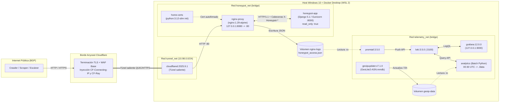

# Diseño, Implementación y Evaluación Empírica de un Honeypot Web con Trampas de Visibilidad CSS para la Detección y Caracterización de Crawlers

**Asignatura:** Internetworking — Ingeniería en Sistemas de Información (FaCENA, UNNE)  
**Dominio de estudio:** `definitivamente-no-hay-trabas.com.ar`  
**Ruta restringida en `robots.txt`:** `Disallow: /archivo-interno/` (etiquetada internamente como `route="trap"`)  
**Período de observación:** 18 de octubre de 2026 (21:31:02 UTC) al 30 de octubre de 2026 (17:57:05 UTC) (11 días, 20 h y 26 min; 3.568.406 líneas brutas)  
**Volumen de datos analizado:** 3.568.349 peticiones HTTP válidas (tras excluir 57 registros de pruebas e inicialización; 3,45 GB de logs JSON)  
**Repositorio público del proyecto:** https://github.com/Gio-glitch04/crawler-honeypot

---

## Resumen

El crecimiento acelerado de los modelos de lenguaje de gran escala (LLM) ha intensificado la recolección automatizada de datos en la web (*web scraping*), planteando interrogantes sobre el respeto práctico al Protocolo de Exclusión de Robots (`robots.txt`, estandarizado en el RFC 9309). Este informe presenta el marco conceptual de la tecnología *honeypot*, su evolución hacia sistemas de engaño en capa de aplicación y el diseño, despliegue en producción y evaluación empírica de un *honeypot* web de baja interacción con un laberinto dinámico de profundidad acotada (`HONEYPOT_MAX_DEPTH = 10`, con hojas sin enlaces en el nivel 11). El sistema fue desplegado sobre un entorno doméstico con **Windows 10 y Docker Desktop (WSL 2)** detrás de un túnel reverso de **Cloudflare Tunnel**, operando mediante dos mecanismos complementarios: (1) una directiva explícita `Disallow: /archivo-interno/` en `robots.txt` y (2) un conjunto de cinco hipervínculos hacia dicha ruta restringida inyectados en cada página HTML pero ocultos visualmente en cuatro de sus variantes mediante hojas de estilo en cascada (CSS) con nombres de clase aleatorios por petición, más un enlace visible de control, todos protegidos mediante tokens criptográficos HMAC-SHA256 sin estado (*stateless*).

Durante la ventana de captura de casi 12 días (18 al 30 de octubre de 2026), el sistema registró **3.568.349 peticiones HTTP válidas**. Los resultados empíricos muestran una marcada bifurcación entre agentes declarados y tráfico camuflado: por un lado, la totalidad de los rastreadores declarados de inteligencia artificial y búsqueda observados (`ClaudeBot` de Anthropic con 55,77 %, `GPTBot` y `OAI-SearchBot` de OpenAI con 43,69 %, `GoogleOther` y `Googlebot` de Google con 0,34 %, y `Applebot`), cuyas subredes de origen fueron contrastadas contra los anuncios BGP (`AS16509`, `AS8075`, `AS15169`) y las listas JSON oficiales, respetaron sin excepción la exclusión (**0 accesos** a `/archivo-interno/` sobre más de 5,36 millones de enlaces trampa expuestos), aunque recorrieron agresivamente el árbol público hasta agotar el límite de profundidad 11. Por otro lado, la totalidad de los **207 accesos válidos a la trampa** provino de **6 orígenes IP** que se presentaron con cadenas `User-Agent` de navegadores Chrome de escritorio (versiones 124 a 150) sin haber solicitado previamente `/robots.txt` (**0 casos** de violación directa post-lectura). Los conteos observados entre las cinco técnicas de enlace presentan una distribución cercana a la equiprobabilidad ($\chi^2 = 0,3188; gl = 4; p = 0,9886$ a nivel exploratorio), indicando que los recolectores que activaron las trampas extraen hipervínculos sin filtrar por su visibilidad visual efectiva.

---

## 1. Introducción y marco conceptual

### 1.1. Planteamiento del problema, pregunta de investigación y objetivos

La arquitectura de la World Wide Web descansa sobre un pacto de cooperación implícita formulado en 1994 por Martijn Koster y formalizado en septiembre de 2022 por el Internet Engineering Task Force (IETF) bajo el **RFC 9309** (*Robots Exclusion Protocol*) [1]. En aquel contexto fundacional, el rastreo automatizado (*web crawling*) era ejecutado mayoritariamente por motores de indexación que generaban un beneficio recíproco: el sitio web cedía ancho de banda y ciclos de cómputo a cambio de visibilidad pública y tráfico de referencia humano. En consecuencia, el estándar `robots.txt` se diseñó como un mecanismo meramente consultivo y voluntario (*advisory*), desprovisto de controles de acceso criptográficos o barreras en capa de red.

A partir de 2022, la irrupción masiva de los modelos fundacionales de inteligencia artificial generativa alteró estructuralmente esta simetría económica y técnica. Los recolectores de datos de entrenamiento (*AI data scrapers*) y los agentes de recuperación en tiempo real (*Retrieval-Augmented Generation*, RAG) descargan repositorios completos de contenido con frecuencias de miles de peticiones por hora sin retornar tráfico humano al servidor de origen [2]. En paralelo, proliferan recolectores y escáneres no declarados que operan desde nubes públicas y proxies falsificando sus cabeceras HTTP para eludir bloqueos basados en listas de reputación.

Este escenario plantea un problema de **observabilidad y atribución en redes**: ¿cómo distinguir empíricamente, desde el servidor de origen, entre un rastreador declarado que respeta las políticas de exclusión, un cliente humano legítimo y un recolector automatizado evasivo que suplanta su identidad en capa de aplicación? La técnica que aborda este problema desde la seguridad defensiva es el despliegue de **honeypots**.

**Pregunta de investigación, objetivos y alcance:**
* **Pregunta de investigación:** *¿En qué medida un honeypot web de baja interacción basado en enlaces ocultos mediante CSS y tokens criptográficos sin estado permite detectar recolectores automatizados que ignoran `robots.txt` y caracterizar su comportamiento de navegación y de red?*
* **Objetivo general:** Diseñar, implementar y evaluar empíricamente un *honeypot* web de baja interacción que permita observar el comportamiento de *crawlers* frente a directivas de exclusión (RFC 9309) y mecanismos de ocultamiento CSS, evaluando su capacidad para detectar accesos automatizados y caracterizar sus patrones de navegación mediante telemetría de red.
* **Objetivos específicos:** (1) Desplegar una arquitectura contenerizada detrás de un túnel reverso capaz de emitir y verificar rutas señuelo sin estado mediante firmas HMAC-SHA256 que codifiquen la técnica de ocultamiento, el instante de emisión y la profundidad; (2) Contrastar la identidad declarada en `User-Agent` con los prefijos BGP, registros RDAP y manifiestos JSON oficiales de los operadores; y (3) Analizar el comportamiento de recorrido, latencia de seguimiento y respuesta frente al ocultamiento CSS de los orígenes que interactúan con el sistema.
* **Alcance metodológico:** Los hallazgos empíricos de este estudio se circunscriben al tráfico recibido por el dominio dedicado `definitivamente-no-hay-trabas.com.ar` entre el 18 y el 30 de octubre de 2026, por lo que describen el comportamiento de las infraestructuras y agentes que interactuaron con el sensor en dicho período sin pretender extrapolarse como un censo universal de toda la actividad de cada operador en Internet.

### 1.2. Fundamentos de la técnica Honeypot: historia, taxonomía y *tarpits*

En la literatura de seguridad en redes, Lance Spitzner definió formalmente un **honeypot** como *"un recurso de sistema de información cuyo valor reside en el uso no autorizado o ilícito de dicho recurso"* [3]. A diferencia de los mecanismos de perímetro tradicionales —como cortafuegos (*firewalls*), sistemas de detección de intrusiones (IDS) o *Web Application Firewalls* (WAF)—, un *honeypot* no aloja servicios productivos ni usuarios reales. Por definición, carece de tráfico legítimo habitual: cualquier paquete o petición que interactúe con un recurso señuelo constituye, en sí mismo, un evento de interés analítico, reduciendo drásticamente la tasa de falsos positivos que afecta a los detectores basados en firmas.

La evolución histórica de la técnica comenzó en la década de 1990 con los trabajos seminales de Clifford Stoll (*The Cuckoo's Egg*, 1989) y Bill Cheswick (*An Evening with Berferd*, 1992), consolidándose a principios de los años 2000 con el **Honeynet Project** [3] y el análisis sistemático de Niels Provos sobre marcos de engaño distribuido (`Honeyd`, 2004) [4]. La taxonomía clásica divide estos sistemas según su **nivel de interacción**:

1. **Honeypots de baja interacción (*Low-interaction*):** Emulan únicamente un subconjunto acotado de protocolos, puertos o rutas de aplicación (por ejemplo, `Honeyd` [4], `Dionaea` para captura de *exploits* SMB/HTTP, o **Canarytokens** [5] para detección de acceso a recursos señuelo). Su superficie de ataque es mínima, son fáciles de instrumentar y no exponen un sistema operativo completo al adversario.
2. **Honeypots de media y alta interacción (*Medium/High-interaction*):** Exponen entornos complejos o sistemas operativos reales instrumentados para registrar el comportamiento post-explotación del atacante (por ejemplo, **Cowrie** [6] para sesiones interactivas SSH/Telnet, o arquitecturas multi-sensor como **T-Pot** [7]). Ofrecen telemetría profunda, pero conllevan mayor riesgo operativo si el intruso intenta utilizar el nodo como pivote.

Una variante especializada dentro de las tecnologías de engaño (*deception technology*) es el **tarpit** (pozo de brea), introducido originalmente por Tom Liston con `LaBrea` en capa TCP y extendido en aplicaciones como `Endlessh` [8] o el sistema clásico de recolección de *malware* `Nepenthes` (2006) [9]. Mientras un *honeypot* pasivo busca observar sin interferir, un *tarpit* retiene al cliente automatizado en un ciclo de consumo de tiempo o recursos. En el contexto actual de rastreo masivo para IA, esta técnica resurgió en capa de aplicación HTTP como **laberintos dinámicos de enlaces** (*crawler tarpits*), ejemplificados por proyectos recientes como el *tarpit* HTTP homónimo `Nepenthes` (2025) [10] y el servicio comercial **Cloudflare AI Labyrinth** (2025) [12], que exponen árboles sintéticos de páginas interconectadas para estudiar o degradar a los recolectores que ignoran las directivas de exclusión.

### 1.3. Conceptos fundamentales de Internetworking y capa de aplicación

Para comprender el diseño y los hallazgos del sistema implementado, es necesario establecer cuatro conceptos técnicos transversales de redes y arquitectura web:

* **Semántica de evaluación y caché de `robots.txt` (RFC 9309):** El estándar especifica que un rastreador debe recuperar `/robots.txt`, identificar el grupo de reglas aplicable a su `User-Agent` (o el comodín `*`) y evaluar las directivas `Allow` y `Disallow` mediante coincidencia de prefijos de ruta (*path prefix matching*), donde prevalece la regla de mayor longitud de caracteres en caso de conflicto [1]. Asimismo, el protocolo contempla que los operadores almacenen el archivo en caché hasta por 24 horas y compartan dicha política entre los nodos de su infraestructura distribuida para no solicitar `/robots.txt` antes de cada página.
* **Diferencia entre extracción HTML/DOM y renderizado visual CSS (*Render Tree*):** Conforme a los estándares del **WHATWG HTML** [11] y del **W3C CSS Display Module** [20], un navegador web moderno construye primero el *Document Object Model* (DOM) a partir del HTML, luego el *CSS Object Model* (CSSOM), y combina ambos en el **Render Tree** antes de calcular la geometría (*layout*) y pintar los píxeles en pantalla. Los nodos con `display: none` son excluidos del *Render Tree*, y los elementos con `opacity: 0` o desplazados fuera del *viewport* (`left: -10000px`) resultan invisibles al usuario humano, aunque **todos ellos permanecen presentes en el árbol DOM y en el texto fuente HTML**. Por consiguiente, tanto un recolector ligero que analice el texto HTML crudo (`curl`, `python-requests`, `Scrapy`) como un navegador automatizado (*headless browser* con Playwright/Puppeteer) que consulte el DOM mediante selectores (`querySelectorAll('a')`) sin verificar explícitamente la geometría o visibilidad computada del elemento extraerán indistintamente los enlaces ocultos y los visibles.
* **Túneles reversos en el borde y preservación de identidad L3/L7:** Cuando un servicio web se aloja detrás de un túnel reverso como *Cloudflare Tunnel*, la conexión TCP/TLS del cliente externo termina en el nodo de borde (*edge* o *PoP*) más cercano por enrutamiento BGP *anycast*. El contenedor local `cloudflared` mantiene una conexión saliente persistente hacia el borde, por lo que no se abren puertos en el router doméstico ni se expone la dirección IP pública del host anfitrión. Como contrapartida, la huella criptográfica del saludo TLS del cliente (**JA3/JA4** [18]) queda en el borde salvo que se reenvíe mediante reglas de transformación empresariales, y el socket TCP local de Nginx observa como par inmediato (`$realip_remote_addr`) la dirección interna del contenedor `cloudflared`. Para restituir la IP real del cliente sin permitir suplantación (*IP spoofing*), Nginx debe restringir la directiva `set_real_ip_from` exclusivamente a la subred interna del túnel antes de tomar el valor de la cabecera `CF-Connecting-IP`.
* **Atribución mediante Sistemas Autónomos (ASN) y registros BGP/RDAP:** Dado que la cabecera `User-Agent` en capa 7 es texto arbitrario trivialmente falsificable por el cliente, la verificación de identidad en Internetworking requiere contrastar la dirección IP de origen contra la tabla de enrutamiento global **BGP** (*Border Gateway Protocol*), los registros de asignación regional **RDAP/WHOIS** (ARIN, RIPE, APNIC, LACNIC) y los manifiestos JSON de prefijos IP publicados oficialmente por los operadores de rastreadores (`gptbot.json`, `searchbot.json`, `googlebot.json`).

---

## 2. Arquitectura y funcionamiento

El sistema desarrollado implementa un **honeypot web de baja interacción con laberinto dinámico sin estado de profundidad acotada (`HONEYPOT_MAX_DEPTH = 10`)**. Su objetivo es doble: medir el cumplimiento práctico del RFC 9309 frente a una ruta vedada (`Disallow: /archivo-interno/`) y evaluar empíricamente cómo interactúan los distintos agentes con hipervínculos ocultos mediante CSS.

### 2.1. Componentes efectivamente desplegados y topología de red (Windows 10 + Docker Desktop)

El despliegue en producción se ejecutó sobre una PC con **Windows 10 (22H2) y Docker Desktop (motor WSL 2)** combinando el archivo base [`docker-compose.yml`](https://github.com/Gio-glitch04/crawler-honeypot/blob/main/docker-compose.yml) con el *override* [`docker-compose.home.yml`](https://github.com/Gio-glitch04/crawler-honeypot/blob/main/docker-compose.home.yml) y el perfil `--profile maxmind` (documentado paso a paso en [`PUESTA-EN-LINEA.md`](https://github.com/Gio-glitch04/crawler-honeypot/blob/main/PUESTA-EN-LINEA.md)). La topología segmenta los contenedores en **tres redes virtuales tipo *bridge*** aisladas (`tunnel_net` en `10.98.0.0/24`, `honeypot_net` y `telemetry_net`), sin abrir ningún puerto hacia la red local ni en el router doméstico:



Los componentes desplegados cumplen las siguientes responsabilidades internas:

1. **Agente de túnel reverso (`cloudflared`, imagen `cloudflare/cloudflared:2025.9.1`):** Conecta únicamente con la red `tunnel_net` (`10.98.0.0/24`). Establece túneles salientes hacia el borde de Cloudflare autenticados mediante `CLOUDFLARE_TUNNEL_TOKEN` y entrega las peticiones entrantes por HTTP interno a `nginx-proxy:80`.
2. **Inicializador de certificados (`home-certs`, imagen `python:3.12-slim`):** Contenedor efímero sin red (`network_mode: none`) que verifica o genera con OpenSSL un par de claves autofirmadas (`/certs/honeypot.pem` y `honeypot.key`) antes de que arranque Nginx (`condition: service_completed_successfully`).
3. **Proxy inverso y sensor de telemetría (`nginx-proxy`, imagen `nginx:1.29-alpine`):** Conecta `tunnel_net` con `honeypot_net` y expone únicamente `127.0.0.1:8080:80` en la propia PC para pruebas locales de control. Al arrancar, procesa la plantilla [`home/templates/honeypot.conf.template`](https://github.com/Gio-glitch04/crawler-honeypot/blob/main/home/templates/honeypot.conf.template) y ejecuta tres tareas críticas:
   * **Restitución segura de IP real y marcado de origen:** Mediante [`home/cloudflare_realip.conf`](https://github.com/Gio-glitch04/crawler-honeypot/blob/main/home/cloudflare_realip.conf) (`set_real_ip_from 10.98.0.0/24; real_ip_header CF-Connecting-IP;`), reemplaza `$remote_addr` por la IP real del cliente únicamente si la conexión TCP proviene de `cloudflared` (`$realip_remote_addr` en `10.98.0.0/24`), registrando `via_cloudflare="1"` (o `"0"` cuando se realizan controles locales por `127.0.0.1:8080`).
   * **Captura y ocultamiento de metadatos internos del laberinto:** Lee las cuatro cabeceras internas devueltas por Django (`$upstream_http_x_honeypot_route`, `technique`, `token_issued` y `depth`), las graba en el log JSON (`honeypot_access.json`) y las suprime de la respuesta HTTP saliente mediante `proxy_hide_header` para que ningún rastreador pueda detectar que está siendo instrumentado.
4. **Motor del laberinto y validación criptográfica (`honeypot-app`, construido desde [`honeypot/Dockerfile`](https://github.com/Gio-glitch04/crawler-honeypot/blob/main/honeypot/Dockerfile)):** Aplicación Django 5.1 servida por **Gunicorn** (2 procesos *worker*, timeout de 30 s) sobre `python:3.12-slim`, ejecutada con usuario sin privilegios y sistema de archivos de solo lectura (`read_only: true`, con `/tmp` en memoria `tmpfs`).
5. **Pipeline de observabilidad y enriquecimiento en `telemetry_net`:**
   * **`promtail` (`grafana/promtail:3.5.0`)** y **`loki` (`grafana/loki:3.5.0`):** `Promtail` lee en tiempo real `/var/log/nginx/honeypot_access.json` desde el volumen compartido `nginx-logs`, parsea los campos clave (`route`, `link_technique`, `via_cloudflare`, `status`) y los indexa en Loki, cuyas métricas se visualizan localmente en **`grafana` (`grafana/grafana:12.0.0`**, en `127.0.0.1:3000`).
   * **`geoipupdate` (`ghcr.io/maxmind/geoipupdate:v7.1.0`)** y **`analytics` (batch Python):** `geoipupdate` mantiene actualizada la base binaria `GeoLite2-ASN.mmdb` en el volumen `geoip-data`, mientras que `analytics` ejecuta a las `00:30 UTC` el módulo [`honeypot_analytics/daily.py`](https://github.com/Gio-glitch04/crawler-honeypot/blob/main/analytics/honeypot_analytics/daily.py) para consultar Loki, cruzar las IPs con su ASN y clasificar las cadenas `User-Agent` mediante [`bots.py`](https://github.com/Gio-glitch04/crawler-honeypot/blob/main/analytics/honeypot_analytics/bots.py).

### 2.2. Flujo de trabajo típico y diseño del token criptográfico sin estado (HMAC-SHA256)

El desafío arquitectónico central de un laberinto de enlaces bajo rastreo masivo es conocer para cada petición **cómo estaba oculto el enlace que siguió el bot, cuándo fue emitido y en qué nivel de profundidad se encontraba la página madre**, sin guardar millones de registros en una base de datos ni delatar la técnica de ocultamiento en la propia URL.

Para resolverlo, el módulo [`honeypot/trap/tokens.py`](https://github.com/Gio-glitch04/crawler-honeypot/blob/main/honeypot/trap/tokens.py) implementa un **token opaco autoverificable de 52 caracteres hexadecimales**:

$$\tau = \underbrace{\text{UUID}_{v4}}_{\text{32 hex (128 bits)}} \;\Vert\; \underbrace{T_{\text{hex}}}_{\text{8 hex (32 bits)}} \;\Vert\; \underbrace{D_{\text{hex}}}_{\text{2 hex (8 bits)}} \;\Vert\; \underbrace{\text{Trunc}_{40}\!\left(\text{HMAC-SHA256}\left(K,\; \text{UUID}_{v4} \,\Vert\, \text{``|''} \,\Vert\, T_{\text{hex}} \,\Vert\, \text{``|''} \,\Vert\, D_{\text{hex}} \,\Vert\, \text{``|''} \,\Vert\, \text{técnica}\right)\right)}_{\text{10 hex (40 bits)}}$$

donde:
* $\text{UUID}_{v4}$ (`32 hex`) garantiza que cada enlace emitido en cada vista de página sea único y no deduplicable;
* $T_{\text{hex}}$ (`8 hex`) codifica el instante exacto de emisión (`int(time.time())` en segundos Unix), permitiendo medir con precisión la **edad del enlace (`tok_age = timestamp_petición - link_issued`)** al momento en que el bot lo solicita;
* $D_{\text{hex}}$ (`2 hex`) codifica la profundidad de la página que emitió el enlace (`link_depth`);
* **La técnica de ocultamiento (`visible`, `display_none_inline`, `display_none_class`, `opacity_0`, `offscreen` o `public`) NO viaja en claro en la URL**, sino que forma parte del mensaje firmado dentro del **HMAC-SHA256**. Cuando un cliente solicita `/archivo-interno/<token>` o `/public/<token>`, la función `tokens.decode(token_id)` recalcula el HMAC probando las 6 técnicas conocidas mediante `hmac.compare_digest` en tiempo constante: si alguna coincide, recupera de inmediato qué técnica tenía ese enlace; si el token fue inventado o alterado, lo etiqueta como `"invalid"` (y si alguien solicita `/archivo-interno/` a secas sin token, lo etiqueta como `"bare"`).

**Justificación de ingeniería sobre el truncamiento a 40 bits:** Aunque el RFC 2104 recomienda al menos 80 bits para usos criptográficos generales [19], aquí se truncó el HMAC a **40 bits (`10 hex`)** para mantener identificadores compactos de 52 caracteres en la ruta URL. Dado que existen 6 técnicas posibles por cada combinación $(\text{UUID}_{v4}, T_{\text{hex}}, D_{\text{hex}})$, la probabilidad de que un token aleatorio o manipulado coincida por azar con una firma válida es de $6 / 2^{40} \approx 5,46 \times 10^{-12}$ (requiriendo del orden de $1,8 \times 10^{11}$ peticiones HTTP en línea para lograr una colisión), lo cual es completamente inviable a través de la red, reconociéndose igualmente como un compromiso de diseño en la Sección 4.1.

**Acotamiento del laberinto (`HONEYPOT_MAX_DEPTH = 10`):** La página de inicio `/` se sirve con `depth = 1` y emite 5 enlaces públicos (`/public/<token>`) y 5 enlaces trampa (`/archivo-interno/<token>`) firmados con `link_depth = 1`. Cada vez que un rastreador sigue un enlace con `link_depth = d`, la vista calcula la profundidad de la nueva página como `depth = d + 1`. Cuando el rastreador solicita un enlace emitido en `link_depth = 10`, recibe una página de **profundidad 11**: dado que `depth > HONEYPOT_MAX_DEPTH` (`11 > 10`), la función `_page()` en [`views.py`](https://github.com/Gio-glitch04/crawler-honeypot/blob/main/honeypot/trap/views.py) devuelve listas de enlaces vacías (`public = [], traps = []`), actuando como **hoja terminal del árbol**.

### 2.3. Terminología específica, técnicas de ocultamiento CSS y taxonomía del experimento

En cada página con `depth <= 10`, la plantilla [`honeypot/trap/templates/trap/dataset.html`](https://github.com/Gio-glitch04/crawler-honeypot/blob/main/honeypot/trap/templates/trap/dataset.html) presenta un catálogo verosímil de conjuntos de datos climáticos e hidrológicos regionales acompañado de 5 enlaces hacia `/public/<token>` y **5 enlaces trampa hacia `/archivo-interno/<token>`** permutados en orden aleatorio (`random.shuffle`):

1. **`visible` (Control):** Renderizado en un párrafo visible (`<p>Archivo histórico: <a href="/archivo-interno/...">...</a></p>`).
2. **`display_none_inline`:** Envuelto en `<div style="display:none">`. Suprimido del *Render Tree* directamente por atributo en línea.
3. **`display_none_class`:** Envuelto en `<div class="<clase_aleatoria>">` asociada en el bloque `<style>` a `display: none;`.
4. **`opacity_0`:** Asociado mediante clase aleatoria a `opacity: 0; pointer-events: none; position: absolute; width: 0; height: 0; overflow: hidden;`.
5. **`offscreen`:** Asociado mediante clase aleatoria a `position: absolute; left: -10000px; top: auto; width: 1px; height: 1px; overflow: hidden;`.

Para impedir que un recolector pueda filtrar enlaces ocultos buscando nombres de clase fijos en el HTML (como `.hidden` o `.trap`), la función `_css_classes()` genera en cada petición HTTP **nombres de clase efímeros aleatorios** (una letra minúscula seguida de 8 dígitos hexadecimales, por ejemplo `.m4a9c01f2`).

El diseño experimental clasifica las violaciones a `/archivo-interno/` según tres niveles operativos (definidos en el diseño del proyecto y en [`informe-tecnico-honeypot.md §2.2`](https://github.com/Gio-glitch04/crawler-honeypot/blob/main/docs/entrega/informe-tecnico-honeypot.md#L54-L63)):
* **Nivel 1 (Violación directa post-lectura):** El origen descarga `/robots.txt` y posteriormente accede a `/archivo-interno/*`.
* **Nivel 2 (Violación sin descarga previa de `robots.txt`):** El origen accede a `/archivo-interno/*` sin haber solicitado `/robots.txt` durante la ventana de observación.
* **Nivel 3 (Extracción sin filtrado de visibilidad CSS):** El origen sigue enlaces hacia `/archivo-interno/*` que se encontraban ocultos mediante propiedades CSS (`display_none_inline`, `display_none_class`, `opacity_0` u `offscreen`). Los niveles 2 y 3 no son mutuamente excluyentes: el Nivel 2 describe la relación del agente con `robots.txt` y el Nivel 3 caracteriza su mecanismo de extracción de enlaces.

---

## 3. Caso práctico

### 3.1. Despliegue paso a paso y decisiones de implementación

El experimento se puso en línea el **18 de octubre de 2026 a las 21:31:02 UTC** y se exportó el **30 de octubre de 2026 a las 17:57:05 UTC** (11 días, 20 horas y 26 minutos de operación). Se documentan a continuación las decisiones de ingeniería y los comandos ejecutados en PowerShell sobre el host Windows 10:

1. **Ajustes experimentales en Cloudflare para evitar sesgos de medición:** Tras delegar el dominio `definitivamente-no-hay-trabas.com.ar` a Cloudflare (plan Free), se desactivaron explícitamente todas las funciones que pudieran alterar el HTML o bloquear a los crawlers antes de que llegaran al sensor ([`PUESTA-EN-LINEA.md §3`](https://github.com/Gio-glitch04/crawler-honeypot/blob/main/PUESTA-EN-LINEA.md#L46-L59)): *Block AI bots / AI Crawl Control* en *Do not block*, *Managed robots.txt* apagado, *AI Labyrinth* apagado, *Bot Fight Mode* apagado, *Browser Integrity Check* apagado, *Always Use HTTPS* apagado (para no perder bots que entren por HTTP plano) y una regla de caché en *Bypass cache* para todo el dominio. Solo permanecieron activas las reglas WAF administradas de base contra *exploits* críticos.
2. **Configuración de `.env`, túnel y despliegue en Docker Desktop:** Se eligió la ruta prohibida neutra `HONEYPOT_TRAP_PATH=archivo-interno` (evitando la palabra `trap` en las URLs públicas para no alertar a filtros heurísticos de *scrapers*) y una profundidad máxima `HONEYPOT_MAX_DEPTH=10`. En PowerShell se inicializó y verificó el stack con los siguientes comandos:
   ```powershell
   cd C:\honeypot\crawler-honeypot
   Copy-Item home\.env.home.example .env
   # Definición del alias de orquestación combinando base + override de Windows 10
   function hp { docker compose -f docker-compose.yml -f docker-compose.home.yml @args }
   hp --profile maxmind up -d --build
   hp ps -a

   # Controles pre-siembra desde PowerShell (verificando robots.txt, 5 trampas por página y ausencia de cabeceras internas)
   curl.exe -s https://definitivamente-no-hay-trabas.com.ar/robots.txt
   (curl.exe -s https://definitivamente-no-hay-trabas.com.ar/ | Select-String '/archivo-interno/').Count
   curl.exe -sI https://definitivamente-no-hay-trabas.com.ar/ | Select-String x-honeypot
   ```
3. **Descubrimiento y siembra de URLs (`seed_urls`):** El comando [`manage.py seed_urls`](https://github.com/Gio-glitch04/crawler-honeypot/blob/main/honeypot/trap/management/commands/seed_urls.py) permite emitir tokens firmados de profundidad 0 asociados a canales específicos (`github`, `reddit`, `hn`) y publicarlos junto con [`seeds/config.json`](https://github.com/Gio-glitch04/crawler-honeypot/blob/main/seeds/config.json). En los registros capturados durante la ventana del 18 al 30 de octubre se observaron 51 peticiones con cabecera `Referer` de Google y 1 con `Referer` de Hacker News, mientras que la gran mayoría del tráfico de rastreadores declarados ingresó de forma directa sin `Referer` a partir del descubrimiento temprano del dominio en los registros públicos de **Certificate Transparency (CT)** y DNS tras la emisión del certificado de borde en Cloudflare.

### 3.2. Evidencia concreta: registros crudos, secuencia de captura y panel de Grafana

La siguiente traza real tomada del registro de Nginx (documentada en [`docs/entrega/informe-tecnico-honeypot.md §7.5`](https://github.com/Gio-glitch04/crawler-honeypot/blob/main/docs/entrega/informe-tecnico-honeypot.md#L395-L415)) muestra la secuencia con precisión de milisegundos del origen **`154.28.229.x`** el **21 de octubre de 2026 a las 03:51 UTC**, donde el recolector descarga la portada (`home`) y, 221 milisegundos después, comienza a recorrer en paralelo tanto enlaces `/public/` como las cinco variantes de trampa bajo `/archivo-interno/` a razón de ~5 peticiones por segundo sin haber solicitado `/robots.txt`:

```text
03:51:20.358  GET /                                   route=home
03:51:32.371  GET /                                   route=home
03:51:32.592  GET /public/1f79...                     route=public  link_depth=1
03:51:32.789  GET /                                   route=home
03:51:32.977  GET /archivo-interno/...                route=trap    technique=visible              link_depth=1
03:51:33.168  GET /public/...                         route=public  link_depth=1
03:51:33.634  GET /archivo-interno/...                route=trap    technique=offscreen            link_depth=1
03:51:33.816  GET /public/...                         route=public  link_depth=1
03:51:34.013  GET /public/...                         route=public  link_depth=1
03:51:34.194  GET /archivo-interno/...                route=trap    technique=display_none_inline  link_depth=1
03:51:34.377  GET /public/...                         route=public  link_depth=1
03:51:34.581  GET /archivo-interno/...                route=trap    technique=opacity_0            link_depth=1
03:51:34.763  GET /archivo-interno/...                route=trap    technique=display_none_class   link_depth=1
03:51:34.947  GET /public/...                         route=public  link_depth=2
```

La **Figura 1** muestra la captura de pantalla del panel de monitoreo en Grafana (`http://localhost:3000`) tomada el **26 de octubre de 2026** durante la operación en línea del experimento.


> **Nota de lectura sobre la Figura 1:** La captura muestra el estado acumulado en Loki hasta el 26/10 antes de aplicar la limpieza post-hoc de las 57 filas de prueba (§3.3). Por eso se observan **2,95 millones** de peticiones totales (frente a los **3,56 millones** al cierre del 30/10), la ráfaga verde de `ClaudeBot` entre el 23/10 y el 25/10 seguida del escalón constante de `GPTBot` (~7.180 req/h), y **213 accesos a `/trap/` desde 7 IPs** con **45 en `opacity_0`**: esos 6 accesos adicionales sobre los **207 válidos (6 IPs)** corresponden exactamente a la navegación manual de prueba desde la IP argentina `181.4.69.x` del 20/10 (que encadenó 6 clics sobre `opacity_0`), la cual fue depurada en la limpieza metodológica dejando los **39 accesos a `opacity_0`** del dataset final.

### 3.3. Problemas surgidos durante la implementación y limpieza de datos

Durante los 12 días de ejecución surgieron cinco problemas operativos reales (documentados en [`docs/entrega/informe-tecnico-honeypot.md §3 y §11`](https://github.com/Gio-glitch04/crawler-honeypot/blob/main/docs/entrega/informe-tecnico-honeypot.md#L497-L506)):

1. **Detención del proceso batch `analytics` a partir del 21 de octubre:** El contenedor `analytics` generó correctamente los reportes enriquecidos con ASN hasta `data/enriched/events-2026-10-20.csv.gz` (ejecución del 21/10 a las 00:30 UTC, cuando el archivo diario ya pesaba 1,9 MB comprimido). Con la entrada masiva de `GPTBot` y la ráfaga de `ClaudeBot` (>175.000 a >1.050.000 peticiones diarias), las consultas de rango de 24 horas contra Loki sufrieron *timeouts* y agotamiento de memoria. **Resolución:** Dado que Nginx escribe directamente en el volumen `nginx-logs` (`honeypot_access.json`) de forma independiente a Loki y a `analytics`, el 30/10 se exportó el volumen completo desde PowerShell mediante un contenedor Alpine auxiliar (`tar czf /out/nginx-logs.tar.gz`, 227 MB comprimidos / 3,45 GB descomprimidos) y se procesaron las **3.568.406 líneas** fuera de línea en Python/Pandas, verificando además los rangos IP y ASNs mediante [`scripts/verificar_rangos_ip.py`](https://github.com/Gio-glitch04/crawler-honeypot/blob/main/scripts/verificar_rangos_ip.py).
2. **Hueco de captura de 8 h 57 min el 27 de octubre de 2026:** Entre las **03:03:46 UTC y las 12:00:52 UTC del 27/10** (00:03 a 09:00 hora argentina) no se registró ninguna petición debido a que la PC anfitriona con Windows 10 o el túnel estuvieron inactivos, estimándose una pérdida de ~64.000 peticiones de `GPTBot`. **Resolución:** Al reanudarse la sesión, `cloudflared` restableció el túnel automáticamente y `GPTBot` continuó solicitando enlaces válidos de su frontera sin errores gracias al carácter *stateless* de los tokens HMAC.
3. **Crecimiento del log sin rotación activa (3,45 GB en 12 días):** A razón de ~165 MB/día sostenidos por `GPTBot`, el archivo `honeypot_access.json` creció sin rotación en el disco virtual de Docker Desktop (WSL 2), identificándose la necesidad de incorporar `logrotate` diario para campañas prolongadas.
4. **Ausencia de huella TLS (JA3/JA4) en el origen:** Los campos `tls_version`, `tls_cipher`, `ja3` y `ja4` del formato JSON de Nginx quedaron vacíos en el 100 % de las filas porque la sesión TLS del cliente termina en el borde de Cloudflare y el plan Free no inyecta las cabeceras `X-Client-JA3/JA4` hacia el túnel.
5. **Protocolo de limpieza de datos (57 filas excluidas):** Sobre las `3.568.406` líneas brutas del log, se auditaron y excluyeron **57 registros** correspondientes a pruebas de puesta en línea y controles propios para no contaminar los resultados: (a) **15** del auto-test `honeypot-selftest/1.0` (19/10 01:21 UTC); (b) **8** de una visita manual propia desde `45.191.81.x` con Opera (19/10 18:21 UTC); (c) **24** de las pruebas de puesta en línea del 18/10 desde `186.124.199.x` (Argentina, ejecutando los comandos de verificación del paso 8 de `PUESTA-EN-LINEA.md` con cadenas `User-Agent` simuladas de `ClaudeBot`, `GPTBot` y `Bytespider`); (d) **8** de una navegación manual desde `181.4.69.x` (Argentina, 20/10 23:22 UTC, que cargó `/favicon.ico`, envió `Referer` y realizó 6 clics seguidos en `opacity_0`); y (e) **2** controles locales con `curl` a `127.0.0.1:8080` (`via_cloudflare="0"`). Adicionalmente, el panel de Cloudflare reportó **53 bloqueos WAF en el borde** de escáneres de *exploits* que no llegaron al servidor de origen.

### 3.4. Resultados empíricos obtenidos

#### 3.4.1. Panorama general del tráfico y distribución por familia de agente

Sobre las **3.568.349 peticiones válidas** y **1.000 direcciones IP distintas** (~10,9 GB de cuerpo HTTP servidos, con una latencia de origen mediana `request_time` de **$2\text{ ms}$** y percentil 99 de $3\text{–}4\text{ ms}$), el **99,78 %** (`3.560.629`) correspondió a páginas `/public/<token>`, el **0,17 %** (`6.203`) a respuestas `404 Not Found` de escáneres buscando archivos inexistentes (`/.env` con 3.259 intentos, configuraciones con 915, `.php` con 686, WordPress con 309 y `/.git` con 167), el **0,02 %** (`776`) a la portada `/`, el **0,015 %** (`529`) a `/robots.txt` y el **0,006 %** (`207`) a la ruta prohibida `/archivo-interno/`.

La evolución diaria (Figura 2 y Anexo B) muestra dos regímenes completamente distintos entre los dos grandes recolectores de IA que concentraron el **99,45 %** del tráfico:
* **`ClaudeBot` (Anthropic, 1.989.866 peticiones):** Ingresó el 19/10 a las 23:07:11 UTC solicitando primero `GET /robots.txt` en el mismo milisegundo de arranque. Mantuvo una fase de descubrimiento estable (~1.800 req/h) del 20 al 22/10, saltó a una fase de ráfaga intensa el 23/10 a las 08:00 UTC alcanzando un **pico de 887.244 peticiones el 24/10** (máximo horario de **38.787 peticiones/hora $\approx 10,8\text{ req/s}$**), y el **25/10 entre las 12:00 y las 19:00 UTC redujo monótonamente su tasa hasta abandonar por completo el sitio** (dejando solo 32 peticiones residuales de refresco de `robots.txt` hasta el 27/10 y 0 peticiones del 28 al 30/10).
* **`GPTBot` (OpenAI, 1.558.875 peticiones):** Ingresó el 21/10 a las 05:30:31 UTC (exactamente $749\text{ ms}$ después de que `OAI-SearchBot` descargara `/robots.txt` desde la misma red `74.7.0.0/16`) y mantuvo durante los 9,5 días restantes una **tasa constante regulada por un *token bucket* de ~7.184 peticiones/hora ($\approx 2,00\text{ req/s}$ con *jitter* de solo $\pm 4\,\%$**, ~170.000–172.000 peticiones/día), permaneciendo activo hasta el cierre de la captura.


La **Tabla 1** presenta el desglose completo por familia según el clasificador del proyecto (`analytics/bots.py`, documentado en [`docs/entrega/informe-tecnico-honeypot.md §4.3`](https://github.com/Gio-glitch04/crawler-honeypot/blob/main/docs/entrega/informe-tecnico-honeypot.md#L145-L160)):

**Tabla 1.** Distribución del tráfico válido por familia de agente (18 al 30 de octubre de 2026).

| Familia (`analytics/bots.py`) | Categoría funcional | Peticiones válidas | % del total | IPs únicas | Subredes `/24` | Tráfico servido (GB) | Descargas `/robots.txt` | Accesos a `/archivo-interno/` |
| :--- | :--- | ---: | ---: | ---: | ---: | ---: | ---: | ---: |
| `ClaudeBot` (Anthropic) | Crawler IA | 1.989.866 | 55,77 % | 27 | 4 | 6,110 | 155 | 0 |
| `GPTBot` (OpenAI) | Crawler IA | 1.558.875 | 43,69 % | 451 | 4 | 4,720 | 0* | 0 |
| `GoogleOther` (Google) | Crawler IA / I+D | 10.702 | 0,30 % | 11 | 5 | 0,040 | 0* | 0 |
| **`browser` (UA de navegador sin marca de bot)** | **Navegadores / Scrapers / Escáneres camuflados** | **7.036** | **0,20 %** | **427** | **—** | **0,004** | **12** | **207 (6 IPs)** |
| `Googlebot` (Google) | Buscador tradicional | 1.532 | 0,04 % | 22 | 4 | 0,003 | 297 | 0 |
| `OAI-SearchBot` (OpenAI) | Buscador / IA OpenAI | 49 | <0,01 % | 13 | 3 | <0,001 | 49 | 0 |
| `Applebot` (Apple) | Buscador tradicional | 2 | <0,01 % | 2 | 2 | <0,001 | 2 | 0 |
| `tool` (`requests`, `httpx`, `aiohttp`, `Go`, `curl`, `Scrapy`) | Librerías HTTP / Scripts | 168 | <0,01 % | — | — | <0,001 | 7 | 0 |
| `scanner` (`InternetMeasurement`, `CensysInspect`) | Escáneres declarados | 10 | <0,01 % | — | — | <0,001 | 0 | 0 |
| `other` / `other-bot` / vacío (`archive.org_bot`, `redditbot`, etc.) | Otros bots / Sin UA | 109 | <0,01 % | — | — | <0,001 | 7 | 0 |
| **Total general (tráfico válido)** | — | **3.568.349** | **100,00 %** | **1.000** | — | **~10,88** | **529** | **207** |

*\*Nota sobre centralización de `robots.txt` por operador: `GPTBot` no solicitó `/robots.txt` con su propia cadena `User-Agent`, pero `OAI-SearchBot` (ambos de OpenAI, operando en `74.7.0.0/16` sobre Microsoft Azure) solicitó `/robots.txt` 49 veces (cada ~6 horas), comenzando el `2026-10-21 05:30:30.494 UTC`, exactamente **0,75 segundos antes** de la primera petición de `GPTBot` (`05:30:31.243 UTC`). Análogamente, `GoogleOther` comparte las direcciones IP principales (`66.249.73.x` y `66.249.73.x`) con `Googlebot`, que descargó `/robots.txt` 297 veces. Esto confirma empíricamente que los grandes operadores centralizan la caché de `robots.txt` a nivel de infraestructura y no por cadena `User-Agent` individual.*

#### 3.4.2. Dinámica de exploración del laberinto (profundidades 2 a 11 y edad del enlace)

Gracias a que el token HMAC codifica la profundidad de la página emisora (`link_depth`) y la marca temporal de creación (`link_issued`), se reconstruyó con exactitud cómo recorrieron el árbol los crawlers declarados (Figura 3 y Tabla 2):

**Tabla 2.** Distribución de peticiones a `/public/` por nivel de profundidad solicitado (nivel 11 = hoja sin enlaces por `HONEYPOT_MAX_DEPTH = 10`).

| Profundidad de la página solicitada (`link_depth + 1`) | `ClaudeBot` | `GPTBot` | `GoogleOther` | `Googlebot` | Interpretación estructural en el árbol |
| :---: | ---: | ---: | ---: | ---: | :--- |
| **Nivel 2** | 10 | 8 | 17 | 4 | Hijos directos de la portada `/` (`link_depth = 1`) |
| **Nivel 3** | 49 | 33 | 75 | 3 | Expansión inicial ($b_{\text{teórico}} = 5$) |
| **Nivel 4** | 223 | 122 | 220 | 3 | Crecimiento geométrico |
| **Nivel 5** | 943 | 451 | 514 | 2 | Crecimiento geométrico |
| **Nivel 6** | 3.680 | 1.710 | 899 | 4 | Crecimiento geométrico |
| **Nivel 7** | 12.865 | 6.317 | 1.281 | 9 | Transición a meseta en `GoogleOther` |
| **Nivel 8** | 42.283 | 23.328 | 1.670 | 7 | Factor de ramificación $8\to 9$: $3,23$ (`ClaudeBot`) y $3,69$ (`GPTBot`) |
| **Nivel 9** | 136.519 | 86.003 | 1.913 | 6 | Factor de ramificación $9\to 10$: $3,16$ (`ClaudeBot`) y $3,70$ (`GPTBot`) |
| **Nivel 10** | 431.550 | 318.276 | 2.052 | 4 | Último nivel que emite nuevos enlaces (`link_depth = 10`) |
| **Nivel 11 (Hoja)** | **1.361.483** | **1.122.624** | **2.059** | **1.185** | **Hojas servidas sin enlaces (`depth > 10`): 68,4 % de `ClaudeBot` y 72,0 % de `GPTBot`** |

Los datos de la Tabla 2 revelan tres hallazgos de arquitectura de *crawlers*:
1. **Ambos recolectores de IA llegaron hasta el fondo de la configuración real (nivel 11):** Lejos de detenerse prematuramente, tanto `ClaudeBot` como `GPTBot` recorrieron todos los niveles permitidos por `HONEYPOT_MAX_DEPTH = 10` hasta chocar con las hojas sin enlaces en la profundidad 11, donde se concentró cerca del **70 %** de todas las páginas públicas servidas.
2. **Muestreo parcial de la frontera por página:** Aunque cada página con `depth <= 10` ofrecía 5 enlaces públicos, el factor de ramificación efectivo entre los niveles 8 y 11 fue de **$\sim 3,15\text{–}3,23$ enlaces por página (~63 %)** en `ClaudeBot` y de **$\sim 3,53\text{–}3,70$ (~72 %)** en `GPTBot`. En cambio, `GoogleOther` realizó una exploración en anchura acotada casi plana entre los niveles 7 y 11 (~1.670 a 2.059 peticiones por nivel).
3. **Latencia de seguimiento (`tok_age`) opuesta entre OpenAI y Anthropic:** Al calcular la diferencia entre el instante de petición y `link_issued`, **`GPTBot` exhibe una mediana de apenas $8,9\text{ s}$** (el 75 % de los enlaces se pide en menos de $53\text{ s}$ de emitido y envía `Referer` de la página madre en el 100 % de los casos), propio de un pipeline de extracción y seguimiento en línea. Por el contrario, **`ClaudeBot` presenta un suelo rígido de $3.600\text{ s}$ ($1\text{ hora}$)** —ningún enlace fue solicitado antes de una hora de haber sido emitido, con una mediana de **$5,0\text{ horas}$** y 0 % de `Referer`—, demostrando que Anthropic encola las URLs descubiertas y procesa su frontera en **lotes horarios** sincronizados con su refresco de `/robots.txt` cada 60,2 minutos.


#### 3.4.3. Verificación de atribución en capa de red (BGP, RDAP y listas JSON oficiales)

Para verificar formalmente que las peticiones de `ClaudeBot`, `GPTBot`, `OAI-SearchBot`, `Googlebot` y `GoogleOther` provinieran de la infraestructura legítima de cada empresa (compensando la ausencia de huella TLS JA3/JA4), se ejecutó el script reproducible [`scripts/verificar_rangos_ip.py`](https://github.com/Gio-glitch04/crawler-honeypot/blob/main/scripts/verificar_rangos_ip.py) sobre las subredes documentadas en el log ([`docs/entrega/informe-tecnico-honeypot.md §5`](https://github.com/Gio-glitch04/crawler-honeypot/blob/main/docs/entrega/informe-tecnico-honeypot.md#L192-L264)):

**Tabla 3.** Verificación de subredes observadas contra tablas BGP/RDAP y manifiestos JSON oficiales.

| Agente declarado | Subredes observadas (peticiones reales en el log) | Prefijo BGP anunciado, ASN y PoP de Cloudflare | Fuente oficial verificada y coincidencia de prefijos | Cobertura verificada sobre el total del agente |
| :--- | :--- | :--- | :--- | :--- |
| **`ClaudeBot`**<br>(1.989.866 reqs;<br>27 IPs) | • `216.73.217.0/24` (1.590.538)<br>• `216.73.216.0/24` (399.324)<br>• `34.162.0.0/16` (4) | • `216.73.216.0/22` — **AS16509** (Amazon AWS; registro ARIN `NET-216-73-216-0-1` / `AWS-ANTHROPIC`, Anthropic PBC). PoP CF: **CMH (Columbus) 99,999 %**<br>• `34.162.0.0/18` — **AS396982** (Google Cloud) | Documentación oficial de Anthropic [13] y ARIN RDAP (`216.73.216.0/22`). Tres IPs (`.217.127`, `.217.89`, `.216.163`) concentran el 94 % del total. | **1.989.862 / 1.989.866** (**99,9998 %**) en el `/22` oficial de Anthropic (+ 4 reqs en GCP `AS396982`) |
| **`GPTBot`**<br>(1.558.875 reqs;<br>451 IPs) | • `74.7.242.0/24` (1.557.329)<br>• `132.196.86.0/24` (751)<br>• `172.182.207.0/24` (410)<br>• `172.182.202.0/24` (385) | • `74.7.0.0/16`, `132.196.0.0/16`, `172.160.0.0/11` — **AS8075** (Microsoft Azure). PoP CF: **ATL (Atlanta) 98,3 %**, CDG, MIA | `https://openai.com/gptbot.json` [14] (`creationTime: 2026-09-22`): incluye `132.196.86.0/24`, `74.7.242.0/25`, `172.182.207.0/25` y `172.182.202.0/25`. Dos IPs (`.242.36` y `.242.19`) hacen el 99,9 %. | **1.558.875 / 1.558.875** (**100,00 %**) en subredes oficiales de OpenAI sobre Azure (`AS8075`) |
| **`OAI-SearchBot`**<br>(49 reqs;<br>13 IPs) | • `74.7.175.0/24` (38)<br>• `74.7.230.0/24` (9)<br>• `51.8.102.0/24` (2) | • `74.7.0.0/16` y `51.8.0.0/16` — **AS8075** (Microsoft Azure) | `https://openai.com/searchbot.json` [14] (`creationTime: 2026-01-02`): incluye `74.7.175.128/25`, `74.7.230.0/25` y `51.8.102.0/24`. | **49 / 49** (**100,00 %**) en subredes oficiales de `searchbot.json` (`AS8075`) |
| **`Googlebot` + `GoogleOther`**<br>(12.234 reqs;<br>33 IPs) | • `66.249.73.0/24` (12.119)<br>• `192.178.6.0/24` (94)<br>• `66.249.69.0/24`, `66.249.70.0/24` y otras `66.249.x` (21) | • `66.249.64.0/20` y `192.178.0.0/15` — **AS15169** (Google LLC) | `https://developers.google.com/static/search/apis/ipranges/googlebot.json` [15] (`creationTime: 2026-10-30`): publica los 8 bloques `/27` contiguos que cubren el 100 % de cada `/24`. | **12.234 / 12.234** (**100,00 %**) en bloques oficiales de Google LLC (`AS15169`) |

#### 3.4.4. Análisis forense de los 6 orígenes IP en `/archivo-interno/` y evaluación estadística

De las 427 direcciones IP que se presentaron con un `User-Agent` de navegador común (`browser`), 414 fueron escáneres oportunistas que solo solicitaron rutas fijas inexistentes (`/.env`, `/wp-login.php`) sin recorrer jamás el sitio, 7 pidieron 1 o 2 páginas sueltas sin continuar, y **las 6 IPs que recorrieron más de 2 páginas del sitio entraron todas a la trampa `/archivo-interno/`**, acumulando **207 violaciones**. La **Tabla 4** detalla el perfil forense de estas **6 direcciones IP de origen** (extraído de [`docs/entrega/informe-tecnico-honeypot.md §7`](https://github.com/Gio-glitch04/crawler-honeypot/blob/main/docs/entrega/informe-tecnico-honeypot.md#L329-L394)):

**Tabla 4.** Caracterización forense de los 6 orígenes IP que accedieron a `/archivo-interno/` (`route="trap"`).

| Origen IP | País / PoP CF | Perfil de cabeceras y `User-Agent` | Peticiones totales | Accesos a trampa | Pág. públicas | Resp. `404` | Sesiones y duración | Prof. máx. | `robots.txt` | Grupo / Firma conductual |
| :--- | :--- | :--- | ---: | ---: | ---: | ---: | :--- | :---: | :---: | :--- |
| **`158.69.55.x`** | Canadá / YYZ (OVH) | `Chrome/124` Win10 (1 UA); `Accept: */*`; sin idioma; 0 % `Referer`; p50 entre llegadas: **13 ms** | 200 | **98** | 100 | 0 | 2 sesiones de **exactamente 100 reqs** (21/10 03:53 y 24/10 06:40) | 3 | **0** | **Scraper con tope fijo (100 reqs/sesión):** inicia 2 min y 4 min después del Grupo A |
| **`103.196.9.x`** | EE. UU. / BOS | `Chrome/130–131` Linux (2 UAs); `Accept` Chrome completo; `en-US,en;q=0.9`; 0 % `Referer`; p50: **5 ms** | 111 | **53** | 55 | 0 | 1 sesión de **16 s** (24/10 06:36) | 2 | **0** | **Grupo A (Scraper `en-US Chrome/13x`):** arranque idéntico (`GET /`, pausa 10–12 s, `GET /` y barrido total) |
| **`154.28.229.x`** | EE. UU. / IAD | `Chrome/131` Linux y macOS (2 UAs); `Accept` Chrome completo; `en-US,en;q=0.9`; 0 % `Referer`; p50: **178 ms** | 90 | **43** | 44 | 0 | 1 sesión de **29 s** (21/10 03:51) | 2 | **0** | **Grupo A (Scraper `en-US Chrome/13x`):** misma firma de cabeceras y arranque que `103.196.9.x` |
| **`45.138.12.x`** | Polonia / WAW | `Chrome/133` Linux, Win y macOS (3 UAs); `Accept` tipo Firefox; `en-US`; 0 % `Referer`; p50: **111 ms** | 14 | **5** | 5 | 0 | 4 visitas intermitentes (19/10 al 25/10) | 1 | **0** | **Visitante intermitente:** comparte subred `/24` con `45.138.12.x` pero con distinta huella HTTP |
| **`45.138.12.x`** | Polonia / WAW | `Chrome/150` Win10 (1 UA); `Accept-Language: fr-FR,fr;q=0.9...`; 93 % `Referer`; p50: **88 ms** | 297 | **4** | 5 | **285** | 1 sesión de **3,5 min** (26/10 14:31) | 1 | **0** | **Grupo B (Escáner `fr-FR`):** busca `../.git/config` y entra a la trampa al seguir todo `href` de `/` |
| **`93.123.109.x`** | Países Bajos / AMS | `Chrome/150` Win10 (1 UA); `Accept-Language: fr-FR,fr;q=0.9...`; 83 % `Referer`; p50: **1 ms** | 334 | **4** | 5 | **315** | 1 sesión de **6,7 min** (23/10 06:31) | 1 | **0** | **Grupo B (Escáner `fr-FR`):** idéntico diccionario `.git` + POST a endpoints RSC / Next.js |

El análisis forense de la Tabla 4 demuestra por qué **6 direcciones IP no equivalen a 6 actores independientes**:
* **Correlación en los recolectores de enlaces (`103.196.9.x`, `154.28.229.x` y `158.69.55.x`):** Las dos IPs estadounidenses (**Grupo A**) comparten exactamente las mismas cabeceras HTTP y la misma secuencia de arranque (`GET /`, pausa de 10–12 s, segundo `GET /` y barrido de todos los enlaces públicos y trampa por igual hasta profundidad 2). Más aún, la IP canadiense `158.69.55.x` (que aplica un tope rígido de 100 peticiones por trabajo: 49 a trampa, 50 públicas y 1 a `/`) inició su primera sesión el `21/10 a las 03:53 UTC` (**2 minutos después** de que terminara `154.28.229.x` a las `03:51 UTC`) y su segunda sesión el `24/10 a las 06:40 UTC` (**4 minutos después** de que terminara `103.196.9.x` a las `06:36 UTC`), lo que sugiere un **mismo orquestador lanzando trabajos sucesivos desde distintos nodos**.
* **Correlación en los escáneres de vulnerabilidades (**Grupo B**: `45.138.12.x` y `93.123.109.x`):** Ambos comparten la misma cadena `Chrome/150`, el mismo encabezado `Accept-Language: fr-FR,fr;q=0.9,en-US;q=0.8,en;q=0.7` y el mismo diccionario de búsqueda de repositorios expuestos (`/{assets,css,img,js,static}../.git/config`).
* **Cumplimiento de la taxonomía:** **Ninguna de las 6 IPs solicitó `/robots.txt`** (`0` casos de Nivel 1). Las 6 IPs ingresaron directamente a `/archivo-interno/` sin consultar `robots.txt` (**6 orígenes en Nivel 2**) y las 6 siguieron enlaces ocultos con CSS (**6 orígenes en Nivel 3**, sumando 164 accesos a enlaces invisibles y 43 al enlace `visible` de control).


Al desglosar los **207 accesos a `/archivo-interno/`** según la técnica codificada en el token HMAC (Figura 4), se obtienen los siguientes valores:
* `visible` (control): **43** ($20,77\,\%$)
* `display_none_inline`: **43** ($20,77\,\%$)
* `offscreen`: **42** ($20,29\,\%$)
* `display_none_class`: **40** ($19,32\,\%$)
* `opacity_0`: **39** ($18,84\,\%$)

El **79,23 %** ($164 / 207$) de los accesos correspondió a las cuatro técnicas invisibles para un usuario humano. Al calcular el estadístico chi-cuadrado frente a una distribución equiprobable ($E_i = 207 / 5 = 41,4$):

$$\chi^2 = \sum_{i=1}^{5} \frac{(O_i - 41,4)^2}{41,4} = \frac{(43-41,4)^2 + (43-41,4)^2 + (42-41,4)^2 + (40-41,4)^2 + (39-41,4)^2}{41,4} = \frac{2,56 + 2,56 + 0,36 + 1,96 + 5,76}{41,4} = \frac{13,20}{41,4} = 0,3188$$

Los conteos observados presentan una distribución cercana a la equiprobabilidad entre las cinco categorías. La prueba $\chi^2$ convencional no permite rechazar dicha hipótesis ($\chi^2 = 0,3188; gl = 4; p = 0,9886$). Sin embargo, dado que los eventos se encuentran fuertemente agrupados por origen IP (tres IPs concentran 194 de los 207 accesos) y no constituyen observaciones independientes, el resultado debe interpretarse como **exploratorio** y no como una demostración estadística de uniformidad poblacional. Asimismo, desde el punto de vista del mecanismo de cliente, el seguimiento indistinto de enlaces ocultos y visibles —sumado a que ninguna de las 6 IPs descargó hojas de estilo, fuentes ni imágenes y operó con tiempos entre llegadas de $1\text{ a }178\text{ ms}$— indica que estos agentes **no condicionan la extracción de hipervínculos a su visibilidad visual**, resultado compatible tanto con analizadores de HTML crudo como con consultas directas al árbol DOM que no evalúan la representación visual CSS.

Por último, en la comparación entre grupos de rastreadores declarados (**4 familias de IA**: `ClaudeBot`, `GPTBot`, `GoogleOther`, `OAI-SearchBot`; contra **2 buscadores tradicionales**: `Googlebot`, `Applebot`), al registrarse **0 violaciones en ambos grupos**, el test exacto de Fisher a nivel de familia arroja $p = 1,0$ (sin diferencia observable entre IA declarada y buscadores). A nivel de enlace trampa expuesto (Tabla 6.3 de [`informe-tecnico-honeypot.md`](https://github.com/Gio-glitch04/crawler-honeypot/blob/main/docs/entrega/informe-tecnico-honeypot.md#L314-L326)), `ClaudeBot` estuvo expuesto a **3.140.620 enlaces trampa** en 628.124 páginas con enlaces ($0$ seguidos, cota superior Clopper-Pearson al 95 % de $1,17 \times 10^{-6}$ por enlace) y `GPTBot` a **2.181.250 enlaces trampa** en 436.250 páginas ($0$ seguidos, cota superior de $1,69 \times 10^{-6}$ por enlace), lo que acota con altísima precisión el comportamiento de ambas implementaciones en este dominio, mientras que la variable que predice la violación en la muestra es el carácter **camuflado (UA de navegador) frente a declarado**.

---

## 4. Análisis crítico

### 4.1. Ventajas y limitaciones de la arquitectura implementada

**Ventajas principales:**
1. **Trazabilidad criptográfica opaca y sin estado (*stateless*):** Al incluir la técnica de ocultamiento, el timestamp de emisión y la profundidad dentro del mensaje firmado por el HMAC-SHA256, el servidor recupera toda la genealogía del enlace (`link_technique`, `link_issued`, `link_depth`) sin exponer parámetros delatores en la URL (`?t=`) ni consultar bases de datos, manteniendo una mediana de respuesta de **$2\text{ ms}$** bajo ráfagas de $38.787\text{ req/h}$.
2. **Resistencia al filtrado estático de clases CSS:** La generación de nombres de clase aleatorios por petición (`_css_classes()`) impide que un recolector evada las trampas mediante expresiones regulares o listas negras de selectores CSS conocidos.
3. **Aislamiento de la red doméstica mediante Cloudflare Tunnel:** La combinación de `cloudflared` en `tunnel_net` (`10.98.0.0/24`) con `honeypot-app` en modo `read_only: true` permitió recibir 3,56 millones de peticiones reales en una PC con Windows 10 sin abrir puertos en el router ni exponer la dirección IP del hogar.

**Limitaciones técnicas y metodológicas:**
1. **Indiferenciación entre *parser* HTML crudo y consulta DOM sin filtro visual, y evasión por `checkVisibility()`:** Las trampas CSS detectan agentes que extraen atributos `href` sin evaluar la visibilidad visual, pero no distinguen por sí solas entre un parser de texto/HTML y un navegador *headless* que consulta el DOM sin inspeccionar el *Render Tree* (para separarlos se requiere agregar trampas de segundo orden en comentarios HTML o ejecutadas exclusivamente por JavaScript). Asimismo, un navegador *headless* que invoque `Element.checkVisibility()` evadirá las cuatro técnicas ocultas.
2. **Ausencia de huella TLS (JA3/JA4) y de cabeceras `Sec-CH-UA` / `Sec-Fetch-*`:** La terminación TLS en el borde de Cloudflare bajo el plan gratuito dejó vacíos los campos `ja3` y `ja4` en Nginx, y no se registraron cabeceras *Client Hints* (`Sec-CH-UA`, `Sec-Fetch-Site`), que habrían permitido distinguir con mayor riqueza un navegador Chrome real de un script que falsifica el `User-Agent`.
3. **Truncamiento de firma HMAC a 40 bits y cota de profundidad (`HONEYPOT_MAX_DEPTH = 10`):** El truncamiento del HMAC a 40 bits reduce el margen criptográfico teórico respecto de los 80 bits sugeridos en el RFC 2104 [19], aunque es suficiente frente a intentos de adivinación HTTP en línea. Por su parte, el límite de profundidad 10 hizo que el ~70 % de las peticiones de `ClaudeBot` y `GPTBot` cayeran en hojas de nivel 11 sin enlaces nuevos (lo cual no exponía nuevas trampas en esas hojas y probablemente contribuyó al abandono de `ClaudeBot` el 25/10 al detectar un árbol de contenido sintético).
4. **Muestra acotada de familias por falta de siembra masiva:** Al depender principalmente del descubrimiento por Certificate Transparency y DNS, solo arribaron 4 familias declaradas de IA y 2 de buscadores (estando ausentes `Bytespider`, `CCBot`, `PerplexityBot` o `Amazonbot`) y 6 orígenes IP infractores, lo que limita el poder estadístico a nivel de familias independientes.

### 4.2. Comparación técnica con alternativas existentes

Para evaluar objetivamente la herramienta desarrollada, debe comparársela con tecnologías de su misma naturaleza funcional (**sistemas de engaño, *honeypots* y *tarpits* para crawlers**), y no únicamente con controles preventivos de perímetro como WAF o CAPTCHAs (cuyo propósito es bloquear antes del ingreso y no medir). La **Tabla 5** contrasta nuestra arquitectura con cinco alternativas representativas:

**Tabla 5.** Comparación técnica entre el honeypot desarrollado y alternativas del estado del arte.

| Criterio de evaluación | Honeypot clásico de servicios (**Cowrie** [6] / **Dionaea**) | Tokens señuelo (**Canarytokens** [5]) | Tarpit de protocolo L4 (**Endlessh** [8]) | Tarpit HTTP para crawlers (**Nepenthes** 2025 [10]) | Servicio comercial en el borde (**Cloudflare AI Labyrinth** [12]) | **Nuestro sistema (`crawler-honeypot`)** |
| :--- | :--- | :--- | :--- | :--- | :--- | :--- |
| **Capa del modelo OSI / TCP-IP** | L4–L7 (SSH, Telnet, SMB, HTTP básico) | L7 (URLs web, DNS, documentos, API keys) | L4/L7 (Banner SSH pre-autenticación) | L7 (Árboles de hipervínculos HTML) | L7 en CDN de borde (*Edge*) | **L7 con enriquecimiento L3/ASN (HTTP + CSS aleatorio + HMAC)** |
| **Objetivo primario** | Capturar fuerza bruta, comandos de intrusos y *malware* | Alertar sobre filtración o acceso puntual a un recurso | Retener escáneres SSH consumiendo sockets lentos | Degradar o atrapar *scrapers* mediante grafos extensos | Mitigar *scrapers* de IA no autorizados en sitios de clientes | **Medir cumplimiento de RFC 9309, latencia (`tok_age`) y filtrado visual CSS** |
| **Gestión de estado del laberinto** | Con estado por sesión TCP | Sin laberinto (disparo único por token) | Con estado (mantiene el socket TCP abierto) | Generación determinista por semilla o Markov | Gestionado internamente por Cloudflare | **100 % *stateless* mediante token HMAC-SHA256 opaco (`depth <= 10`)** |
| **Discriminación experimental de técnicas CSS** | No aplica | No aplica | No aplica | Ocultamiento simple para no afectar a humanos | Enlaces ocultos para bots (sin desglose experimental por propiedad CSS) | **Diseño con 4 técnicas CSS de clase efímera + control visible codificados en el HMAC** |
| **Acceso a telemetría cruda por el operador** | Total (logs locales JSON/syslog) | Limitado a metadatos del disparo | Total (logs de conexión) | Total (logs del servidor web) | **Restringido a paneles agregados de Cloudflare** (sin log crudo de cada salto del laberinto) | **Total (JSON por petición con `tok_age`, `link_depth`, `link_technique` y `cf_ray`)** |

Como muestra la Tabla 5, **Cloudflare AI Labyrinth** [12] y **Nepenthes (2025)** [10] son los equivalentes conceptuales más cercanos. Sin embargo, *AI Labyrinth* opera como un sistema de mitigación administrado en la nube donde el operador del sitio no dispone de un diseño balanceado por técnica CSS ni de la marca temporal de emisión de cada enlace para medir la edad de la frontera (`tok_age`) de cada crawler. Frente a *Nepenthes* (2025) —diseñado para retener y desgastar al bot con retardos deliberados—, nuestro sistema responde en $2\text{ ms}$ para no alterar la tasa natural de rastreo del agente observado.

### 4.3. Casos de uso en la industria y consideraciones éticas

En el análisis de aplicación práctica cabe distinguir entre **implementaciones documentadas en la industria** y **aplicaciones potenciales de la arquitectura**:

1. **Implementaciones documentadas de engaño web y control de rastreo de IA:** La puesta en producción de **Cloudflare AI Labyrinth** (2025) [12] confirma la adopción industrial de enlaces ocultos hacia páginas sintéticas para detectar recolectores no autorizados que ignoran `robots.txt` [2]. En forma complementaria, herramientas desplegadas en comunidades técnicas como **Anubis** [16] y **Cloudflare Turnstile** [17] aplican desafíos de prueba de trabajo (*Proof-of-Work* SHA-256) o verificación de navegador cuando se detecta recolección agresiva, mientras que **Canarytokens** [5] emplea URLs señuelo únicas para alertar sobre el acceso automatizado a rutas restringidas.
2. **Aplicaciones potenciales de la arquitectura desarrollada:** El mecanismo de tokens HMAC opacos con clases CSS efímeras desarrollado en este trabajo puede transferirse como: (a) sensor pasivo en catálogos de comercio electrónico o portales de contenido para identificar extracción automatizada desde proxies que suplantan el `User-Agent` de Chrome pero no evalúan visibilidad CSS; (b) generador de reglas dinámicas para WAFs locales cuando una IP solicita múltiples enlaces ocultos en ráfagas de milisegundos; y (c) banco de pruebas académico para caracterizar las políticas de encolado, presupuesto de rastreo y refresco de `robots.txt` de nuevos operadores de búsqueda e IA [13, 14, 15].

Desde el punto de vista **ético y de seguridad operativa**, el experimento se ejecutó sobre un dominio dedicado sin usuarios reales ni recolección de datos personales, sirviendo únicamente tablas sintéticas de datos ficticios (`200 OK`) desde un contenedor en modo solo lectura (`read_only: true`).

---

## 5. Conclusiones

### 5.1. Síntesis de lo aprendido

El diseño, despliegue en Windows 10 + Docker Desktop detrás de Cloudflare Tunnel y análisis de las **3.568.349 peticiones HTTP válidas** capturadas entre el 18 y el 30 de octubre de 2026 permitió extraer cuatro conclusiones principales:

1. **La variable que predice la violación en la muestra no es "crawler de IA vs. buscador tradicional", sino "agente declarado vs. agente camuflado":** Tanto los 4 crawlers de IA declarados (`ClaudeBot`, `GPTBot`, `GoogleOther`, `OAI-SearchBot`) como los 2 buscadores tradicionales (`Googlebot`, `Applebot`), cuyas subredes fueron verificadas contra sus bloques BGP (`AS16509`, `AS8075`, `AS15169`) y listas JSON oficiales, respetaron en un **100 %** la directiva `Disallow: /archivo-interno/` ($0$ accesos sobre más de 5,36 millones de enlaces trampa expuestos). En cambio, la totalidad de las **207 violaciones** provino de **6 orígenes IP que falsificaron cadenas `User-Agent` de Chrome** (incluyendo versiones inexistentes como `Chrome/150`) sin haber consultado `/robots.txt` ($0$ violaciones de Nivel 1 y $6$ orígenes en Niveles 2 y 3).
2. **Arquitecturas de rastreo opuestas entre Anthropic y OpenAI y centralización de `robots.txt`:** El estampado de tiempo (`link_issued`) y profundidad (`link_depth`) dentro del token HMAC reveló que `GPTBot` opera en línea (mediana de edad del enlace de $8,9\text{ s}$, `Referer` en el 100 % de las peticiones y tasa fija de $\sim 2,00\text{ req/s}$) delegando la lectura de `robots.txt` en `OAI-SearchBot` ($0,75\text{ s}$ antes del primer acceso), mientras que `ClaudeBot` procesa su frontera en lotes horarios (edad mínima del enlace $>1\text{ h}$, mediana $5,0\text{ h}$, sin `Referer`, ráfagas de hasta $10,8\text{ req/s}$ y abandono completo del sitio tras 6 días). Ambos alcanzaron la profundidad máxima configurada (hojas de nivel 11).
3. **Extracción de enlaces indiferente al ocultamiento CSS en los orígenes infractores:** Los 207 accesos a `/archivo-interno/` se repartieron de forma cercana a la equiprobabilidad entre el enlace visible y las cuatro técnicas de ocultamiento CSS ($\chi^2 = 0,3188; gl = 4; p = 0,9886$ a nivel exploratorio), sin que ninguno de los 6 orígenes descargara archivos CSS, JS o imágenes, lo que confirma que extraen atributos `href` del HTML o del DOM sin filtrar por su representación visual.
4. **Importancia del desacople entre captura de logs y analítica pesada:** La caída del contenedor `analytics` el 21/10 y los *timeouts* en Loki frente a millones de registros demostraron que la escritura cruda de Nginx en volumen dedicado (`honeypot_access.json`) es indispensable para preservar el 100 % de la evidencia primaria y permitir su reprocesamiento fuera de línea.

### 5.2. Reflexión: ¿cuándo conviene (y cuándo no) utilizar esta técnica?

**Cuándo conviene implementarla:**
* Cuando se busca **detectar recolectores y escáneres automatizados que camuflan su `User-Agent` como navegadores convencionales** pero extraen enlaces del HTML/DOM sin evaluar la visibilidad visual computada ni descargar recursos estáticos asociados.
* Cuando se requiere **instrumentar un observatorio de tráfico o sensor de engaño sin estado (*stateless*)** con latencia mínima ($2\text{ ms}$) y sin exponer puertos entrantes en la red local mediante el uso de túneles reversos.
* Cuando se desea **estudiar empíricamente la dinámica de frontera, tasa de muestreo y latencia de seguimiento (`tok_age`)** de rastreadores declarados mediante tokens firmados.

**Cuándo NO conviene implementarla (o resulta insuficiente por sí sola):**
* Cuando el adversario emplea **navegadores *headless* que verifican explícitamente la visibilidad geométrica** del elemento en el *Render Tree* antes de hacer clic; en tal caso deben añadirse trampas ejecutadas por JavaScript, análisis de cabeceras `Sec-CH-UA` / `Sec-Fetch-*` y huellas TLS (JA3/JA4) en el borde.
* Cuando se pretende **ahorrar ancho de banda en el servidor de origen sin aplicar controles en el borde:** como demostró el experimento, un rastreador que respeta `robots.txt` pero recorre las rutas públicas de un laberinto puede consumir más de $10\text{ GB}$ y 3,5 millones de peticiones en pocos días si la cota de profundidad o la mitigación en CDN no lo detienen antes.

---

## 6. Bibliografía

1. Koster, M., Illyes, G., Zeller, H., & Sassman, L. (2022). *RFC 9309: Robots Exclusion Protocol*. Internet Engineering Task Force (IETF). https://www.rfc-editor.org/rfc/rfc9309
2. Longpre, S., Mahari, R., Chen, A., Obeng-Marnu, N., Sileo, D., Brannon, W., ... & Kabbara, J. (2024). *Consent in Crisis: The Rapid Decline of the AI Data Commons*. Advances in Neural Information Processing Systems (NeurIPS 2024). https://arxiv.org/abs/2407.14933
3. Spitzner, L. (2002). *Honeypots: Tracking Hackers*. Addison-Wesley Professional. (Véase también: The Honeynet Project, *Know Your Enemy*, https://www.honeynet.org/).
4. Provos, N. (2004). *A Virtual Honeypot Framework*. En Proceedings of the 13th USENIX Security Symposium (pp. 1–14). https://www.usenix.org/conference/13th-usenix-security-symposium/virtual-honeypot-framework
5. Thinkst Applied Research. (2024). *Canarytokens Documentation: Quick, Free, Detection for the Masses*. https://docs.canarytokens.org/
6. Oosterhof, M. (2024). *Cowrie SSH/Telnet Honeypot Documentation*. https://docs.cowrie.org/
7. Telekom Security. (2024). *T-Pot: The All In One Multi Honeypot Platform*. GitHub Repository & Technical Documentation. https://github.com/telekom-security/tpotce
8. Wellons, C. (2019). *Endlessh: An SSH Tarpit that Slowly Sends an Endless Banner*. https://nullprogram.com/blog/2019/03/22/
9. Baecher, P., Koetter, M., Holz, T., Dornseif, M., & Freiling, F. (2006). *The Nepenthes Platform: An Efficient Approach to Collect Malware*. En International Workshop on Recent Advances in Intrusion Detection (RAID 2006), LNCS vol. 4219, Springer. https://doi.org/10.1007/11856214_9
10. Zadzmo. (2025). *Nepenthes: A HTTP Tarpit Intended to Catch Web Crawlers*. Documentación oficial del proyecto. https://zadzmo.org/code/nepenthes/
11. WHATWG (Web Hypertext Application Technology Working Group). (2025). *HTML Living Standard — Section 3: Semantics, Structure, and APIs of HTML Documents (DOM Tree) & Section 4.6: Links*. https://html.spec.whatwg.org/
12. Cloudflare, Inc. (2025). *Cloudflare AI Labyrinth: Mitigating Unauthorized AI Scraping with Generative Deception*. Cloudflare Reference Documentation. https://developers.cloudflare.com/bots/additional-configurations/ai-labyrinth/
13. Anthropic, PBC. (2025). *Does Anthropic crawl data from the web, and how can site owners block the crawler? (ClaudeBot IP ranges and User-Agent documentation)*. Anthropic Support Center & ARIN RDAP (`NET-216-73-216-0-1`, `216.73.216.0/22`). https://support.anthropic.com/en/articles/8896518
14. OpenAI. (2025). *Overview of OpenAI Crawlers and Official IP Ranges (`gptbot.json`, `searchbot.json`)*. OpenAI Platform Documentation. https://platform.openai.com/docs/bots (Manifiestos JSON: https://openai.com/gptbot.json y https://openai.com/searchbot.json).
15. Google LLC. (2025). *Verifying Googlebot and Other Google Crawlers (`googlebot.json`, `special-crawlers.json`)*. Google Search Central Documentation. https://developers.google.com/search/docs/crawling-indexing/verifying-googlebot
16. Xe Iaso / Techaro. (2025). *Anubis: Web AI Firewall Utility Using SHA-256 Proof-of-Work Challenges*. Documentación técnica. https://github.com/TecharoHQ/anubis
17. Cloudflare, Inc. (2024). *Cloudflare Turnstile Documentation: Privacy-Preserving CAPTCHA Alternative*. https://developers.cloudflare.com/turnstile/
18. Althouse, J., Atkinson, J., & Atkins, J. (2019). *TLS Fingerprinting with JA3 and JA3S*. Salesforce Engineering. https://engineering.salesforce.com/tls-fingerprinting-with-ja3-and-ja3s-247362855967/
19. Krawczyk, H., Bellare, M., & Canetti, R. (1997). *RFC 2104: HMAC: Keyed-Hashing for Message Authentication*. Internet Engineering Task Force (IETF). https://www.rfc-editor.org/rfc/rfc2104
20. World Wide Web Consortium (W3C). (2021). *CSS Display Module Level 3 (W3C Candidate Recommendation)*. https://www.w3.org/TR/css-display-3/

---

## Anexos Técnicos (Material de respaldo fuera del cómputo de páginas)

### Anexo A: Fragmentos reales de configuración y código del repositorio

**A.1. Configuración JSON, restitución de IP real y captura de cabeceras internas en Nginx ([`nginx/nginx.conf`](https://github.com/Gio-glitch04/crawler-honeypot/blob/main/nginx/nginx.conf) y [`home/cloudflare_realip.conf`](https://github.com/Gio-glitch04/crawler-honeypot/blob/main/home/cloudflare_realip.conf)):**
```nginx
# home/cloudflare_realip.conf (Modo PC Windows 10 + Cloudflare Tunnel)
set_real_ip_from 10.98.0.0/24;

# nginx/nginx.conf
include /etc/nginx/snippets/cloudflare_realip.conf;
real_ip_header CF-Connecting-IP;

geo $realip_remote_addr $via_cloudflare {
    default 0;
    include /etc/nginx/snippets/cloudflare_geo.conf;
}

log_format honeypot_json escape=json
    '{'
      '"timestamp":"$time_iso8601",'
      '"msec":"$msec",'
      '"remote_ip":"$remote_addr",'
      '"cf_connecting_ip":"$http_cf_connecting_ip",'
      '"peer_ip":"$realip_remote_addr",'
      '"via_cloudflare":"$via_cloudflare",'
      '"host":"$host",'
      '"scheme":"$scheme",'
      '"request_method":"$request_method",'
      '"request_uri":"$request_uri",'
      '"server_protocol":"$server_protocol",'
      '"status":"$status",'
      '"body_bytes_sent":"$body_bytes_sent",'
      '"request_time":"$request_time",'
      '"http_referer":"$http_referer",'
      '"http_user_agent":"$http_user_agent",'
      '"http_accept":"$http_accept",'
      '"http_accept_language":"$http_accept_language",'
      '"http_accept_encoding":"$http_accept_encoding",'
      '"cf_ray":"$http_cf_ray",'
      '"cf_country":"$http_cf_ipcountry",'
      '"route":"$upstream_http_x_honeypot_route",'
      '"link_technique":"$upstream_http_x_honeypot_technique",'
      '"link_issued":"$upstream_http_x_honeypot_token_issued",'
      '"link_depth":"$upstream_http_x_honeypot_depth"'
    '}';
```

**A.2. Emisión y decodificación de tokens HMAC-SHA256 sin estado ([`honeypot/trap/tokens.py`](https://github.com/Gio-glitch04/crawler-honeypot/blob/main/honeypot/trap/tokens.py)):**
```python
TRAP_TECHNIQUES = (VISIBLE, DISPLAY_NONE_INLINE, DISPLAY_NONE_CLASS, OPACITY, OFFSCREEN)
ALL_TECHNIQUES = TRAP_TECHNIQUES + (PUBLIC,)
TOKEN_LEN = 52
MAX_DEPTH = 0xFF

def _sign(uid: str, ts_hex: str, depth_hex: str, technique: str) -> str:
    msg = f"{uid}|{ts_hex}|{depth_hex}|{technique}".encode()
    return hmac.new(settings.TOKEN_SECRET.encode(), msg, hashlib.sha256).hexdigest()[:10]

def issue(technique: str, depth: int = 0) -> str:
    uid = uuid.uuid4().hex
    ts_hex = f"{int(time.time()):08x}"
    depth_hex = f"{min(depth, MAX_DEPTH):02x}"
    return uid + ts_hex + depth_hex + _sign(uid, ts_hex, depth_hex, technique)

def decode(token_id: str) -> Token:
    token_id = token_id.lower()
    if len(token_id) != TOKEN_LEN or any(c not in "0123456789abcdef" for c in token_id):
        return Token(token_id, "invalid", None, None)
    uid, ts_hex, depth_hex, sig = token_id[:32], token_id[32:40], token_id[40:42], token_id[42:]
    for technique in ALL_TECHNIQUES:
        if hmac.compare_digest(sig, _sign(uid, ts_hex, depth_hex, technique)):
            return Token(token_id, technique, int(ts_hex, 16), int(depth_hex, 16))
    return Token(token_id, "invalid", None, None)
```

### Anexo B: Serie temporal diaria real (18 al 30 de octubre de 2026)

| Fecha (UTC) | `ClaudeBot` | `GPTBot` | `GoogleOther` | `Googlebot` | `browser` | Resto (`OAI-SearchBot`, `Applebot`, `tool`, `scanner`, `other`) | **Total diario** |
| :--- | ---: | ---: | ---: | ---: | ---: | ---: | ---: |
| **2026-10-18** *(desde 21:31)* | 0 | 0 | 0 | 0 | 90 | 69 | **159** |
| **2026-10-19** | 6 | 0 | 25 | 12 | 568 | 23 | **634** |
| **2026-10-20** | 32.597 | 0 | 9.067 | 779 | 279 | 20 | **42.742** |
| **2026-10-21** | 42.700 | 132.805 | 1.609 | 619 | 1.021 | 17 | **178.771** |
| **2026-10-22** | 40.198 | 162.594 | 1 | 14 | 402 | 29 | **203.238** |
| **2026-10-23** | 523.098 | 172.256 | 0 | 9 | 1.368 | 21 | **696.752** |
| **2026-10-24** | 887.244 | 171.489 | 0 | 41 | 905 | 54 | **1.059.733** |
| **2026-10-25** | 463.997 | 172.139 | 0 | 0 | 869 | 18 | **637.023** |
| **2026-10-26** | 24 | 171.730 | 0 | 44 | 688 | 44 | **172.530** |
| **2026-10-27** *(† hueco 9 h)* | 2 | 107.097 | 0 | 0 | 35 | 15 | **107.149** |
| **2026-10-28** | 0 | 169.894 | 0 | 10 | 24 | 8 | **169.936** |
| **2026-10-29** | 0 | 170.670 | 0 | 2 | 283 | 6 | **170.961** |
| **2026-10-30** *(‡ hasta 17:57)* | 0 | 128.201 | 0 | 2 | 504 | 14 | **128.721** |
| **Total general** | **1.989.866** | **1.558.875** | **10.702** | **1.532** | **7.036** | **338** | **3.568.349** |

*† El 27/10 incluye la interrupción de captura de 8 h 57 min entre las 03:03:46 y las 12:00:52 UTC. ‡ El 30/10 abarca hasta la hora de exportación del log (17:57:05 UTC).*

### Anexo C: Consultas LogQL y guion de demostración práctica para la defensa oral (20 minutos)

**C.1. Consultas LogQL utilizadas en Grafana (`Explore -> Loki`):**
```logql
# 1. Accesos a la trampa (/archivo-interno/) desglosados por IP de origen y User-Agent
sum by (remote_ip, http_user_agent) (count_over_time({job="honeypot", route="trap"} | json [30d]))

# 2. Descargas de /robots.txt por User-Agent
sum by (http_user_agent) (count_over_time({job="honeypot", route="robots"} | json [30d]))

# 3. Tasa horaria de peticiones de GPTBot a páginas públicas
sum(count_over_time({job="honeypot", route="public"} |= "GPTBot" [1h]))
```

**C.2. Demostración práctica en vivo desde PowerShell (entorno local en Windows 10):**
```powershell
# 1. Verificar robots.txt servido por el honeypot (debe mostrar Disallow: /archivo-interno/)
curl.exe -i -H "Host: definitivamente-no-hay-trabas.com.ar" http://127.0.0.1:8080/robots.txt

# 2. Extraer un enlace trampa de la portada y simular un scraper camuflado
$html = curl.exe -s -H "Host: definitivamente-no-hay-trabas.com.ar" http://127.0.0.1:8080/
$trapUrl = ([regex]::Matches($html, '/archivo-interno/[0-9a-f]{52}') | Select-Object -First 1).Value
curl.exe -i -H "Host: definitivamente-no-hay-trabas.com.ar" -A "Mozilla/5.0 (Windows NT 10.0; Win64; x64) Chrome/131.0.0.0" "http://127.0.0.1:8080$trapUrl"

# 3. Inspeccionar la última línea en honeypot_access.json verificando route="trap" y link_technique decodificada por HMAC
docker compose -f docker-compose.yml -f docker-compose.home.yml exec nginx-proxy tail -n 1 /var/log/nginx/honeypot_access.json
```
