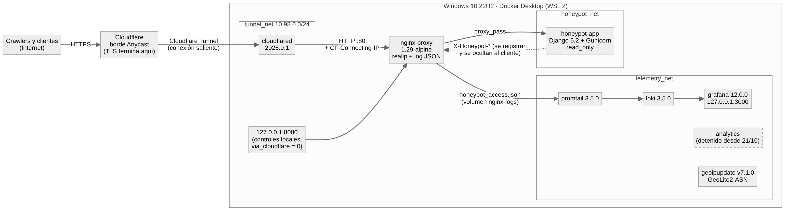

# Honeypots web para medir el cumplimiento de `robots.txt` (RFC 9309): diseño con tokens HMAC sin estado y estudio de caso en un dominio señuelo

**Joel Jesús Marcori, Julio César Pintos, Giovanni Oscar Piazza**  
Facultad de Ciencias Exactas, Naturales y Agrimensura (FaCENA), Universidad Nacional del Nordeste (UNNE). Corrientes, Argentina.  
Cátedra de Internetworking, 2026. Contacto: {joelmarcori1, juliopintoscesar, gpiazza1804}@gmail.com  
Repositorio: <https://github.com/Gio-glitch04/crawler-honeypot> — Dominio experimental: `definitivamente-no-hay-trabas.com.ar`

---

## Resumen

Este trabajo analiza la técnica de *honeypot* aplicada a la auditoría empírica del Protocolo de Exclusión de Robots (`robots.txt`, RFC 9309) y la compara con alternativas como AI Labyrinth de Cloudflare. Se implementó un honeypot HTTP de capa 7 sin estado que genera un laberinto de enlaces señuelo identificados por tokens autenticados con HMAC-SHA256, sin base de datos en el servidor. Desplegado durante 11,85 días sobre Windows 10 con Docker Desktop y Cloudflare Tunnel, procesó 3.568.349 peticiones válidas. Los tres operadores declarados expuestos al laberinto (Anthropic, OpenAI y Google, 99,8 % del tráfico) registraron 0 accesos a la ruta prohibida sobre 5,36 millones de enlaces trampa, con orígenes verificados contra prefijos publicados y registros RDAP. En contraste, 6 direcciones IP que imitaban navegadores comerciales produjeron 207 violaciones: todas omitieron consultar `robots.txt` y el 79,2 % siguió enlaces ocultos por CSS. Tomando al operador como unidad de análisis ($n = 3$; cota de Clopper-Pearson al 95 % de 63,2 %), se discuten alcances, limitaciones, aspectos éticos y criterios de aplicabilidad.

**Palabras clave:** honeypot, deception, web crawlers, robots.txt, RFC 9309, HMAC, tokens sin estado, ClaudeBot, GPTBot.

---

## 1. Introducción y marco conceptual

### 1.1. Contexto, planteamiento del problema y objetivos

El Protocolo de Exclusión de Robots (`robots.txt`), estandarizado en el RFC 9309 [1], permite indicar qué recursos no deben ser rastreados por agentes automatizados. Como no incorpora autenticación ni bloqueo en las capas de red o transporte, su cumplimiento es voluntario (*advisory*). Con la expansión de los modelos de lenguaje (LLM) y de los sistemas RAG, la recolección masiva de datos transformó el tráfico web: en 2024 el tráfico automatizado superó al humano y alcanzó el 51 % del total [2], con una adopción asimétrica de directivas defensivas entre sitios [3].

Estudios recientes aportan evidencia directa. Kim *et al.* [4] evaluaron 130 bots y hallaron que el acatamiento disminuye ante directivas más restrictivas, a la vez que advirtieron sobre la suplantación del `User-Agent`; Liu *et al.* [5] examinaron la eficacia de `robots.txt` para proteger a creadores de contenido frente a crawlers de IA. De allí surge la pregunta central: **¿respetan los agentes de IA declarados las directivas de exclusión en producción, o las violaciones provienen de recolectores camuflados que omiten el protocolo?**

Los objetivos son tres: sistematizar el marco conceptual de los honeypots y posicionar el diseño frente a alternativas (§1.2, §4.3); diseñar e implementar en producción un honeypot HTTP de capa 7 sin estado para auditar el RFC 9309 (§2, §3); y evaluar empíricamente el comportamiento de los crawlers, acotando conclusiones y aspectos éticos (§3.4, §4, §5). Son de autoría propia la arquitectura, el código, el despliegue, el registro de 3,57 millones de peticiones y los análisis; el estudio no extrapola sus conclusiones a toda la web: audita a los agentes que visitaron un único dominio señuelo frente a una directiva `Disallow` benigna.

### 1.2. Fundamentos de la técnica honeypot: historia, taxonomía y *tarpits*

Un *honeypot* es un recurso informático cuyo valor reside en su uso no autorizado o ilícito [6]. Al carecer de usuarios legítimos, casi toda interacción que recibe constituye una anomalía inspeccionable.

La disciplina reconoce como hitos el rastreo pionero de intrusos de Stoll [7] y Cheswick [8]; la formalización del engaño de Cohen [9]; el Honeynet Project [10], el simulador Honeyd [11] y el *tarpit* LaBrea [12]; Project Honey Pot contra el spam [13]; plataformas como Nepenthes [14], Glastopf [15], Cowrie [16] y Canarytokens [17]; y laberintos recientes contra crawlers de IA como AI Labyrinth de Cloudflare [18]. Cabe advertir una homonimia: el Nepenthes de 2006 [14] es una plataforma de captura de malware (luego sucedida por Dionaea), mientras que el Nepenthes de 2025 [19] es un *tarpit* contra crawlers de IA sin relación con el anterior.

La técnica se clasifica según tres ejes: el **nivel de interacción** (baja, con respuestas sintéticas y riesgo mínimo, como el honeypot de este trabajo; media, con intérpretes confinados como Cowrie; alta, con sistemas reales instrumentados que exigen contención estricta); la **escala y el propósito** (honeypots aislados frente a *honeynets*, y sistemas de producción frente a sistemas de investigación); y la **forma del señuelo** (servicios de red, aplicaciones web o *honeytokens*, como URL o credenciales que alertan al ser accedidas [17]).

Medir el cumplimiento de `robots.txt` en sitios existentes enfrenta tres problemas: la contaminación por enlaces externos previos, la incapacidad de los logs estándar para registrar la visibilidad del enlace de procedencia y la saturación de bases de datos ante rastreos masivos. Un honeypot web de baja interacción, con dominio aislado y tokens criptográficos, resuelve los tres a la vez.

### 1.3. Conceptos de Internetworking y de capa de aplicación

* **Semántica y caché de `robots.txt`:** el RFC 9309 exige obtener `/robots.txt`, identificar el grupo aplicable al `User-Agent` (o al comodín `*`) y aplicar coincidencia por prefijo de ruta, prevaleciendo la regla más específica; admite conservar la política en caché hasta 24 horas [1]. Como no prescribe cómo un operador distribuido comparte la política entre sus agentes, una consulta compartida (§3.4.3) es compatible con él.
* **Árbol DOM y árbol de renderizado:** el navegador construye el DOM a partir del HTML [20] y lo combina con el CSSOM en el *render tree* antes de calcular la geometría (*layout*) y pintar. Los elementos con `display: none` se excluyen del árbol de renderizado [21]; los que tienen `opacity: 0` [22] o están desplazados fuera de pantalla con `position: absolute; left: -10000px` [23] se renderizan pero no se ven. **Todos permanecen en el DOM y en el HTML crudo.** Un recolector que extraiga enlaces sin evaluar su visibilidad (por ejemplo, con `checkVisibility()` [24]) seguirá los invisibles.
* **Túneles reversos y dirección de origen:** con Cloudflare Tunnel, la conexión TCP/TLS del cliente termina en el nodo Anycast más cercano y el tráfico llega al anfitrión por una conexión saliente, sin puertos abiertos. Nginx observa como origen la red del túnel, por lo que la IP pública debe recuperarse de una cabecera de forma segura (§2.2).
* **Atribución en capa de red:** el `User-Agent` es texto libre y fácilmente falseable. Verificar la identidad exige distinguir dos planos: el **plano de enrutamiento** (qué Sistema Autónomo anuncia el prefijo vía BGP) y el **plano administrativo** (a quién asignó el bloque el registro regional, consultable por RDAP/WHOIS). A ello se suman las listas de prefijos publicadas por cada operador y la verificación por DNS inverso confirmado hacia adelante (FCrDNS: consulta `PTR` de la IP y luego `A`/`AAAA` del nombre obtenido), método recomendado por Google [25].

---

## 2. Arquitectura y funcionamiento

### 2.1. Componentes desplegados y topología de red

El despliegue se ejecutó sobre Windows 10 (22H2) con Docker Desktop (WSL 2), combinando `docker-compose.yml`, `docker-compose.home.yml` y el perfil `maxmind`. Como ilustra la **Figura 1**, los servicios se segmentan en tres redes virtuales tipo *bridge* (`tunnel_net` en `10.98.0.0/24`, `honeypot_net` y `telemetry_net`), sin puertos expuestos en el enrutador.


*Figura 1. Topología de red y servicios desplegados. El contenedor `analytics` figura detenido desde el 21/10 (§3.3). Fuente del diagrama: `graficos/topologia.mmd`.*

Los servicios cumplen los siguientes roles:
1. **`cloudflared` (2025.9.1):** establece túneles salientes autenticados hacia Cloudflare y reenvía el tráfico a `nginx-proxy:80`.
2. **`nginx-proxy` (`nginx:1.29-alpine`):** puente entre `tunnel_net` y `honeypot_net`; recupera la IP real (§2.2), registra en JSON las cabeceras internas de Django y las suprime hacia el cliente. Publica además `127.0.0.1:8080` en el anfitrión para controles locales, que no atraviesan el túnel y quedan marcados con `via_cloudflare = 0` (§3.3). Al combinar los archivos Compose queda unido también a una red heredada sin servicios activos (`iagrocorr_net`).
3. **`honeypot-app` (Django 5.2 con Gunicorn):** genera el laberinto y valida los tokens, sin privilegios y con sistema de archivos de solo lectura.
4. **Observabilidad (`telemetry_net`):** `promtail` 3.5.0 envía el log a `loki` 3.5.0, visualizado con `grafana` 12.0.0 en `127.0.0.1:3000`; `geoipupdate` mantiene la base `GeoLite2-ASN`. Un contenedor efímero (`home-certs`) genera certificados autofirmados antes del arranque.

### 2.2. Aislamiento y recuperación de la dirección IP real

Para impedir la inyección arbitraria de `CF-Connecting-IP`, Nginx confía en esa cabecera solo cuando la conexión proviene de la subred del túnel [26], y marca el origen con el módulo `geo` [27]:

```nginx
include /etc/nginx/snippets/cloudflare_realip.conf;  # set_real_ip_from 10.98.0.0/24;
real_ip_header CF-Connecting-IP;
geo $realip_remote_addr $via_cloudflare {
    default 0;
    include /etc/nginx/snippets/cloudflare_geo.conf;  # 1 si proviene del túnel
}
proxy_hide_header X-Honeypot-Route;      # ídem Technique, Token-Issued y Depth
```

Si una petición no procede del túnel, `$via_cloudflare` vale `0` y Nginx ignora cualquier `CF-Connecting-IP` inyectada. Las cabeceras `X-Honeypot-*` se registran de forma estructurada por petición en el log JSON y se ocultan al cliente.

### 2.3. Construcción del token sin estado (HMAC-SHA256)

Cada enlace emitido hacia `/public/<token>` o `/archivo-interno/<token>` lleva un identificador de 52 caracteres hexadecimales (208 bits), formado por la **concatenación directa, sin separadores**, de cuatro campos:

$$\text{token} = \underbrace{\text{uid}}_{32\text{ hex (UUID4)}} \;\Vert\; \underbrace{\text{ts}}_{8\text{ hex}} \;\Vert\; \underbrace{d}_{2\text{ hex}} \;\Vert\; \underbrace{\sigma}_{10\text{ hex (40 b)}}$$

donde $\text{ts}$ es el instante de emisión $t_\text{emisión}$ (época Unix) y $d$ es la profundidad del token. La firma, en cambio, se calcula sobre una cadena ASCII que **sí usa el carácter `|` (0x7C) como delimitador** e incluye la técnica de ocultamiento, y se trunca a sus primeros 10 caracteres hexadecimales [28]:

$$\sigma = \operatorname{trunc}_{10\,\text{hex}}\Big(\text{HMAC-SHA256}_K\big(\texttt{"uid|ts|d|técnica"}\big)\Big)$$

En `honeypot/trap/tokens.py` esto se implementa como `hmac.new(K, f"{uid}|{ts_hex}|{depth_hex}|{technique}".encode(), hashlib.sha256).hexdigest()[:10]`. La técnica no viaja explícita en la URL: `decode()` prueba la firma contra las seis técnicas posibles con `hmac.compare_digest()` y recupera técnica, profundidad e instante de emisión sin acceder a disco. La probabilidad de que un identificador arbitrario valide por azar es $6/2^{40} \approx 5{,}46 \times 10^{-12}$. El RFC 2104 recomienda no truncar por debajo de 80 bits [28]; aquí se aceptaron 40 bits porque el token no protege secretos sino que etiqueta enlaces propios, y forjarlo requeriría del orden de $10^{11}$ peticiones en línea, inviable con el tráfico observado (§4.5).

Como el token transporta su instante de emisión, se define la **edad del token** como $\Delta t = t_\text{solicitud} - t_\text{emisión}$, métrica que permite observar las colas de frontera de los crawlers (§3.4.2).

### 2.4. Laberinto dinámico, técnicas de ocultamiento y taxonomía de violaciones

Se distinguen dos magnitudes. La **profundidad del token** $d \in \{1, \dots, 10\}$ es el valor codificado en cada enlace; el **nivel de página** $L$ es la posición de la página servida, con $L = 1$ para la portada `/` y $L = d + 1 \in \{2, \dots, 11\}$ para una página alcanzada mediante un token de profundidad $d$. Toda página con $L \le 10$ inserta 10 hiperenlaces:
- **5 enlaces públicos** hacia `/public/<token>`.
- **5 enlaces trampa** hacia `/archivo-interno/<token>`, en orden aleatorio (`random.shuffle`), uno por variante:
  1. `visible`: enlace en claro dentro de un párrafo (control no oculto).
  2. `display_none_inline`: dentro de `<div style="display:none">`.
  3. `display_none_class`: dentro de un `<div>` con clase aleatoria definida como `{display:none}`.
  4. `opacity_0`: dentro de un `<div>` con clase aleatoria definida únicamente como `{opacity:0}`.
  5. `offscreen`: dentro de un `<div>` con clase aleatoria definida como `{position:absolute; left:-10000px; top:auto; width:1px; height:1px; overflow:hidden}`.

Los nombres de clase se regeneran en cada petición como una letra aleatoria seguida de `secrets.token_hex(4)` (9 caracteres, porque un selector de clase no puede comenzar con un dígito), lo que impide filtrar las trampas por nombre de clase sin interpretar el CSS. La variante `opacity_0` conserva su caja en el flujo: es invisible, pero puede pulsarse con el ratón. Las páginas con $L = 11$ se sirven sin enlaces, lo que acota la exploración.

El `/robots.txt` servido (`User-agent: *` / `Disallow: /archivo-interno/`) es la directiva más benigna posible: restringe un único prefijo señuelo y habilita el resto del árbol.

**Taxonomía de violaciones.** Los niveles no son mutuamente excluyentes: los Niveles 1 y 2 miden la dimensión *protocolar* (si el actor consultó o no `robots.txt`, y son excluyentes entre sí), mientras que el Nivel 3 mide una dimensión ortogonal, la *extracción del DOM sin evaluar el CSS*, y se acumula con cualquiera de los anteriores.
- **Nivel 1 (violación directa):** descarga `/robots.txt` y luego accede a `/archivo-interno/*`.
- **Nivel 2 (violación por omisión):** accede a `/archivo-interno/*` sin haber consultado `/robots.txt`.
- **Nivel 3 (extracción sin renderizado):** accede a la trampa mediante una variante oculta (`display_none_inline`, `display_none_class`, `opacity_0` u `offscreen`).

---

## 3. Caso práctico

### 3.1. Simulación local, despliegue en producción y siembra

**Simulación local.** Antes del despliegue, el sistema se validó en `127.0.0.1` con `docker-compose.local.yml` y el arnés `local/simulate.py`: los GPTBot y Bytespider simulados cayeron en la trampa (Niveles 1 y 2, acumulados con Nivel 3), mientras que los Googlebot y ClaudeBot simulados respetaron las rutas públicas, sin fugas de cabeceras `X-Honeypot-*`.

**Puesta en producción.** Superada la simulación, el mismo conjunto de servicios se levantó en el anfitrión con Docker Compose y la salud del túnel se confirmó en los logs de `cloudflared`. El dominio experimental, `definitivamente-no-hay-trabas.com.ar`, es un dominio `.com.ar` registrado *ad hoc*, de denominación arbitraria y sin historial DNS ni enlaces entrantes previos, condición necesaria para atribuir todo el tráfico al experimento.

**Parámetros de borde en Cloudflare.** Se desactivaron *Block AI Bots*, *AI Crawl Control*, *Managed robots.txt*, *AI Labyrinth*, *Bot Fight Mode* y la optimización de HTML, con *Bypass Cache* para todo el tráfico. El WAF bloqueó 53 escáneres de *exploits* que no figuran en el log.

**Siembra de URL y descubrimiento.** El 18/10/2026 se generaron URL semilla atribuibles por canal con `manage.py seed_urls` y se publicaron en GitHub y Hacker News. En la ventana observada, **los tokens de semilla registraron 0 accesos directos**: ningún crawler ingresó siguiendo esos enlaces específicos. El rastreo comenzó por el descubrimiento de la raíz `/` y de `/robots.txt`, compatible con la publicación del certificado TLS en los registros de *Certificate Transparency* y con la indexación inicial del dominio; solo se registraron 1 petición con `Referer` de Hacker News y 51 con `Referer` de Google, ninguna con token de semilla. Las notas de trabajo intermedias que indicaban la siembra como «pendiente» quedan superadas por esta descripción.

**Ventana experimental.** Del 18/10/2026 21:31:02 UTC al 30/10/2026 17:57:05 UTC (11 d 20 h 26 min), con 3.568.406 líneas JSON de log (3,45 GB). Los enlaces trampa, `robots.txt` y la supresión de cabeceras internas se verificaron periódicamente con `curl.exe`.

### 3.2. Evidencia: registros crudos y panel de Grafana

La traza de Nginx siguiente muestra la interacción del origen infractor `154.28.229.0/24` el 21/10/2026. Tras una segunda descarga de la portada a las 03:51:32.371 UTC, transcurren apenas 221 ms hasta que solicita enlaces públicos y trampas intercalados, a razón de unas 5 peticiones por segundo y sin haber consultado `/robots.txt`:

```text
03:51:32.371  GET /                     route=home
03:51:32.592  GET /public/1f79...       route=public  d=1
03:51:32.977  GET /archivo-interno/...  route=trap    technique=visible    d=1
03:51:33.634  GET /archivo-interno/...  route=trap    technique=offscreen  d=1
03:51:34.581  GET /archivo-interno/...  route=trap    technique=opacity_0  d=1
03:51:34.947  GET /public/...           route=public  d=2
```

La latencia del origen tuvo una mediana de 2 ms y un percentil 99 de 3 a 4 ms. La **Figura 2** muestra el panel de Grafana, alimentado por consultas LogQL a Loki [29], en un corte intermedio (2,95 millones de peticiones): los 213 accesos brutos a la ruta trampa, menos los 6 de prueba del equipo sobre `opacity_0` (§3.3), dan exactamente los 207 accesos netos. El panel rotula la ruta como `/trap/` por su etiqueta interna `route="trap"`, que corresponde a `/archivo-interno/`.


*Figura 2. Panel de Grafana en producción en un corte intermedio (2,95 M de peticiones): perfil temporal de rastreo y accesos brutos a la ruta trampa.*

### 3.3. Depuración del conjunto de datos y lecciones operativas

Se removieron 57 peticiones atribuibles a verificaciones del propio equipo:
- `honeypot-selftest/1.0`: 15 peticiones de validación funcional.
- Subred `45.191.81.0/24` (Argentina): 8 accesos manuales con Opera.
- Subred `186.124.199.0/24` (Argentina): 24 peticiones con `curl -A` y `User-Agent` de bots simulados.
- Subred `181.4.69.0/24` (Argentina, 20/10 23:22 UTC): 8 peticiones con Chrome, incluidos `/favicon.ico` y 6 clics sobre enlaces `opacity_0` (posibles sin herramientas de desarrollo, §2.4), identificadas como prueba interna de las trampas.
- Peticiones locales por `127.0.0.1:8080` (`via_cloudflare = 0`): 2 controles de salud.

El conjunto depurado final comprende **3.568.349 peticiones válidas**.

Durante la operación surgieron tres incidencias. El contenedor `analytics` dejó de funcionar el 21/10 al crecer el volumen (GPTBot alcanzó 132.805 peticiones diarias el 21/10 y ClaudeBot 887.244 el 24/10), por lo que el cómputo final se realizó con lectura en *streaming* sobre el log exportado. Una interrupción del anfitrión el 27/10 (03:03–12:00 UTC) dejó un vacío de 8 h 57 min, con unas 64.000 peticiones de GPTBot estimadas como no registradas. Finalmente, el log creció ~291 MB diarios hasta 3,45 GB, lo que exige rotación y compresión en despliegues más largos.

### 3.4. Resultados empíricos

#### 3.4.1. Distribución general del tráfico

El tráfico se compuso de 3.560.629 visitas a `/public/` (99,78 %), 6.203 respuestas `404 Not Found` (0,17 %), 776 solicitudes a la raíz `/`, 529 descargas de `/robots.txt`, 207 accesos a `/archivo-interno/` y 5 errores de cliente (4 HTTP 413 y 1 HTTP 400):
$$3.560.629 + 6.203 + 776 + 529 + 207 + 5 = \mathbf{3.568.349}$$

La **Tabla 1** resume la actividad por familia de agente y la **Figura 3** su evolución diaria; la serie completa se detalla en el Anexo A.

**Tabla 1. Actividad por familia de agente.**

| Familia | Categoría | Peticiones | % total | Subredes `/24` | Datos (GB) | `robots.txt` | Accesos a trampa |
|---|---|---:|---:|---:|---:|---:|---:|
| **ClaudeBot** (Anthropic) | IA | 1.989.866 | 55,77 % | 4 | 6,11 | 155 | **0** |
| **GPTBot** (OpenAI) | IA | 1.558.875 | 43,69 % | 4 | 4,72 | 0 * | **0** |
| **GoogleOther** (Google) | I+D / IA [30] | 10.702 | 0,30 % | 5 | 0,04 | 0 * | **0** |
| **Navegadores** (sin marca de bot) | Sin identificar | 7.036 | 0,20 % | Múltiples | 0,004 | 12 | **207** |
| **Googlebot** (Google) | Buscador | 1.532 | 0,04 % | 4 | 0,003 | 297 | **0** |
| **OAI-SearchBot** (OpenAI) | IA / búsqueda | 49 | <0,01 % | 3 | <0,001 | 49 | **0** |
| **Applebot** (Apple) | Buscador | 2 | <0,01 % | 1 | <0,001 | 2 | **0** |
| **Herramientas, escáneres y otros** | Varios | 287 | <0,01 % | Múltiples | <0,001 | 14 | **0** |
| **TOTAL** | — | **3.568.349** | **100,00 %** | — | **~10,9** | **529** | **207** |

*\* Sin consultas propias; compatible con consulta centralizada (§3.4.3). La familia se asignó por `User-Agent` con el clasificador `bots.py`. La columna `/24` difiere de la Tabla 2 porque esta consolida por operador y agrupa dos `/24` de Google Cloud bajo `34.162.0.0/16`.*


*Figura 3. Volumen diario de peticiones por familia (UTC): pico de ráfagas de ClaudeBot y cadencia regulada cuasi constante de GPTBot.*

#### 3.4.2. Dinámicas de rastreo de ClaudeBot y GPTBot

ClaudeBot (Anthropic) consumió el laberinto **por lotes**: la mediana de la edad del token ($\Delta t$, §2.3) fue de 5,0 h, con un piso de ~1 h y sin `Referer`, lo que indica que los enlaces descubiertos esperan en una cola de frontera. Alcanzó ráfagas de 38.787 peticiones por hora (~10,8 por segundo) el 24/10 y cesó a partir del 25/10.

GPTBot (OpenAI), en cambio, consumió **en flujo continuo**: la mediana de $\Delta t$ fue de 8,9 s y el 100 % de sus peticiones incluyó `Referer`. Su tasa horaria fue cuasi constante (mediana de 7.184 por hora, ~2,0 por segundo, coeficiente de variación 0,068), compatible con un limitador de tipo *token bucket*.

Ambos agotaron la profundidad del laberinto: entre el 68 % y el 72 % de sus peticiones correspondieron a páginas hoja ($L = 11$), como muestran la **Figura 4** y el Anexo C. La ramificación efectiva ($b \approx 3{,}2$ y $3{,}6$, frente a 5 teórico) refleja enlaces que quedaron sin visitar en las colas.


*Figura 4. Peticiones por nivel de página $L$ en escala logarítmica frente a la ramificación teórica.*

#### 3.4.3. Consulta centralizada de `robots.txt` y verificación de rangos IP

Aunque GPTBot y GoogleOther nunca pidieron `robots.txt` con su propio nombre, la evidencia temporal y de red es compatible con una consulta centralizada por operador. En OpenAI [31], `OAI-SearchBot` descargó `/robots.txt` el 21/10 a las 05:30:30.494 UTC y, apenas 749 ms después, GPTBot inició su rastreo desde la misma red; en adelante `OAI-SearchBot` refrescó la directiva aproximadamente cada 360 minutos (49 descargas) sin solicitar HTML. En Google, Googlebot realizó 297 consultas a `/robots.txt` y GoogleOther comparte con él sus IP principales en `66.249.73.0/24`, coherente con una infraestructura común.

Las subredes de origen se contrastaron con las listas oficiales de prefijos de Google [30] y OpenAI [32], [33], y con el registro RDAP de ARIN para Anthropic [34], [35], mediante `scripts/verificar_rangos_ip.py`. La **Tabla 2** resume el resultado.

**Tabla 2. Subredes observadas y cobertura verificada por operador** (generada con `scripts/generar_tablas.py` a partir de `data/verificacion_rangos.csv`).

| Operador | Subredes observadas (peticiones) | AS de origen (BGP) | Fuente de verificación | Verificadas / total | Cobertura |
|---|---|---|---|---:|---:|
| **Anthropic** | `216.73.217.0/24` (1.590.538); `216.73.216.0/24` (399.324); `34.162.0.0/16` (4) | AS16509 (Amazon AWS); AS396982 (Google Cloud) | Bloque ARIN `NET-216-73-216-0-1` (`216.73.216.0/22`) | 1.989.862 / 1.989.866 | **99,9998 %** |
| **OpenAI** | `74.7.242.0/24` (1.557.329); otros 6 `/24` (1.595) | AS8075 (Microsoft Azure) | `gptbot.json` y `searchbot.json` | 1.558.924 / 1.558.924 | **100,00 %** |
| **Google** | `66.249.73.0/24` (12.119); `192.178.6.0/24` (94); otros `/24` de `66.249.x` (21) | AS15169 (Google) | Listas JSON de crawlers de Google | 12.213 / 12.234 | **99,83 %** |

*Notas.* (i) Anthropic no publica lista de prefijos: la verificación descansa en el plano administrativo (ARIN registra `216.73.216.0/22` a nombre de Anthropic), aunque en el plano de enrutamiento el bloque se anuncia desde AS16509, de Amazon AWS. Las 4 peticiones con `User-Agent` de ClaudeBot desde `34.162.0.0/16` (Google Cloud) **no están verificadas** y son probablemente suplantaciones. Análogamente, AS8075 es Microsoft Azure, donde opera OpenAI. (ii) Para OpenAI y Google, un `/24` se dio por verificado si contiene un prefijo publicado más específico (`/25`, `/27`); una IP de la porción no publicada de ese `/24` se contaría como válida, límite declarado en §4.5. (iii) Las 21 peticiones de Google sin desglose se computan como no verificadas. (iv) No se aplicó FCrDNS [25].

#### 3.4.4. Evaluación estadística y análisis de las violaciones

Como acatar `robots.txt` es una política de cada organización y no un evento independiente por enlace, la unidad de análisis es el **operador expuesto**, definido como aquel cuyos agentes recibieron al menos una página con enlaces trampa. Así $n = 3$ (Anthropic, OpenAI y Google); Apple queda excluida porque Applebot solo descargó `/robots.txt` y ninguna página HTML. La **Tabla 3** resume la exposición de cada operador.

**Tabla 3. Cumplimiento de la exclusión por operador expuesto.**

| Operador | Crawlers activos | Páginas con enlaces | Enlaces trampa expuestos | Trampas seguidas | Tasa observada |
|---|---|---:|---:|---:|---:|
| **Anthropic** | ClaudeBot | 628.124 | 3.140.620 | 0 | 0,00 % |
| **OpenAI** | GPTBot, OAI-SearchBot | 436.250 | 2.181.250 | 0 | 0,00 % |
| **Google** | GoogleOther, Googlebot | 8.690 | 43.450 | 0 | 0,00 % |
| **TOTAL** | — | **1.073.064** | **5.365.320** | **0** | **0,00 %** |

Los tres operadores expuestos acataron plenamente la directiva en el sitio señuelo. Con $n = 3$ y $k = 0$, la cota superior unilateral exacta de Clopper-Pearson al 95 % para la proporción de operadores infractores es $1 - 0{,}05^{1/3} \approx 63{,}2\,\%$ (70,8 % bilateral) [36]. Calculadas de forma descriptiva sobre los enlaces expuestos, las cotas individuales son $9{,}54 \times 10^{-7}$ para ClaudeBot y $1{,}37 \times 10^{-6}$ para GPTBot (Anexo D).

La evidencia más limpia es la variante `visible`, libre del factor de confusión de las ocultas (un bot podría descartarlas por no verlas, no por `robots.txt`): se expuso 1.073.064 veces sin ningún acceso, mientras los mismos agentes seguían masivamente los enlaces visibles hacia `/public/`.

En contraste, **6 direcciones IP** con cabeceras de navegadores comerciales originaron **207 accesos a la ruta prohibida**; la **Tabla 4** sintetiza su perfil y el Anexo B lo detalla.

**Tabla 4. Perfil de los 6 orígenes que accedieron a `/archivo-interno/`.**

| Actor | Subred IP (/24) | Peticiones | Accesos a trampa | Perfil observado |
| :--- | :--- | ---: | ---: | :--- |
| **A1** | `154.28.229.0/24` | 90 | **43** | `Chrome/131` Linux, `en-US`; barrido rápido hasta nivel 2 |
| **A2** | `103.196.9.0/24` | 111 | **53** | `Chrome/130–131` Linux, `en-US`; mismo perfil y cadencia que A1 |
| **C** | `158.69.55.0/24` | 200 | **98** | `Chrome/124` Windows 10, sin idioma; 2 sesiones de exactamente 100 peticiones |
| **B1** | `93.123.109.0/24` | 334 | **4** | `Chrome/150` Windows 10, `fr-FR`; sondeos `.git` (315 respuestas 404) |
| **B2** | `45.138.12.0/24` | 297 | **4** | `Chrome/150` Windows 10, `fr-FR`; mismo diccionario y cabeceras que B1 |
| **D** | `45.138.12.0/24` | 14 | **5** | `Chrome/133` Linux/Windows; visitas aisladas a lo largo de 7 días |

*B2 y D comparten la misma subred `/24` pero corresponden a direcciones y perfiles temporales distintos.*

Ninguno de estos actores solicitó `/robots.txt`, por lo que el 100 % de los accesos es de Nivel 2. En cuanto a la variante, 43 accesos ingresaron por `visible` y 164 por modalidades ocultas, de modo que **164 de 207 accesos (79,2 %) son además de Nivel 3**. La distribución por técnica, que muestra la **Figura 5** (43 `visible`, 43 `display_none_inline`, 42 `offscreen`, 40 `display_none_class` y 39 `opacity_0`), arroja una bondad de ajuste a la uniforme de $\chi^2 = 0{,}3188$ (gl = 4, $p = 0{,}9886$). Como las 207 observaciones provienen de 6 IP y no son independientes, el ajuste solo se interpreta como consistente con un extractor que recoge todos los `href` sin renderizar.


*Figura 5. Accesos a la ruta prohibida por variante frente a la frecuencia uniforme esperada.*

El grupo B combinó sondeos de repositorios Git (`/.git/config`) y de *endpoints* RSC (`/_next/rsc`) con la recolección de enlaces de portada. Ningún perfil anunciaba una versión vigente del navegador: Chrome 150 llegó al canal estable el 30/06/2026, y durante la ventana las versiones estables fueron Chrome 155 (06/10/2026) y 156 (20/10/2026) [37]. `Chrome/150` estaba, por lo tanto, desactualizado unos cuatro meses, y los perfiles A, C y D (`Chrome/124–133`) aún más, lo que es típico de scripts con cabeceras fijas. Además, **ninguno de los 6 orígenes solicitó `/favicon.ico`**, recurso que un navegador real pide al cargar una portada; la prueba del equipo con Chrome real (§3.3) sí lo solicitó. Como GPTBot también lo pidió una vez, la omisión es un indicio complementario y no una prueba. Nada vincula a estos actores con desarrolladores de LLM: se trata de escáneres y extractores no cooperativos.

---

## 4. Análisis crítico

### 4.1. Ventajas y limitaciones de la técnica

La técnica ofrece una alta relación señal/ruido, porque toda interacción con la ruta prohibida es anómala [6]; escala sin estado, ya que procesó 3,57 millones de peticiones con latencia mediana de 2 ms sin base de datos; y permite observar el protocolo en acción (refresco de `robots.txt`, procesamiento por lotes, colas de frontera). Entre sus limitaciones, un navegador *headless* que evalúe el *layout* puede descartar las trampas ocultas; el alcance es pasivo, restringido a quienes visitan el señuelo; y el laberinto puede agotar la cuota de rastreo que cada crawler asigna al dominio.

### 4.2. Casos documentados en la industria

Entre los casos documentados se cuentan Project Honey Pot, que identifica recolectores de correo con páginas trampa y publica listas DNS [13]; la investigación de Cloudflare de 2025 que, con dominios señuelo, mostró que Perplexity eludía `robots.txt` con agentes no declarados [38]; AI Labyrinth, que desperdicia los recursos de crawlers infractores con contenido generado en el borde [18], [39]; la plataforma de honeypots T-Pot de Deutsche Telekom Security [40]; y los *honeytokens* de Canarytokens [17].

### 4.3. Comparación con herramientas afines

La **Tabla 5** compara el enfoque propuesto con las alternativas más cercanas.

**Tabla 5. Comparativa de alternativas frente a la auditoría de crawlers.**

| Enfoque | Objetivo primordial | Telemetría / atribución | Ventaja distintiva | Limitación metodológica |
|---|---|---|---|---|
| **Honeypot L7 propuesto** | **Auditar** el cumplimiento | Nivel, profundidad, edad del token, técnica CSS | Sin estado, reproducible | No detecta *headless* con *layout* |
| **AI Labyrinth** [18], [39] | **Disuadir** con texto generado | Eventos agregados en consola | Nativo en la CDN | Propietario; depende de clasificación previa |
| **Nepenthes** (*tarpit* IA) [19] | **Agotar** crawlers | Solicitudes en el laberinto | Respuestas lentas y polución de datos | Contramedida, no auditoría |
| **LaBrea** [12] | Retener gusanos en capa 4 | Conexiones TCP retenidas | Consumo mínimo | Ajeno a HTTP y `robots.txt` |
| **Canarytokens** [17] | Detectar filtraciones | Alerta por acceso | Sin falsos positivos | No mide dinámicas |
| **Desafíos activos en cliente / PoW** (Turnstile [41], Anubis [42]) | **Prevenir** el *scraping* | Desafíos resueltos en cliente | Encarece la recolección | Bloquea; no mide cumplimiento |

*Turnstile combina atestación del navegador y heurísticas no interactivas (la prueba de trabajo es una señal menor); Anubis es una prueba de trabajo SHA-256 pura.*

### 4.4. Relación con la literatura previa

Kim *et al.* [4] evaluaron 130 bots durante 40 días y concluyeron que el cumplimiento disminuye ante directivas más restrictivas; la ausencia de violaciones de los tres operadores observados coincide con su hallazgo de que los grandes proveedores respetan las directivas benignas. Liu *et al.* [5] observaron que los principales agentes de IA respetan las exclusiones explícitas, resultado que este estudio corrobora de forma independiente para ClaudeBot y GPTBot. Bytespider, señalado como poco cooperativo en [4], [5], no generó tráfico en producción.

### 4.5. Amenazas a la validez

- **Directiva única y benigna:** la regla ensayada fue la más permisiva posible; la literatura muestra mayor desobediencia al restringir la raíz (`Disallow: /`) [4].
- **Sitio único y ventana de 12 días:** un dominio nuevo atrae, pese a la siembra, una población sesgada hacia los grandes operadores; Bytespider, CCBot o PerplexityBot no pudieron caracterizarse.
- **No independencia de observaciones:** los 207 accesos trampa provienen de 6 IP; contar cada acceso como independiente sería pseudorreplicación.
- **Verificación sobre agregados `/24`:** la cobertura de la Tabla 2 se calculó por solapamiento entre `/24` y prefijos publicados más específicos, sin FCrDNS.
- **Truncamiento HMAC a 40 bits:** inferior a los 80 bits recomendados [28], compensado por la inviabilidad práctica de forjar tokens en línea.

### 4.6. Consideraciones éticas, privacidad y reproducibilidad

En cumplimiento de la Ley 25.326 [43], todas las direcciones IP publicadas en este informe se anonimizan a nivel `/24`. No se recolectaron cookies, credenciales ni datos personales, y los registros originales se conservan cifrados con fines académicos. El laberinto no aplicó envenenamiento de datos (*data poisoning*) y limitó la profundidad a $L \le 11$ para contener el consumo de recursos de los operadores. El repositorio incluye el código, los archivos Docker Compose, los CSV canónicos en `data/` y los scripts de análisis (`generar_tablas.py`, `verificar_rangos_ip.py`, `estadisticas_y_graficos.py`); el procesamiento final se hizo con lectura en *streaming* sobre el log exportado.

---

## 5. Conclusiones y trabajos futuros

### 5.1. Cuándo conviene implementar esta tecnología

Esta tecnología conviene en investigación y auditoría, cuando se necesita discriminar el tráfico cooperativo de los recolectores camuflados; como sonda interna que alimente listas de bloqueo en infraestructuras con contenido sensible; y para medir la cadencia, el ancho de banda y las colas de los crawlers masivos. No conviene como sustituto de defensas perimetrales activas, porque documenta pero no bloquea; tampoco sin aislamiento de dominio ni límite de profundidad, que evitan una autodenegación de servicio; ni frente a recolectores *headless* que evalúan el *layout*.

### 5.2. Conclusiones del estudio

1. ClaudeBot, GPTBot/OAI-SearchBot y Googlebot/GoogleOther respetaron la directiva en el 100 % de los casos, con orígenes verificados.
2. Las 207 violaciones provinieron de 6 actores camuflados tras cabeceras de navegadores comerciales: todas de Nivel 2 y el 79,2 % además de Nivel 3.
3. Con $n = 3$ operadores (cota de Clopper-Pearson al 95 % de 63,2 %), el resultado no se generaliza a toda la web ni a directivas restrictivas; y el protocolo no protege frente a recolectores no declarados.
4. El diseño sin estado absorbió 3,57 millones de peticiones con latencia mediana de 2 ms y sin base de datos.

### 5.3. Trabajos futuros

1. **Políticas restrictivas:** evaluar `Disallow: /` y reglas diferenciadas por `User-Agent` [4].
2. **Ampliación de la siembra:** extender la difusión a otros canales (Hugging Face, Reddit) para medir latencias de descubrimiento y atraer bots ausentes (Bytespider, CCBot, PerplexityBot).
3. **Huellas por capa, independientes del `User-Agent`:** combinar (a) huella pasiva de capa 4 sobre el segmento TCP `SYN` (ventana, MSS, orden de opciones; `p0f` o JA4T); (b) huella del `ClientHello` TLS (JA4), obtenida en el borde de Cloudflare (`cf.bot_management.ja4` mediante *Transform Rules*) o en un VPS, porque terminar TLS en el anfitrión exigiría abrir el puerto 443 y anularía el aislamiento del túnel; y (c) cabeceras HTTP de capa 7 (`Sec-CH-UA`, `Sec-Fetch-*`) para detectar incoherencias con el `User-Agent` declarado.
4. **Trampas DOM avanzadas:** incorporar trampas en comentarios HTML, inyecciones JavaScript y *sitemaps* XML.

---

## 6. Referencias

[1] M. Koster, G. Illyes, H. Zeller y L. Sassman, "Robots Exclusion Protocol," IETF, RFC 9309, sep. 2022, doi: 10.17487/RFC9309.

[2] Imperva, "2025 Imperva Bad Bot Report: The rapid rise of bots and the unseen risk for business," Thales Group, 2025. [En línea]. Disponible en: https://www.imperva.com/resources/resource-library/reports/2025-bad-bot-report/ [Consultado: 1 nov. 2026].

[3] N. Steinacker-Olsztyn, D. Gosain y H. Dao, "Is misinformation more open? A study of robots.txt gatekeeping on the web," 2025, *arXiv*:2510.10315, doi: 10.48550/arXiv.2510.10315.

[4] T. Kim, K. Bock, C. Luo, A. Liswood, C. Poroslay y E. Wenger, "Scrapers selectively respect robots.txt directives: Evidence from a large-scale empirical study," en *Proc. ACM Internet Meas. Conf. (IMC '25)*, Madison, WI, EE. UU., 2025, doi: 10.1145/3730567.3764471.

[5] E. Liu, E. Luo, S. Shan, G. M. Voelker, B. Y. Zhao y S. Savage, "Somesite I used to crawl: Awareness, agency and efficacy in protecting content creators from AI crawlers," en *Proc. ACM Internet Meas. Conf. (IMC '25)*, Madison, WI, EE. UU., 2025, pp. 78–99, doi: 10.1145/3730567.3732913.

[6] L. Spitzner, *Honeypots: Tracking Hackers*. Boston, MA, EE. UU.: Addison-Wesley, 2002.

[7] C. Stoll, *The Cuckoo's Egg: Tracking a Spy Through the Maze of Computer Espionage*. Nueva York, NY, EE. UU.: Doubleday, 1989.

[8] B. Cheswick, "An evening with Berferd in which a cracker is lured, endured, and studied," en *Proc. Winter USENIX Conf.*, San Francisco, CA, EE. UU., 1992.

[9] F. Cohen, "A note on the role of deception in information protection," *Comput. Secur.*, vol. 17, no. 6, pp. 483–506, 1998.

[10] The Honeynet Project, *Know Your Enemy: Learning About Security Threats*, 2.ª ed. Boston, MA, EE. UU.: Addison-Wesley, 2004.

[11] N. Provos, "A virtual honeypot framework," en *Proc. 13th USENIX Secur. Symp.*, San Diego, CA, EE. UU., 2004.

[12] T. Liston, "LaBrea: 'Sticky' honeypot and IDS," 2001. [En línea]. Disponible en: https://labrea.sourceforge.io/ [Consultado: 1 nov. 2026].

[13] Unspam Technologies, "Project Honey Pot." [En línea]. Disponible en: https://www.projecthoneypot.org/ [Consultado: 1 nov. 2026].

[14] P. Baecher, M. Koetter, T. Holz, M. Dornseif y F. Freiling, "The Nepenthes platform: An efficient approach to collect malware," en *Recent Advances in Intrusion Detection (RAID 2006)*, LNCS, vol. 4219. Berlín, Alemania: Springer, 2006, pp. 165–184, doi: 10.1007/11856214_9.

[15] L. Rist, S. Vetsch, M. Kossin y M. Mauer, "Know your tools: Glastopf – A dynamic, low-interaction web application honeypot," The Honeynet Project, nov. 2010. [En línea]. Disponible en: https://www.honeynet.org/ [Consultado: 1 nov. 2026].

[16] M. Oosterhof, "Cowrie SSH/Telnet honeypot," repositorio GitHub. [En línea]. Disponible en: https://github.com/cowrie/cowrie [Consultado: 1 nov. 2026].

[17] Thinkst Applied Research, "Canarytokens." [En línea]. Disponible en: https://docs.canarytokens.org/ [Consultado: 1 nov. 2026].

[18] R. Tatoris, H. Saxena y L. Miglietti, "Trapping misbehaving bots in an AI Labyrinth," *The Cloudflare Blog*, 19 mar. 2025. [En línea]. Disponible en: https://blog.cloudflare.com/ai-labyrinth/ [Consultado: 1 nov. 2026].

[19] Aaron B., "Nepenthes," ZADZMO, 2025. [En línea]. Disponible en: https://zadzmo.org/code/nepenthes/ [Consultado: 1 nov. 2026].

[20] WHATWG, "HTML Living Standard." [En línea]. Disponible en: https://html.spec.whatwg.org/ [Consultado: 1 nov. 2026].

[21] W3C, "CSS Display Module Level 3," W3C Candidate Recommendation Draft, 2026. [En línea]. Disponible en: https://www.w3.org/TR/css-display-3/ [Consultado: 1 nov. 2026].

[22] W3C, "CSS Color Module Level 4," W3C Candidate Recommendation Draft. [En línea]. Disponible en: https://www.w3.org/TR/css-color-4/ [Consultado: 1 nov. 2026].

[23] W3C, "CSS Positioned Layout Module Level 3," W3C Working Draft. [En línea]. Disponible en: https://www.w3.org/TR/css-position-3/ [Consultado: 1 nov. 2026].

[24] W3C, "CSSOM View Module," W3C Working Draft. [En línea]. Disponible en: https://www.w3.org/TR/cssom-view-1/ [Consultado: 1 nov. 2026].

[25] Google, "Verifying Googlebot and other Google crawlers," Google Search Central. [En línea]. Disponible en: https://developers.google.com/search/docs/crawling-indexing/verifying-googlebot [Consultado: 1 nov. 2026].

[26] F5 / NGINX, "Module ngx_http_realip_module," documentación de NGINX. [En línea]. Disponible en: https://nginx.org/en/docs/http/ngx_http_realip_module.html [Consultado: 1 nov. 2026].

[27] F5 / NGINX, "Module ngx_http_geo_module," documentación de NGINX. [En línea]. Disponible en: https://nginx.org/en/docs/http/ngx_http_geo_module.html [Consultado: 1 nov. 2026].

[28] H. Krawczyk, M. Bellare y R. Canetti, "HMAC: Keyed-hashing for message authentication," IETF, RFC 2104, feb. 1997, doi: 10.17487/RFC2104.

[29] Grafana Labs, "LogQL: Log query language," Grafana Loki documentation, v3.5.x, 2025. [En línea]. Disponible en: https://grafana.com/docs/loki/v3.5.x/query/ [Consultado: 1 nov. 2026].

[30] Google, "Overview of Google crawlers and fetchers (user agents)," Google Search Central. [En línea]. Disponible en: https://developers.google.com/search/docs/crawling-indexing/overview-google-crawlers [Consultado: 1 nov. 2026].

[31] OpenAI, "Overview of OpenAI crawlers." [En línea]. Disponible en: https://platform.openai.com/docs/bots [Consultado: 1 nov. 2026].

[32] OpenAI, "gptbot.json" [Conjunto de datos]. [En línea]. Disponible en: https://openai.com/gptbot.json [Consultado: 1 nov. 2026].

[33] OpenAI, "searchbot.json" [Conjunto de datos]. [En línea]. Disponible en: https://openai.com/searchbot.json [Consultado: 1 nov. 2026].

[34] Anthropic, "Does Anthropic crawl data from the web, and how can site owners block the crawler?," Anthropic Help Center. [En línea]. Disponible en: https://support.anthropic.com/en/articles/8896518 [Consultado: 1 nov. 2026].

[35] American Registry for Internet Numbers (ARIN), "NET-216-73-216-0-1," registro RDAP. [En línea]. Disponible en: https://rdap.arin.net/registry/ip/216.73.216.0 [Consultado: 1 nov. 2026].

[36] C. J. Clopper y E. S. Pearson, "The use of confidence or fiducial limits illustrated in the case of the binomial," *Biometrika*, vol. 26, no. 4, pp. 404–413, 1934, doi: 10.1093/biomet/26.4.404.

[37] The Chromium Projects, "Chromium Dash — Schedule." [En línea]. Disponible en: https://chromiumdash.appspot.com/schedule [Consultado: 1 nov. 2026].

[38] G. Corral, V. Singhal, B. Mitchell y R. Tatoris, "Perplexity is using stealth, undeclared crawlers to evade website no-crawl directives," *The Cloudflare Blog*, 4 ago. 2025. [En línea]. Disponible en: https://blog.cloudflare.com/perplexity-is-using-stealth-undeclared-crawlers-to-evade-website-no-crawl-directives/ [Consultado: 1 nov. 2026].

[39] Cloudflare, "AI Labyrinth," Cloudflare Developers – Bots. [En línea]. Disponible en: https://developers.cloudflare.com/bots/additional-configurations/ai-labyrinth/ [Consultado: 1 nov. 2026].

[40] Deutsche Telekom Security, "T-Pot – The all in one multi honeypot platform," repositorio GitHub. [En línea]. Disponible en: https://github.com/telekom-security/tpotce [Consultado: 1 nov. 2026].

[41] Cloudflare, "Cloudflare Turnstile," Cloudflare Developers. [En línea]. Disponible en: https://developers.cloudflare.com/turnstile/ [Consultado: 1 nov. 2026].

[42] X. Iaso, "Anubis: Weighs the soul of incoming HTTP requests to stop AI crawlers," Techaro, 2025. [En línea]. Disponible en: https://github.com/TecharoHQ/anubis [Consultado: 1 nov. 2026].

[43] República Argentina, *Ley N.º 25.326 de Protección de los Datos Personales*, Boletín Oficial, 2 nov. 2000.

---

# Anexos

## Anexo A. Serie temporal diaria de peticiones por familia (UTC)

| Fecha (UTC) | ClaudeBot | GPTBot | GoogleOther | Googlebot | Navegadores | Resto | Total día |
|---|---:|---:|---:|---:|---:|---:|---:|
| **18/10/2026** | 0 | 0 | 0 | 0 | 90 | 69 | **159** |
| **19/10/2026** | 6 | 0 | 25 | 12 | 568 | 23 | **634** |
| **20/10/2026** | 32.597 | 0 | 9.067 | 779 | 279 | 20 | **42.742** |
| **21/10/2026** | 42.700 | 132.805 | 1.609 | 619 | 1.021 | 17 | **178.771** |
| **22/10/2026** | 40.198 | 162.594 | 1 | 14 | 402 | 29 | **203.238** |
| **23/10/2026** | 523.098 | 172.256 | 0 | 9 | 1.368 | 21 | **696.752** |
| **24/10/2026** | 887.244 | 171.489 | 0 | 41 | 905 | 54 | **1.059.733** |
| **25/10/2026** | 463.997 | 172.139 | 0 | 0 | 869 | 18 | **637.023** |
| **26/10/2026** | 24 | 171.730 | 0 | 44 | 688 | 44 | **172.530** |
| **27/10/2026** † | 2 | 107.097 | 0 | 0 | 35 | 15 | **107.149** |
| **28/10/2026** | 0 | 169.894 | 0 | 10 | 24 | 8 | **169.936** |
| **29/10/2026** | 0 | 170.670 | 0 | 2 | 283 | 6 | **170.961** |
| **30/10/2026** ‡ | 0 | 128.201 | 0 | 2 | 504 | 14 | **128.721** |
| **Total** | **1.989.866** | **1.558.875** | **10.702** | **1.532** | **7.036** | **338** | **3.568.349** |

*† Vacío de captura de 8 h 57 min (03:03–12:00 UTC). ‡ Corte de exportación a las 17:57:05 UTC.*

## Anexo B. Detalle de los 6 actores infractores

| Actor | Subred (/24) | PoP CF / país | Pet. totales | Trampa | Públicas | 404 | User-Agent | `Accept-Language` | `Referer` | Arribo (p50) | Edad token (p50) | Nivel máx. |
|---|---|---|---:|---:|---:|---:|---|---|---:|---:|---:|---:|
| **C** | `158.69.55.0/24` | `YYZ` / CA | 200 | 98 | 100 | 0 | Chrome/124 (Win10) | *(ausente)* | 0 % | 13 ms | 1,8 s | 3 |
| **A2** | `103.196.9.0/24` | `BOS` / US | 111 | 53 | 55 | 0 | Chrome/130–131 (Linux) | `en-US,en;q=0.9` | 0 % | 5 ms | 4,3 s | 2 |
| **A1** | `154.28.229.0/24` | `IAD` / US | 90 | 43 | 44 | 0 | Chrome/131 (Linux) | `en-US,en;q=0.9` | 0 % | 178 ms | 8,9 s | 2 |
| **D** | `45.138.12.0/24` | `WAW` / PL | 14 | 5 | 5 | 0 | Chrome/133 (Win/Mac) | `en-US,en;q=0.9` | 0 % | 111 ms | 15,4 h | 1 |
| **B2** | `45.138.12.0/24` | `WAW` / PL | 297 | 4 | 5 | 285 | Chrome/150 (Win10) | `fr-FR,fr;q=0.9…` | 93 % | 88 ms | 3,1 s | 1 |
| **B1** | `93.123.109.0/24` | `AMS` / NL | 334 | 4 | 5 | 315 | Chrome/150 (Win10) | `fr-FR,fr;q=0.9…` | 83 % | 1 ms | 3,7 s | 1 |

*Las direcciones IP se presentan con el último octeto enmascarado (`/24`) conforme a la política de minimización de datos (Ley 25.326).*

## Anexo C. Exploración del laberinto por nivel y tráfico hostil

**Peticiones por nivel de página $L$** (portada $L = 1$; $L = d + 1$ para tokens de profundidad $d$):

| Nivel $L$ | ClaudeBot | GPTBot | GoogleOther | Googlebot |
|---:|---:|---:|---:|---:|
| **1 (portada `/`)** | 2 | 2 | 2 | 5 |
| **2** | 10 | 8 | 17 | 4 |
| **3** | 49 | 33 | 75 | 3 |
| **4** | 223 | 122 | 220 | 3 |
| **5** | 943 | 451 | 514 | 2 |
| **6** | 3.680 | 1.710 | 899 | 4 |
| **7** | 12.865 | 6.317 | 1.281 | 9 |
| **8** | 42.283 | 23.328 | 1.670 | 7 |
| **9** | 136.519 | 86.003 | 1.913 | 6 |
| **10** | 431.550 | 318.276 | 2.052 | 4 |
| **11 (hojas, sin enlaces)** | **1.361.483** | **1.122.624** | **2.059** | **1.185** |

*La suma de los niveles 1 a 10 coincide con la columna «Páginas con enlaces» de la Tabla 3.*

**Sondeos hostiles (6.203 respuestas 404):** variables de entorno y secretos (`.env`, `/laravel/.env`), 3.259; scripts PHP y rutas WordPress, 995; archivos de configuración, 915; credenciales de proveedores *cloud* (`/.aws/credentials`, `.s3cfg`), 223; volcados y copias de seguridad, 193; repositorios de control de versiones (`/.git/config`, `/.git/HEAD`), 167. Destaca una red de 29 IP de Google Cloud (AS396982) que ejecutaron cada una exactamente 271 peticiones idénticas de diccionario.

## Anexo D. Cotas superiores de Clopper-Pearson al 95 % ($k = 0$)

La cota unilateral es $1 - 0{,}05^{1/n}$ y la bilateral $1 - 0{,}025^{1/n}$. Las aproximaciones $3/n$ («regla del tres») y $3{,}69/n$ solo son válidas para $n$ grande: para $n = 3$, $3/n = 1$, mientras que la cota exacta es 0,6316.

| Agrupamiento | Exposiciones ($n$) | Unilateral | Bilateral | Interpretación |
| :--- | ---: | ---: | ---: | :--- |
| **Operadores declarados expuestos al laberinto (unidad válida)** | **3** | **0,6316** (63,2 %) | **0,7076** (70,8 %) | Unidad de análisis; no permite generalizar |
| ClaudeBot (todas las trampas) | 3.140.620 | $9{,}54 \times 10^{-7}$ | $1{,}18 \times 10^{-6}$ | Exposición por enlace (pseudorreplicación) |
| GPTBot (todas las trampas) | 2.181.250 | $1{,}37 \times 10^{-6}$ | $1{,}69 \times 10^{-6}$ | Exposición por enlace (pseudorreplicación) |
| GoogleOther (todas las trampas) | 43.215 | $6{,}93 \times 10^{-5}$ | $8{,}54 \times 10^{-5}$ | Exposición por enlace (pseudorreplicación) |
| Googlebot (todas las trampas) | 235 | $1{,}27 \times 10^{-2}$ | $1{,}56 \times 10^{-2}$ | Exposición por enlace (pseudorreplicación) |
| ClaudeBot (solo variante visible) | 628.124 | $4{,}77 \times 10^{-6}$ | $5{,}87 \times 10^{-6}$ | Control sin factor de visibilidad |
| GPTBot (solo variante visible) | 436.250 | $6{,}87 \times 10^{-6}$ | $8{,}46 \times 10^{-6}$ | Control sin factor de visibilidad |
| GoogleOther (solo variante visible) | 8.643 | $3{,}47 \times 10^{-4}$ | $4{,}27 \times 10^{-4}$ | Control sin factor de visibilidad |
| Googlebot (solo variante visible) | 47 | $6{,}18 \times 10^{-2}$ | $7{,}55 \times 10^{-2}$ | Control sin factor de visibilidad |
| Subtotal IA declarada (solo variante visible) | 1.073.017 | $2{,}79 \times 10^{-6}$ | $3{,}44 \times 10^{-6}$ | Control sin factor de visibilidad |
| **Total agentes declarados (solo variante visible)** | **1.073.064** | **$2{,}79 \times 10^{-6}$** | **$3{,}44 \times 10^{-6}$** | **Control sin factor de visibilidad** |

*628.124 + 436.250 + 8.643 = 1.073.017; sumando los 47 de Googlebot se obtiene 1.073.064.*
