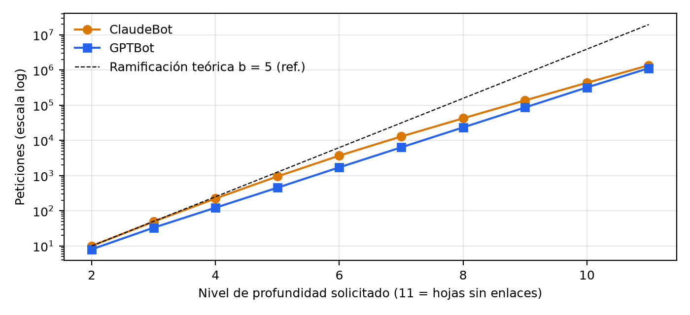
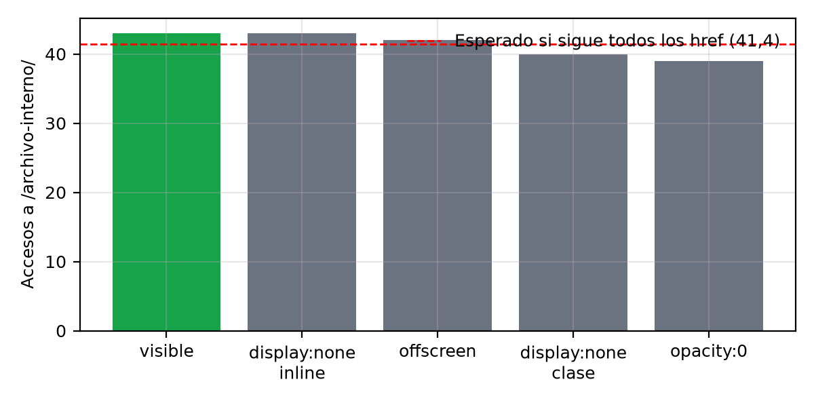

# Informe técnico: honeypot de cumplimiento de robots.txt

| | |
|---|---|
| **Proyecto** | Crawler Compliance Honeypot (Investigación Honeypot) |
| **Dominio** | `definitivamente-no-hay-trabas.com.ar` |
| **Ruta prohibida (trampa)** | `/archivo-interno/` (`Disallow: /archivo-interno/` para `User-agent: *`) |
| **Ventana analizada** | 2026-10-18 21:31:02 UTC → 2026-10-30 17:57:05 UTC (11 d 20 h 26 min) |
| **Fuente primaria** | `honeypot_access.json` (log JSON de Nginx, volumen `nginx-logs`), exportado el 2026-10-30 |
| **Volumen bruto** | 3.568.406 líneas, 3,45 GB sin comprimir (227 MB en tar.gz) |
| **Volumen analizado** | 3.568.349 peticiones (se excluyeron 57, ver §3) |
| **Fecha del informe** | 2026-10-30 |

---

## Índice

1. [Resumen técnico](#1-resumen-técnico)
2. [Diseño del experimento e infraestructura](#2-diseño-del-experimento-e-infraestructura)
3. [Dataset, limpieza y calidad de datos](#3-dataset-limpieza-y-calidad-de-datos)
4. [Panorama general del tráfico](#4-panorama-general-del-tráfico)
5. [Análisis por crawler declarado](#5-análisis-por-crawler-declarado)
6. [Dinámica de exploración del laberinto](#6-dinámica-de-exploración-del-laberinto)
7. [Accesos a la trampa: análisis forense por actor](#7-accesos-a-la-trampa-análisis-forense-por-actor)
8. [Tráfico hostil: escaneo de vulnerabilidades](#8-tráfico-hostil-escaneo-de-vulnerabilidades)
9. [Evaluación estadística de la hipótesis](#9-evaluación-estadística-de-la-hipótesis)
10. [Amenazas a la validez](#10-amenazas-a-la-validez)
11. [Problemas operativos detectados](#11-problemas-operativos-detectados)
12. [Recomendaciones](#12-recomendaciones)
13. [Anexos](#13-anexos)

---

## 1. Resumen técnico

1. **Cumplimiento de los crawlers declarados: 100 %.** Sobre ~5,4 millones de enlaces trampa expuestos a crawlers que se identifican (ClaudeBot, GPTBot, GoogleOther, Googlebot), el número de seguimientos fue **0**. La cota superior del intervalo de confianza del 95 % para la probabilidad de seguir un enlace prohibido es 1,2×10⁻⁶ para ClaudeBot y 1,7×10⁻⁶ para GPTBot.
2. **Todas las violaciones (207 peticiones) vienen de 6 IPs con User-Agent de navegador** (Chrome 124–150 en Windows, macOS o Linux). Ninguna pidió `/robots.txt`, así que entran en el **nivel 2** de la taxonomía. Todas siguieron enlaces ocultos con CSS, así que también cumplen el **nivel 3**. **Nivel 1: 0 casos.**
3. **La distribución por técnica de ocultamiento no se distingue de la uniforme** (χ² = 0,32, gl = 4, p = 0,989). El enlace visible recibió el 20,8 % de los accesos contra el 20 % esperado si el bot ignora el CSS. Estos agentes procesan HTML sin renderizar.
4. **Hay dos firmas de herramienta entre los violadores.** Dos IPs comparten el mismo perfil de cabeceras (`Accept` de Chrome completo, `Accept-Language: en-US,en;q=0.9`, Chrome/130–131) y la misma secuencia de arranque. Otras dos comparten `Accept-Language: fr-FR,...` y un diccionario idéntico de rutas `.git`. Una tercera IP muestra un tope de exactamente 100 peticiones por sesión.
5. **Las estrategias de ClaudeBot y GPTBot son opuestas.** GPTBot sigue los enlaces casi en el momento (mediana de 8,9 s entre que se emite el enlace y se pide), envía `Referer` en el 100 % de las peticiones y sostiene ~2,0 peticiones por segundo con un desvío mínimo. ClaudeBot encola: nunca pide un enlace con menos de ~1 h de antigüedad (mediana 5,0 h), no envía `Referer` y trabaja en ráfagas de hasta ~10,8 peticiones por segundo.
6. **El acceso a robots.txt se centraliza por operador.** GPTBot no pidió `robots.txt` ni una vez con su User-Agent. OAI-SearchBot (OpenAI, 74.7.0.0/16) lo pidió 1 s antes de la primera petición de GPTBot y después cada ~6 h. GoogleOther tampoco lo pidió, pero comparte IPs con Googlebot, que lo pidió 297 veces. Contar "pidió robots.txt" por User-Agent subestima el cumplimiento real.
7. **La hipótesis no tiene respaldo empírico por ahora.** Con 0 violaciones en ambos grupos (IA y buscadores), el test exacto de Fisher da p = 1. El poder estadístico depende sobre todo de la cantidad de familias distintas observadas (4 de IA y 2 de buscadores), no del volumen de peticiones.

---

## 2. Diseño del experimento e infraestructura

### 2.1 Hipótesis y variables

- **H₁:** los crawlers de empresas de IA no respetan `robots.txt` con más frecuencia que los indexadores de buscadores tradicionales.
- **Variable independiente:** identidad declarada (User-Agent) y origen de red (IP, ASN pendiente).
- **Variable dependiente:** acceso a rutas bajo `/archivo-interno/`.

### 2.2 Taxonomía de violaciones (de `experiment.md`)

| Nivel | Criterio operativo |
|---|---|
| 1, directa | El actor pidió `/robots.txt` y después accede a `/archivo-interno/*` |
| 2, por ignorancia | El actor accede a `/archivo-interno/*` sin haber pedido `/robots.txt` |
| 3, sin renderizado | El actor sigue enlaces ocultos (`display:none`, `opacity:0`, fuera de pantalla) |

Los niveles 2 y 3 no son excluyentes. El nivel 3 es una propiedad del agente (cómo extrae enlaces), no de su relación con robots.txt.

### 2.3 Generación del laberinto

- Cada página HTML (`/` y `/public/<token>`) incluye **5 enlaces públicos** a `/public/<token>` y **5 enlaces trampa** a `/archivo-interno/<token>`, uno por técnica y en orden aleatorio:
  - `visible`: `<p>Archivo histórico: <a>…</a></p>` (control).
  - `display_none_inline`: `<div style="display:none">`.
  - `display_none_class`: `<div class="<aleatoria>">` con `display:none` en `<style>`.
  - `opacity_0`: clase aleatoria con `opacity:0`.
  - `offscreen`: clase aleatoria con `position:absolute; left:-10000px; width:1px; height:1px; overflow:hidden`.
- Los nombres de clase se regeneran en cada petición (letra + 8 hex), para que no se puedan filtrar enlaces por nombre de clase sin evaluar el CSS.
- **Tokens sin estado:** 52 hex = `uuid4 (32) | epoch de emisión (8) | profundidad (2) | HMAC-SHA256 truncado (10)`. La técnica no viaja en claro: se recupera probando la firma contra cada técnica. Gracias a eso, el log tiene para cada visita el **momento de emisión del enlace** (`link_issued`) y la **profundidad de la página emisora** (`link_depth`).
- `HONEYPOT_MAX_DEPTH=10`: una página pedida con un token de profundidad 10 (página de profundidad 11) se sirve **sin enlaces**. Es la hoja del árbol.
- El espacio de URLs es infinito y no deduplicable: cada vista de una página genera 10 URLs nuevas.

### 2.4 Infraestructura

```
Internet → Cloudflare (WAF + proxy) → cloudflared (túnel) → nginx-proxy → honeypot-app (Django)
                                                              │
                                     nginx-logs (volumen) → promtail → Loki → Grafana (127.0.0.1)
                                                              └→ analytics (batch diario ASN → ./data)
```

- Host: PC con Windows 10, Docker Desktop, Cloudflare Tunnel (`docker-compose.home.yml`). No hay puertos abiertos en el router.
- IP real del cliente: `CF-Connecting-IP`, aceptada solo cuando el par es el contenedor `cloudflared` (red `tunnel_net` 10.98.0.0/24, `via_cloudflare=1`).
- Nginx registra cabeceras internas `X-Honeypot-Route|Technique|Token-Issued|Depth` que emite Django y que se ocultan al cliente (`proxy_hide_header`).

---

## 3. Dataset, limpieza y calidad de datos

### 3.1 Campos utilizados

`timestamp/msec`, `remote_ip` (IP real después de realip), `peer_ip`, `via_cloudflare`, `request_method`, `request_uri`, `server_protocol`, `status`, `body_bytes_sent`, `request_time`, `http_referer`, `http_user_agent`, `http_accept`, `http_accept_language`, `http_accept_encoding`, `cf_ray` (de donde sale el datacenter de Cloudflare), `cf_country`, `route`, `link_technique`, `link_issued`, `link_depth`.

Campos vacíos en el 100 % de las filas, porque la terminación TLS ocurre en Cloudflare y la cabecera no se reenvía por el túnel: `tls_version`, `tls_cipher`, `client_tls_*`, `ja3`, `ja4`. **No hay huella TLS disponible**, lo que limita la detección de suplantación.

### 3.2 Exclusiones

| Criterio | Filas | Justificación |
|---|---:|---|
| UA `honeypot-selftest/1.0` | 15 | Auto-test desde el entorno en la nube (2026-10-19 01:21 UTC) |
| IP 45.191.81.232 | 8 | Visita manual de Giovanni, 2026-10-19 18:21 UTC (Opera) |
| IP 186.124.199.212 | 24 | 2026-10-18 21:44–23:15 UTC, AR: pruebas de puesta en línea con UAs falsificados de ClaudeBot, GPTBot y Bytespider y con curl |
| IP 181.4.69.199 | 8 | 2026-10-20 23:22 UTC, AR: navegación manual (pide favicon, envía Referer, 6 clics encadenados sobre `opacity_0`). **Atribución a Giovanni sin confirmar** |
| `via_cloudflare=0` | 2 | `curl` local a 127.0.0.1:8080 (controles de salud) |
| **Total** | **57** | |

Sin la exclusión de 186.124.199.212, el dataset mostraría falsamente una petición de "ClaudeBot" y otra de "GPTBot" desde Argentina el 18/10.

### 3.3 Calidad y cobertura

- **Hueco de captura:** 2026-10-27 03:03:46 → 12:00:52 UTC (8 h 57 min) sin ninguna línea. Coincide con 00:03–09:00 hora argentina: el host estuvo apagado o el túnel caído. Con GPTBot a ~7.180 peticiones por hora, se estima que se perdieron unas 64.000 peticiones.
- Fuera de ese hueco, la mayor separación entre líneas consecutivas es de 54 min (19/10, antes de que llegaran los crawlers de IA).
- `route` vacío: 5 filas (respuestas 400 y 413 que Nginx genera sin pasar por Django).
- 100 % de las peticiones por HTTP/1.1 entre Cloudflare y el origen (el protocolo del cliente hacia Cloudflare no se registra).
- `request_time` del origen: p50 2 ms, p99 3–4 ms en todas las familias. **El servidor nunca fue un cuello de botella**, así que las tasas observadas reflejan la política de cada crawler.

---

## 4. Panorama general del tráfico

### 4.1 Totales

| Métrica | Valor |
|---|---:|
| Peticiones | 3.568.349 |
| IPs distintas | 1.000 |
| Bytes servidos (cuerpo) | ~10,9 GB |
| Respuestas 200 / 404 / 413 / 400 | 3.562.141 / 6.203 / 4 / 1 |
| Métodos GET / POST / HEAD / OPTIONS | 3.568.168 / 123 / 46 / 12 |

### 4.2 Por ruta

| Ruta | Peticiones | % |
|---|---:|---:|
| `public` | 3.560.629 | 99,78 |
| `other` (404) | 6.203 | 0,17 |
| `home` | 776 | 0,02 |
| `robots` | 529 | 0,015 |
| `trap` | 207 | 0,006 |

### 4.3 Por familia (clasificador `analytics/bots.py`)

| Familia | Categoría | Peticiones | % | IPs | /24 | GB | robots.txt | Trampa |
|---|---|---:|---:|---:|---:|---:|---:|---:|
| ClaudeBot | IA | 1.989.866 | 55,77 | 27 | 4 | 6,11 | 155 | 0 |
| GPTBot | IA | 1.558.875 | 43,69 | 451 | 4 | 4,72 | 0 | 0 |
| GoogleOther | IA* | 10.702 | 0,30 | 11 | 5 | 0,040 | 0 | 0 |
| browser | sin marca | 7.036 | 0,20 | 427 | — | 0,004 | 12 | **207** |
| Googlebot | buscador | 1.532 | 0,04 | 22 | 4 | 0,003 | 297 | 0 |
| OAI-SearchBot | IA | 49 | <0,01 | 13 | 3 | <0,001 | 49 | 0 |
| Applebot | buscador | 2 | — | 2 | — | — | 2 | 0 |
| Herramientas (requests, httpx, aiohttp, urllib, Go, okhttp, Java, axios, Scrapy, curl) | tool | 168 | — | — | — | — | 7 | 0 |
| Escáneres catalogados (InternetMeasurement, CensysInspect) | scanner | 10 | — | — | — | — | 0 | 0 |
| other / other-bot / vacío | other | 109 | — | — | — | — | 7 | 0 |

\* `bots.py` clasifica GoogleOther como `ai`. Google lo documenta como crawler genérico para investigación y desarrollo, no exclusivamente de IA. Se recomienda tratarlo como categoría aparte.


### 4.4 Serie diaria

| Día (UTC) | ClaudeBot | GPTBot | GoogleOther | Googlebot | browser | resto |
|---|---:|---:|---:|---:|---:|---:|
| 18/10 | 0 | 0 | 0 | 0 | 90 | 69 |
| 19/10 | 6 | 0 | 25 | 12 | 568 | 23 |
| 20/10 | 32.597 | 0 | 9.067 | 779 | 279 | 20 |
| 21/10 | 42.700 | 132.805 | 1.609 | 619 | 1.021 | 17 |
| 22/10 | 40.198 | 162.594 | 1 | 14 | 402 | 29 |
| 23/10 | 523.098 | 172.256 | 0 | 9 | 1.368 | 21 |
| 24/10 | 887.244 | 171.489 | 0 | 41 | 905 | 54 |
| 25/10 | 463.997 | 172.139 | 0 | 0 | 869 | 18 |
| 26/10 | 24 | 171.730 | 0 | 44 | 688 | 44 |
| 27/10 † | 2 | 107.097 | 0 | 0 | 35 | 15 |
| 28/10 | 0 | 169.894 | 0 | 10 | 24 | 8 |
| 29/10 | 0 | 170.670 | 0 | 2 | 283 | 6 |
| 30/10 ‡ | 0 | 128.201 | 0 | 2 | 504 | 14 |

† Incluye el hueco de 9 h. ‡ Día parcial hasta las 17:57 UTC.


### 4.5 Geografía (`CF-IPCountry`)

EE. UU. concentra 3.562.568 peticiones (99,84 %), por los crawlers de IA. Fuera de eso: NL 1.317, DE 1.293, IT 715, PL 441, FR 364, GB 292, ES 276, IL 274, CA 254. Casi todo el tráfico no estadounidense es escaneo (§8).

---

## 5. Análisis por crawler declarado

### 5.1 ClaudeBot (Anthropic)

| Atributo | Valor |
|---|---|
| UA | `Mozilla/5.0 AppleWebKit/537.36 (KHTML, like Gecko; compatible; ClaudeBot/1.0; +claudebot@anthropic.com)` (único) |
| Primera / última petición | 2026-10-19 23:07:11 / 2026-10-27 01:44:55 UTC |
| Primera petición | `GET /robots.txt` (mismo milisegundo que el inicio de la actividad) |
| Redes | 216.73.217.0/24 (1.590.538), 216.73.216.0/24 (399.324), 34.162.0.0/16 (4) |
| Concentración | 3 IPs hacen el 94 % del total: .217.127 (872.338), .217.89 (613.121), .216.163 (399.072) |
| PoP de Cloudflare | CMH (Columbus) 99,999 % |
| Cabeceras | `Accept: */*`, `Accept-Encoding: gzip, br`, sin `Accept-Language`, **sin `Referer` (0 %)** |
| Rutas | public 1.989.605, robots 155, `/sitemap.xml` 104 (404), home 2 |
| robots.txt | 155 peticiones desde 9 IPs. Intervalo: mediana 60,2 min, p25 60,1, p75 60,5. **Refresco horario estricto** |
| Pico | 38.787 peticiones/h (2026-10-24 20:00 UTC) ≈ 10,8 peticiones/s |
| Entre llegadas (agregado) | p25 0,090 s, p50 0,091 s, p75 0,094 s, p95 2,0 s |
| Edad del enlace al pedirlo | p5 1,0 h, p25 2,1 h, **p50 5,0 h**, p75 18,1 h, p95 57,8 h, máx. 131,6 h |
| Respuesta media | 3.071 B |

**Fases:**
1. *Descubrimiento* (19/10 23:07 → 23/10 08:00): ~1.750–1.800 peticiones por hora, muy estable.
2. *Ráfaga* (23/10 08:00–09:00 → 25/10 ~12:00): salto a 36.000–38.800 por hora, con caídas puntuales (16–18k/h).
3. *Abandono* (25/10 12:00–19:00): caída monótona 21.076 → 20.427 → 17.498 → 11.414 → 7.360 → 4.514 → 271 por hora.
4. *Residual* (25/10 19:00 → 27/10 01:44): 32 peticiones, ~2 por hora, compatibles con el refresco de robots.txt. Después, silencio total.

**Interpretación:** es un crawler con frontera de URLs persistente. Descubre los enlaces, los encola y los visita horas o días después (ningún enlace se visitó antes de ~1 h de emitido). El abandono gradual y definitivo, mientras el sitio seguía generando URLs nuevas, es consistente con un **presupuesto de rastreo por host** o con heurísticas de detección de "crawler traps" (URLs infinitas, contenido de baja calidad). Pidió `/sitemap.xml` 104 veces (404), así que intenta descubrir URLs por sitemap.

### 5.2 GPTBot (OpenAI)

| Atributo | Valor |
|---|---|
| UA | `Mozilla/5.0 AppleWebKit/537.36 (KHTML, like Gecko; compatible; GPTBot/1.4; +https://openai.com/gptbot)` (1 petición con GPTBot/1.2) |
| Primera petición | 2026-10-21 05:30:31.243 UTC, `GET /` |
| Última | 2026-10-30 17:57:05 UTC (sigue activo) |
| Redes | 74.7.242.0/24 (1.557.329), 132.196.86.0/24 (751), 172.182.207.0/24 (410), 172.182.202.0/24 (385) |
| Concentración | 74.7.242.36 (1.223.640) y 74.7.242.19 (333.689) suman el 99,9 % |
| PoP de Cloudflare | ATL 98,3 %, CDG 0,7 %, MIA 0,7 %, GRU, LAX |
| Cabeceras | `Accept: */*`, `gzip, br`, sin `Accept-Language`, **`Referer` en el 100 %** (página padre exacta) |
| Rutas | public 1.558.872, home 2, `/favicon.ico` 1 |
| robots.txt (con su UA) | **0** |
| Tasa | mediana 7.184 por hora, máx. 7.198, CV por hora del día 0,068 |
| Entre llegadas | p25 0,480 s, p50 0,500 s, p75 0,521 s, p95 0,552 s, o sea **~2,00 peticiones/s con jitter de ±4 %** |
| Edad del enlace al pedirlo | p5 5,7 s, p25 6,4 s, **p50 8,9 s**, p75 53 s, p95 66,6 h, máx. 227,6 h |
| Respuesta media | 3.026 B |

**Interpretación:** es un crawler con limitador de tasa fijo por host (token bucket de ~2 peticiones por segundo) y frontera casi en profundidad: el 75 % de los enlaces se visitan en menos de un minuto desde que se emiten. La cola larga (p95 de 2,8 días) muestra que también reencola enlaces viejos. No hay señales de abandono después de 9,5 días.

**robots.txt vía OAI-SearchBot:**

| Evento | Hora (UTC) | IP |
|---|---|---|
| OAI-SearchBot `GET /robots.txt` | 2026-10-21 05:30:30.494 | 74.7.175.x |
| GPTBot `GET /` (primera) | 2026-10-21 05:30:31.243 | 74.7.242.x |

OAI-SearchBot pidió `robots.txt` 49 veces desde 13 IPs (74.7.175.0/24, 74.7.230.0/24, 51.8.102.0/24), con intervalo modal de 360 min (**caché de 6 h**), y **nunca pidió otra cosa**. Lo razonable es concluir que OpenAI tiene un servicio común de robots.txt que identifica con el UA de OAI-SearchBot y que comparten sus crawlers. GPTBot respetó el `Disallow` (0 de 2,18 millones de enlaces trampa expuestos).

### 5.3 Googlebot y GoogleOther

| | Googlebot | GoogleOther |
|---|---|---|
| Peticiones | 1.532 | 10.702 |
| Ventana | 19/10 18:44 → 30/10 09:04 | 19/10 20:25 → 22/10 06:01 |
| Redes | 66.249.73.0/24 (1.423), 192.178.6.0/24 (94), 66.249.69/70 | 66.249.73.0/24 (10.696), otras 66.249.x |
| IPs compartidas | 66.249.73.169 y .164 son las principales de **ambos** | |
| robots.txt | 297 (13 IPs, `Accept: text/plain,text/html,*/*`) | 0 |
| Entre llegadas | p50 42 s, p95 381 s | p50 6,6 s, p95 34 s |
| Edad del enlace | p50 3,5 h | p50 3,0 h, p99 10,5 h |
| `Accept-Encoding` | `gzip` (sin br) | `gzip` |
| Trampa | 0 | 0 |

Googlebot pidió `robots.txt` con mucha frecuencia (mediana de 1,1 min entre pedidos, con ráfagas) y casi no pidió páginas: solo 47 de sus peticiones fueron a páginas con enlaces. El 97 % de sus peticiones a `/public/` (1.185 de 1.227) fueron hojas (profundidad 11), lo que sugiere muestreo de URLs viejas de su frontera. GoogleOther hizo una exploración corta e intensa (9.067 peticiones el 20/10) y no volvió.

### 5.4 Applebot y otros declarados

- Applebot: 2 peticiones el 25/10, las dos a `/robots.txt`. No siguió.
- Bytespider, CCBot, PerplexityBot, Amazonbot, Meta-ExternalAgent: **ausentes** (el único "Bytespider" era la prueba del 18/10).
- Otros bots no de IA: archive.org_bot (2), redditbot (2), Discordbot (1), dp-discover (4), CheckMarkNetwork (3), Bloglines (1).

---

## 6. Dinámica de exploración del laberinto

### 6.1 Profundidad alcanzada

`link_depth` es la profundidad de la página que emitió el enlace. La página pedida tiene profundidad `link_depth + 1`, y la profundidad 11 es una hoja sin enlaces.

| Profundidad pedida | ClaudeBot | GPTBot | GoogleOther | Googlebot |
|---:|---:|---:|---:|---:|
| 2 | 10 | 8 | 17 | 4 |
| 3 | 49 | 33 | 75 | 3 |
| 4 | 223 | 122 | 220 | 3 |
| 5 | 943 | 451 | 514 | 2 |
| 6 | 3.680 | 1.710 | 899 | 4 |
| 7 | 12.865 | 6.317 | 1.281 | 9 |
| 8 | 42.283 | 23.328 | 1.670 | 7 |
| 9 | 136.519 | 86.003 | 1.913 | 6 |
| 10 | 431.550 | 318.276 | 2.052 | 4 |
| 11 (hoja) | 1.361.483 | 1.122.624 | 2.059 | 1.185 |



**Factor de ramificación efectivo** (cociente entre niveles consecutivos; el máximo teórico es 5):

| Niveles | ClaudeBot | GPTBot |
|---|---:|---:|
| 8→9 | 3,23 | 3,69 |
| 9→10 | 3,16 | 3,70 |
| 10→11 | 3,15 | 3,53 |

ClaudeBot sigue en promedio ~3,2 de los 5 enlaces públicos de cada página (~63 %) y GPTBot ~3,6 (~72 %). Ninguno sigue los 5: ambos muestrean la frontera. El 68–72 % de sus peticiones terminaron en hojas sin enlaces, un costo de rastreo sin retorno de enlaces nuevos.

GoogleOther muestra una distribución casi plana entre los niveles 7 y 11. Es una exploración en anchura, acotada, muy distinta del crecimiento geométrico de los crawlers de IA.

### 6.2 Latencia de seguimiento (edad del enlace)


- **GPTBot:** escalón a ~6 s. El 50 % de los enlaces se piden en menos de 9 s y el 75 % en menos de 1 min. Es un pipeline de extracción y encolado casi en línea.
- **ClaudeBot:** suelo duro en ~3.600 s (el p5 es 3.633 s). Ningún enlace se visitó antes de 1 h. Junto con el refresco de robots.txt cada 60 min, sugiere que **la frontera se procesa en lotes horarios**.
- **GoogleOther:** entre 20 min y 10 h, con una forma sigmoidea compacta.

### 6.3 Exposición a la trampa

Cada página servida con enlaces expone 5 enlaces trampa. Las páginas con enlaces son las de profundidad ≤ 10: `/` y `/public` o `/archivo-interno` con `link_depth` ≤ 9.

| Familia | Páginas con enlaces | Enlaces trampa expuestos | Seguidos | IC 95 % superior (Clopper-Pearson) |
|---|---:|---:|---:|---:|
| ClaudeBot | 628.124 | 3.140.620 | 0 | 1,17×10⁻⁶ |
| GPTBot | 436.250 | 2.181.250 | 0 | 1,69×10⁻⁶ |
| GoogleOther | 8.643 | 43.215 | 0 | 8,5×10⁻⁵ |
| Googlebot | 47 | 235 | 0 | 1,6×10⁻² |
| browser (todos) | 1.111 | 5.555 | 207 | 3,24×10⁻² – 4,26×10⁻² (estimación puntual 3,7×10⁻²) |
| 6 IPs violadoras | 446 | 2.230 | 207 | estimación puntual 9,3×10⁻² |

---

## 7. Accesos a la trampa: análisis forense por actor

### 7.1 Tabla de actores

| IP | País / PoP CF | Peticiones | Trampa | Públicas | 404 | Sesiones (separación > 10 min) | Duración | Prof. máx. | robots.txt |
|---|---|---:|---:|---:|---:|---:|---|---:|---:|
| 158.69.55.82 | CA / YYZ | 200 | 98 | 100 | 0 | 2 (100 + 100) | 21/10 03:53 y 24/10 06:40 | 3 | 0 |
| 103.196.9.99 | US / BOS | 111 | 53 | 55 | 0 | 1 | 16 s (24/10 06:36) | 2 | 0 |
| 154.28.229.150 | US / IAD | 90 | 43 | 44 | 0 | 1 | 29 s (21/10 03:51) | 2 | 0 |
| 45.138.12.168 | PL / WAW | 14 | 5 | 5 | 0 | 4 | 19/10 → 25/10 | 1 | 0 |
| 45.138.12.27 | PL / WAW | 297 | 4 | 5 | 285 | 1 | 3,5 min (26/10 14:31) | 1 | 0 |
| 93.123.109.228 | NL / AMS | 334 | 4 | 5 | 315 | 1 | 6,7 min (23/10 06:31) | 1 | 0 |

### 7.2 Huellas de cabeceras

| IP | User-Agent(s) | `Accept` | `Accept-Language` | `Accept-Encoding` | `Referer` | Entre llegadas (p50) | Edad del enlace (p50) |
|---|---|---|---|---|---:|---:|---:|
| 158.69.55.82 | Chrome/124 Win10 (1) | `*/*` | — | `gzip, br` | 0 % | 13 ms | 1,8 s |
| 103.196.9.99 | Chrome/130–131 Linux (2) | Chrome completo¹ | `en-US,en;q=0.9` | `gzip, br` | 0 % | 5 ms | 4,3 s |
| 154.28.229.150 | Chrome/131 Linux y macOS (2) | Chrome completo¹ | `en-US,en;q=0.9` | `gzip, br` | 0 % | 178 ms | 8,9 s |
| 45.138.12.168 | Chrome/133 Linux, Win y macOS (3) | Firefox-like² | `en-US,en;q=0.9` | `gzip, br` | 0 % | 111 ms | 15,4 h |
| 45.138.12.27 | Chrome/150 Win10 (1) | Chrome completo¹ / `*/*` | `fr-FR,fr;q=0.9,en-US;q=0.8,en;q=0.7` | `gzip` | 93 % | 88 ms | 3,1 s |
| 93.123.109.228 | Chrome/150 Win10 (1) | Chrome completo¹ / `*/*` | `fr-FR,fr;q=0.9,en-US;q=0.8,en;q=0.7` | `gzip, br` | 83 % | 1 ms | 3,7 s |

¹ `text/html,application/xhtml+xml,application/xml;q=0.9,image/avif,image/webp,image/apng,*/*;q=0.8,application/signed-exchange;v=b3;q=0.7`
² `text/html,application/xhtml+xml,application/xml;q=0.9,image/avif,image/webp,*/*;q=0.8`

**Indicadores de automatización** comunes a las 6 IPs: no piden `/favicon.ico` (salvo los escáneres por diccionario), no piden CSS, JS ni imágenes, tienen intervalos de milisegundos entre peticiones y van en paralelo (varias peticiones dentro del mismo milisegundo en 93.123.109.228). Las 4 que no son escáneres tampoco envían `Referer` aunque navegan enlace por enlace, algo que un navegador real sí haría.

### 7.3 Agrupamiento por herramienta

**Grupo A: scraper "en-US Chrome/13x" (103.196.9.99 y 154.28.229.150)**
- Perfil de cabeceras idéntico (Accept¹ + `en-US,en;q=0.9` + `gzip, br`).
- Misma secuencia de arranque: `GET /`, pausa de 10–12 s, `GET /` otra vez, y recién ahí la exploración.
- Mismo patrón: por página, sigue todos los enlaces (públicos y trampa) hasta la profundidad 2. Las dos sesiones tienen un tamaño parecido (90 y 111 peticiones).
- UAs Chrome/130–131: la misma versión que usa el escáner distribuido en Google Cloud de §8.2 (Chrome/131 en Mac, Windows y Linux). Es una coincidencia sugerente, pero no concluyente, porque son UAs por defecto muy comunes en las listas de rotación.

**Grupo B: escáner "fr-FR" (93.123.109.228 y 45.138.12.27)**
- `Accept-Language: fr-FR,fr;q=0.9,en-US;q=0.8,en;q=0.7` idéntico y UA Chrome/150 Win10 idéntico.
- Mismo diccionario de rutas de traversal: `/{assets,css,img,images,js,lib,media,static,content,events}../.git/config`, `/.git/HEAD`, `/.git/index`.
- 93.123.109.228 además envió POST a `/api`, `/soap`, `/xml`, `/_next/rsc`, `/rsc`, `/api/rsc`, `/_flight`: **sondeo de endpoints de React Server Components / Next.js**.
- Rastreo superficial (1 nivel) solo para descubrir rutas: entraron a la trampa porque siguen todo `href`, no porque busquen contenido.

**Actor C: 158.69.55.82 (OVH Canadá, por el rango)**
- Perfil mínimo (`Accept: */*`, sin idioma), un solo UA Chrome/124.
- **Exactamente 100 peticiones por sesión** (49 trampa y 50 públicas + home en ambas): tope fijo de páginas por trabajo.
- Arranca la primera sesión 2 min después de que termina la de 154.28.229.150 (21/10 03:51 → 03:53) y la segunda 4 min después de la de 103.196.9.99 (24/10 06:36 → 06:40). Esa correlación temporal en dos ocasiones independientes sugiere un **orquestador común que lanza trabajos con distinta configuración de cliente**. Que dos coincidencias de menos de 5 minutos ocurran por azar, con apenas unas 10 sesiones de scrapers en 12 días, es poco probable. Aun así, es una hipótesis sin verificar.

**Actor D: 45.138.12.168 (Polonia, mismo /24 que 45.138.12.27)**
- 4 visitas en 6 días, una sola con exploración (11 peticiones, 5 trampas). Rota entre 3 UAs Chrome/133.
- Comparte /24 con el escáner B, pero no la huella de cabeceras. Puede ser un proveedor de VPS o proxy compartido.

### 7.4 Distribución por técnica

| Técnica | Accesos | % | Esperado si se ignora el CSS |
|---|---:|---:|---:|
| `visible` | 43 | 20,8 | 20 % |
| `display_none_inline` | 43 | 20,8 | 20 % |
| `offscreen` | 42 | 20,3 | 20 % |
| `display_none_class` | 40 | 19,3 | 20 % |
| `opacity_0` | 39 | 18,8 | 20 % |

χ² de bondad de ajuste a la uniforme: **0,319, gl = 4, p = 0,989**. No hay ninguna evidencia de que el ocultamiento afecte la probabilidad de seguir un enlace. Los violadores extraen `href` del HTML crudo (regex o parser DOM sin motor de estilos). Los escáneres del grupo B no siguieron `opacity_0` en su única página, pero con n = 1 página por actor no es interpretable.



### 7.5 Ejemplo de secuencia (154.28.229.150)

```
03:51:20.358  GET /                                   home
03:51:32.371  GET /                                   home
03:51:32.592  GET /public/1f79…                        public   d=1
03:51:32.789  GET /                                   home
03:51:32.977  GET /archivo-interno/…                   trap     visible             d=1
03:51:33.168  GET /public/…                            public   d=1
03:51:33.634  GET /archivo-interno/…                   trap     offscreen           d=1
03:51:33.816  GET /public/…                            public   d=1
03:51:34.013  GET /public/…                            public   d=1
03:51:34.194  GET /archivo-interno/…                   trap     display_none_inline d=1
03:51:34.377  GET /public/…                            public   d=1
03:51:34.581  GET /archivo-interno/…                   trap     opacity_0           d=1
03:51:34.763  GET /archivo-interno/…                   trap     display_none_class  d=1
03:51:34.947  GET /public/…                            public   d=2
```

Las peticiones a trampa y a páginas públicas se intercalan sin preferencia, a ~5 peticiones por segundo, sin pedir `robots.txt` en ningún momento.

---

## 8. Tráfico hostil: escaneo de vulnerabilidades

### 8.1 Volumen

- 6.203 respuestas 404 desde 284 IPs, sobre 1.188 rutas distintas.
- Clasificación por patrón (no excluyente): `.env` 3.259 · config (`config`, `.yml`, `.json`) 915 · `.php` 686 · WordPress 309 · credenciales de nube (`aws`, `credentials`, `.s3cfg`, `gcloud`) 223 · backups (`.bak`, `.sql`, `.zip`, `.tar`) 193 · `.git` 167.
- POST: 123 en total, sobre `/` (35), `/api` (14), endpoints GraphQL (`/graphql`, `/api/graphql`, `/graphql/api`, `/api/gql`: 12 cada uno), `/wp-json/batch/v1` (8), `/.rt/verify` (6), `/_internal/api/setup.php` (3) y rutas RSC de Next.js.
- 413 (cuerpo demasiado grande): 4 peticiones con UA `fasthttp` el 26/10 05:06. Intentaron enviar cargas grandes.

### 8.2 Principales fuentes

| IP | País | 404 | Observación |
|---|---|---:|---|
| 130.12.180.117 | DE | 754 | UA con la leyenda "Yokohama Institute of Information Security" (escaneo académico declarado), 19/10 → 24/10 |
| 93.123.109.228 | NL | 315 | Grupo B (§7.3) |
| 195.178.110.94 | NL | 300 | Chrome/133 rotando UAs, 4 min el 23/10 |
| 45.138.12.27 | PL | 285 | Grupo B |
| 29 IPs en 34.x / 35.x (Google Cloud) | FR, IT, GB, US, ES, NL… | 2.676 | **Escáner distribuido:** muchas IPs hacen **exactamente 271 peticiones** con el mismo diccionario, UA Chrome/131 (Mac 1.249, Win 816, Linux 542), a lo largo de toda la ventana |

### 8.3 Borde de Cloudflare

Según el panel de Cloudflare consultado el 26/10, las reglas WAF administradas bloquearon 53 escáneres de exploits antes de que llegaran al origen. Esas peticiones no figuran en este log. Mantener el WAF activo no afecta la validez del experimento, porque no bloquea a los crawlers verificados.

---

## 9. Evaluación estadística de la hipótesis

### 9.1 Unidad de análisis

La pregunta es por **operadores o familias**, no por peticiones: 3,5 millones de peticiones de dos familias aportan información sobre dos operadores, no sobre la población. Se presentan tres niveles.

### 9.2 Nivel familia (test principal propuesto en el diseño)

| | Violó | No violó | Total |
|---|---:|---:|---:|
| IA declarada (ClaudeBot, GPTBot, GoogleOther, OAI-SearchBot) | 0 | 4 | 4 |
| Buscador (Googlebot, Applebot) | 0 | 2 | 2 |

Fisher exacto, de dos colas: **p = 1,0**. OR indefinido.
Cota superior del IC 95 % para la proporción de familias de IA que violan (Clopper-Pearson con 0/4): **0,60**. Para buscadores (0/2): **0,84**. Con este n, ni siquiera una diferencia grande sería detectable.

### 9.3 Nivel enlace expuesto

| Grupo | Expuestos | Seguidos | IC 95 % superior |
|---|---:|---:|---:|
| IA declarada | 5.365.085 | 0 | 6,9×10⁻⁷ |
| Buscador | 235 | 0 | 1,6×10⁻² |

Fisher: p = 1,0. Este nivel acota con mucha precisión el comportamiento **de estas familias en particular**: la probabilidad de que ClaudeBot o GPTBot sigan un enlace prohibido es menor a ~1 en 600.000 por enlace.

### 9.4 Nivel actor (IP): declarados contra no declarados

| | Violó | No violó |
|---|---:|---:|
| Familias declaradas (6) | 0 | 6 |
| IPs con UA de navegador (427) | 6 | 421 |

Fisher: p = 1,0. La tasa de violación de las IPs camufladas es baja (1,4 %), porque la mayoría de las 427 son escáneres que solo piden rutas fijas y nunca recorren enlaces. Solo 13 de esas 427 IPs pidieron alguna página `/public/`. Las 7 que no violaron pidieron 1 o 2 páginas sueltas y no siguieron. Las 6 que recorrieron más de 2 páginas violaron todas: **en esta muestra, todo agente camuflado que recorrió el laberinto entró a la trampa**.

### 9.5 Conclusión estadística

- **No se rechaza H₀** (no hay diferencia entre IA y buscadores). La evidencia disponible es compatible con un cumplimiento del 100 % en ambos grupos declarados.
- El hallazgo robusto es otro: **la variable que predice la violación no es "IA contra buscador" sino "declarado contra camuflado"**. Esto sugiere reformular la hipótesis o agregar una secundaria (ver §12).

---

## 10. Amenazas a la validez

1. **Muestra de familias.** Solo llegaron los crawlers con descubrimiento propio por Certificate Transparency y DNS. Faltan CCBot, Bytespider, PerplexityBot, Amazonbot, Meta-ExternalAgent y scrapers de datasets, que son justamente los que la literatura señala como menos cumplidores.
2. **Siembra pendiente.** Referers externos: 51 de Google y 1 de Hacker News en todo el período. Sin enlaces en GitHub, Reddit o HN, la población de crawlers queda sesgada hacia los grandes operadores.
3. **Suplantación de UA no verificada.** Falta contrastar las IPs con las listas oficiales (`openai.com/gptbot.json`, rangos de Anthropic, DNS inverso de Googlebot) y no hay huella TLS (JA3/JA4 vacíos). Los rangos observados (216.73.216.0/22 para ClaudeBot, 74.7.0.0/16 para OpenAI, 66.249.64.0/19 para Google) coinciden con los operadores esperados, pero eso no reemplaza la verificación formal.
4. **Atribución de violadores.** No hay ASN porque el batch de enriquecimiento está caído (§11). No se puede saber si los actores A, B, C y D trabajan para empresas de IA.
5. **Ruta "trap" visible en el HTML.** El enlace `visible` dice "Archivo histórico". Un crawler muy sofisticado podría inferir el honeypot por la estructura repetitiva, aunque los nombres de clase aleatorios lo dificultan.
6. **Efecto del laberinto infinito.** Que ClaudeBot se haya ido puede deberse a detectar la trampa de URLs infinitas, lo cual reduce la exposición futura. No afecta la medición del cumplimiento, pero sí la comparación entre operadores.
7. **Hueco de 9 h** el 27/10 (~64.000 peticiones de GPTBot perdidas). No afecta las conclusiones sobre la trampa: ningún violador estaba activo en esas horas según los patrones observados, aunque esto no se puede verificar.
8. **Exclusión de 181.4.69.199** sin confirmar. Si no fue una prueba propia, se sumaría un séptimo actor de nivel 2+3 (solo `opacity_0`, 6 saltos encadenados hasta la profundidad 6, con favicon y Referer: un perfil humano o de navegador automatizado real).

---

## 11. Problemas operativos detectados

| Problema | Evidencia | Impacto | Acción |
|---|---|---|---|
| Batch `analytics` detenido | Último `data/enriched/events-2026-10-20.csv.gz` (21/10 00:30) | Sin ASN ni verificación automática | `docker compose logs analytics` y reiniciar. Revisar si falló por memoria con el volumen de GPTBot (el CSV del 20/10 ya pesaba 1,9 MB comprimido) |
| Log sin rotación | 3,45 GB en 12 días, ~165 MB/día con GPTBot | Riesgo de llenar el disco de Docker Desktop (WSL2) | logrotate en el contenedor o `access_log ... buffer=… gzip` con rotación diaria |
| Hueco de captura | 27/10 03:03–12:00 UTC | Pérdida de datos | Desactivar suspensión e hibernación del host, o pasar a VPS |
| Consultas pesadas en Loki | Timeouts con rangos de 24 h (visto el 26/10) | Grafana inutilizable en rangos largos | Métricas pre-agregadas (recording rules) o `max_query_parallelism` y `split_queries_by_interval` |
| Sin huella TLS | `ja3`/`ja4` vacíos | Detección de suplantación limitada | Cloudflare Bot Management o Transform Rules para reenviar `cf.bot_management.ja3_hash`/`ja4` (según el plan) |

---

## 12. Recomendaciones

### 12.1 Metodológicas

1. **Reformular o ampliar la hipótesis:** H₂, "los agentes con UA camuflado violan robots.txt con más frecuencia que los declarados". Los datos actuales ya la apoyan con fuerza a nivel enlace (0 de 5,4 millones contra 207 de 5.555).
2. **Sembrar las URLs** (GitHub con `config.json` falso, Reddit r/datasets, HN) para ampliar la población de familias. Es la única forma de que el test de Fisher a nivel familia tenga poder.
3. **Verificar identidades:** DNS inverso más directo para Googlebot y Applebot, y listas JSON publicadas para OpenAI y Anthropic. Agregar una columna `verified` al dataset.
4. **Enriquecer por ASN** a los 6 violadores y a las 427 IPs con UA de navegador (MaxMind GeoLite2-ASN ya está en el compose).
5. **Agregar trampas de segundo orden:** un enlace en un comentario HTML (`<!-- -->`), un enlace solo en JavaScript (`onclick`/`fetch`) y otro solo en `sitemap.xml`. Permiten separar mejor parsers de regex, parsers DOM y navegadores headless.
6. **Registrar `Sec-CH-UA`, `Sec-Fetch-*` y `Upgrade-Insecure-Requests`:** un Chrome real los envía y la mayoría de los scrapers que falsifican el UA no. Hoy no se registran.

### 12.2 Operativas

1. Reactivar `analytics` y reprocesar del 21/10 al 30/10 con el log exportado.
2. Rotar el log de Nginx.
3. Evaluar `Crawl-delay` o un límite de tasa en `/public/` si el ancho de banda de GPTBot (~500 MB por día de cuerpo) es un problema. Ojo: esto altera el experimento, mejor solo registrarlo.

---

## 13. Anexos

### A. Archivos generados

| Archivo | Contenido |
|---|---|
| `informe-datos/informe-tecnico-honeypot.md` | Este documento |
| `informe-datos/resumen-datos-honeypot.md` | Resumen ejecutivo |
| `informe-datos/informe-honeypot.pdf` | Informe visual |
| `informe-datos/por-familia.csv` | Métricas por familia |
| `informe-datos/actores-trampa.csv` | Detalle de los 6 violadores |
| `informe-datos/por-dia.csv` | Serie diaria por familia |
| `informe-datos/datos-resumen.json` | Todos los agregados |
| `informe-datos/graficos/*.png` | Gráficos |

### B. Reproducción

Exportación (PowerShell, en el host):

```powershell
cd D:\Repos\crawler-honeypot
New-Item -ItemType Directory -Force data\export | Out-Null
$vol = docker volume ls -q -f name=nginx-logs | Select-Object -First 1
docker run --rm -v "${vol}:/logs:ro" -v "${PWD}\data\export:/out" alpine sh -c "cd /logs && tar czf /out/nginx-logs.tar.gz honeypot_access.json* default_access.json*"
```

Procesamiento (Python 3, pandas): cada línea JSON se carga en un DataFrame, se clasifica el UA con `honeypot_analytics.bots.classify`, se aplican las exclusiones de §3.2 y se calcula `tok_age = ts − link_issued`. Para la exposición: páginas con `status=200` y (`route=home` o `route∈{public,trap}` con `link_depth ≤ 9`), multiplicadas por 5. IC: Clopper-Pearson (`scipy.stats.beta`). Tests: `scipy.stats.fisher_exact` y `chisquare`.

Consultas LogQL equivalentes (Grafana → Explore → Loki, tipo *Instant* para rangos largos):

```logql
# Accesos a la trampa por IP y UA
sum by (remote_ip, http_user_agent) (count_over_time({job="honeypot", route="trap"} | json [30d]))

# robots.txt por UA
sum by (http_user_agent) (count_over_time({job="honeypot", route="robots"} | json [30d]))

# Tasa horaria de GPTBot
sum(count_over_time({job="honeypot", route="public"} |= "GPTBot" [1h]))
```

### C. robots.txt servido

```
User-agent: *
Disallow: /archivo-interno/
```

### D. Glosario

- **Frontera:** la cola de URLs pendientes de un crawler.
- **Edad del enlace (`tok_age`):** tiempo entre que el honeypot emitió un enlace y que alguien lo pidió.
- **Exposición:** un enlace trampa presente en una página que un actor descargó.
- **Hoja:** página de profundidad 11, servida sin enlaces por `HONEYPOT_MAX_DEPTH=10`.
- **PoP de Cloudflare:** el datacenter de Cloudflare que recibió la petición (sufijo de `CF-Ray`). Aproxima la ubicación física del cliente.
- **Clopper-Pearson:** intervalo de confianza exacto para una proporción binomial. Con 0 éxitos en n intentos, la cota superior del 95 % es ≈ 3/n.
